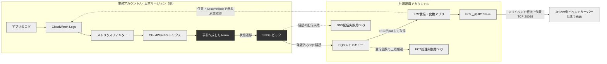

# CloudWatch Logs から JP1/IM までのアラート連携 詳細ガイド

確認基準日：**2026-10-11**。Excel版と同じ説明・設定例を収録。

業務アカウントのログを数え、CloudWatch Alarmの状態変化をSNSと共通運用SQS経由でJP1へ届ける構成を説明します。JP1のバージョンと通知EC2のOSは未定として、Windows／Linuxの差を併記しています。

**資料の区分**：公式仕様には出典を付けています。しきい値、保持期間、ID、ホスト名、処理台帳などは設計例です。AWS・JP1への実接続・設定適用・受入試験は実施していません。

最初に押さえる点は、Alarmを事前作成すること、数える単位は一致ログイベントであること、通常のAlarm通知に元ログ本文は含まれないこと、通知は主に状態変化で行われること、SQSは処理成功後に削除することです。

## 目次

[構成図](#architecture) ／ [数値シミュレーターの読み方](#simulator) ／ [公式出典](#sources)

- [02 まず理解する：学校の連絡係にたとえる](#s02)
- [03 1件の知らせがJP1へ届くまで](#s03)
- [04 なぜ部品が分かれているのか：歴史と背景](#s04)
- [05 CloudWatch Logs：最初の記録を正しく作る](#s05)
- [06 メトリクスフィルター：文章を数字に変える](#s06)
- [07 文字列条件：どのログを拾うか](#s07)
- [08 メトリクス：数値の名前と足し方](#s08)
- [09 CloudWatch Alarm：実際に指定する値](#s09)
- [10 5分・3/5・欠損を混同しない](#s10)
- [12 SNS：知らせを配る連絡網](#s12)
- [13 クロスアカウント：両側の鍵を合わせる](#s13)
- [14 SQS：確実に預かり、処理後に消す](#s14)
- [15 通知EC2：読む・訳す・確認する](#s15)
- [16 JP1/BaseとJP1/IM：受け取れるイベントへ変換する](#s16)
- [17 エラー内容：要約通知と原文添付を分けて設計する](#s17)
- [18 通知データ：どの段階に何が入るか](#s18)
- [19 ネットワーク・IAM・KMS：届く道と開ける鍵](#s19)
- [20 障害パターン：何が止まるとどこに残るか](#s20)
- [21 要件から設定へ：よくある7つの設計](#s21)
- [22 構築手順：宛先から順に用意する](#s22)
- [23 受入試験：何をもって動いたと言えるか](#s23)
- [24 運用と切り分け：毎日何を見るか](#s24)
- [25 料金と容量：小さく始めても数え方を間違えない](#s25)
- [26 古い説明との違い：確認時点を明示する](#s26)
- [27 小さな用語集と、よくある疑問](#s27)
- [28 本番設計チェックリスト](#s28)
- [30 設定例：JSONとコマンドを対応させる](#s30)

<a id="architecture"></a>
## 01 構成図



実線は基本の通知経路です。EC2のログ追加検索と2種類のDLQは目的を分けて設計します。SNS配信DLQは購読所有者と同じアカウント・リージョンに置きます。本例はB所有の購読です。 [S18](https://docs.aws.amazon.com/sns/latest/dg/sns-send-message-to-sqs-cross-account.html) [S24](https://docs.aws.amazon.com/sns/latest/dg/sns-dead-letter-queues.html)

時刻とIDはすべて説明用です。A=111111111111、B=222222222222、東京リージョンを例にしています。

<a id="s02"></a>
## 02 まず理解する：学校の連絡係にたとえる

1件の記録が、数になり、異常の知らせになり、JP1のイベントへ変わる。各担当は別の仕事をする。

### 02-01 全体を一文で

アプリが「困ったことが起きた」と日記に書く。数える係が件数を数え、見張り係が多すぎるかを判断する。配達係が共通の連絡箱へ入れ、翻訳係がJP1の言葉に直して運用担当者へ見せる。

**設定値・具体例**

ログ → フィルター → メトリクス → Alarm → SNS → SQS → EC2 → JP1/Base → JP1/IM  

**注意・判断**：「アラート」は人が対応する知らせ全般。「Alarm」はAWSで定義する監視ルールとその状態を指す。

根拠：[S01](https://docs.aws.amazon.com/AmazonCloudWatch/latest/logs/MonitoringLogData.html) [S11](https://docs.aws.amazon.com/AmazonCloudWatch/latest/monitoring/CloudWatch_Alarms.html) [S18](https://docs.aws.amazon.com/sns/latest/dg/sns-send-message-to-sqs-cross-account.html) [S39](https://itpfdoc.hitachi.co.jp/manuals/3021/30213L0910/INDEX.HTM)

### 02-02 最重要① Alarmは先に作る

火災報知器を火事の後で取り付けないのと同じ。監視条件と通知先を事前に登録する。ログがしきい値を超えると、既存Alarmの状態がALARMに変わる。

**設定値・具体例**

事前作成：prod-order-error-5m-ge5  
運用中：OK → ALARM → OK  

**注意・判断**：障害のたびに新しいAlarmリソースが自動生成される構成ではない。動的に監視対象が増える場合の作成自動化は別の設計。

根拠：[S11](https://docs.aws.amazon.com/AmazonCloudWatch/latest/monitoring/CloudWatch_Alarms.html) [S12](https://docs.aws.amazon.com/AmazonCloudWatch/latest/APIReference/API_PutMetricAlarm.html)

### 02-03 最重要② 文字列の出現回数とイベント数

「ERROR ERROR」と1つのログイベントに2回書いても、metricValue=1なら通常は一致イベント1件として1を加算する。文章中の単語数をすべて数える機能ではない。

**設定値・具体例**

1イベント：ERROR ERROR → 1  
2イベント：ERROR／ERROR → 2  

**注意・判断**：ログイベントの分割・結合と重複配信によって件数は変わる。売上伝票の厳密な件数としては使わない。

根拠：[S01](https://docs.aws.amazon.com/AmazonCloudWatch/latest/logs/MonitoringLogData.html) [S02](https://docs.aws.amazon.com/AmazonCloudWatch/latest/logs/FilterAndPatternSyntaxForMetricFilters.html)

### 02-04 最重要③ 5分を決める場所

数える係は取り込んだログを判定し、数値を発行する。どの時間幅で足すかはAlarm側のPeriodとStatisticで決める。

**設定値・具体例**

5分合計：Period=300秒、Statistic=Sum  
1区間判定：EvaluationPeriods=1、DatapointsToAlarm=1  

**注意・判断**：メトリクスフィルターに「過去5分」という検索期間を設定するわけではない。

根拠：[S02](https://docs.aws.amazon.com/AmazonCloudWatch/latest/logs/FilterAndPatternSyntaxForMetricFilters.html) [S12](https://docs.aws.amazon.com/AmazonCloudWatch/latest/APIReference/API_PutMetricAlarm.html)

### 02-05 最重要④ 元の本文は自動で来ない

「5件ありました」という集計表から、その5人の日記の文章を復元することはできない。Alarm通知も同じで、集計値の判定理由や監視名は届くが、エラーログ本文は標準では届かない。

**設定値・具体例**

標準通知：監視名、ALARM、時刻、理由、しきい値  
追加取得：元のログを検索して抜粋を添える  

**注意・判断**：ロググループやlogStream、個々のeventIdも通常のメトリクスAlarm通知にはない。監視名と検索条件の対応表が必要。

根拠：[S17](https://docs.aws.amazon.com/AmazonCloudWatch/latest/monitoring/Notify_Users_Alarm_Changes.html) [S37](https://docs.aws.amazon.com/AmazonCloudWatchLogs/latest/APIReference/API_FilterLogEvents.html)

### 02-06 最重要⑤ 毎件通知ではない

見張り係は「正常から異常になった」ときに知らせる。異常のまま次のエラーが来ても、通常のSNSアクションを毎回繰り返さない。

**設定値・具体例**

OK→ALARM：障害通知  
ALARM→ALARM：状態変化なし  
ALARM→OK：OKActionsを設定した場合に通知  

**注意・判断**：定時の再通知やエラー全件転送が必要なら、状態管理や別経路を設計する。SNSの配送重複とは別の話。

根拠：[S11](https://docs.aws.amazon.com/AmazonCloudWatch/latest/monitoring/CloudWatch_Alarms.html)

### 02-07 最重要⑥ SQSは待合室

受け手が昼休みでも、連絡箱に手紙をためておける。EC2が止まってもSQSに届いたメッセージは保持期限内なら後で読める。

**設定値・具体例**

SQS保持例：4日  
EC2停止2時間：復旧後に取り出す  

**注意・判断**：SQSに到着する前の配信失敗、期限切れ、誤った削除までは防げない。全経路に責任の境界を決める。

根拠：[S25](https://docs.aws.amazon.com/AWSSimpleQueueService/latest/APIReference/API_SetQueueAttributes.html) [S27](https://docs.aws.amazon.com/AWSSimpleQueueService/latest/SQSDeveloperGuide/sqs-visibility-timeout.html)

### 02-08 最重要⑦ EC2は自分で取りに行く

SQSからEC2へ自動的にアプリが起動するわけではない。EC2の受信プログラムがReceiveMessageを呼び続けて、通知を取りに行く。

**設定値・具体例**

待ち時間20秒のlong polling → 受信 → JP1送信 → 成功後DeleteMessage  

**注意・判断**：EC2の作成だけでは何も転送されない。受信アプリ、常駐化、再起動、監視、JP1/Base導入が必要。

根拠：[S26](https://docs.aws.amazon.com/AWSSimpleQueueService/latest/APIReference/API_ReceiveMessage.html) [S39](https://itpfdoc.hitachi.co.jp/manuals/3021/30213L0910/INDEX.HTM)

### 02-09 最重要⑧ 二度来ても壊れない

郵便をなくさないよう再配達すると、同じ知らせが2通来ることがある。受信側は「この状態変化は処理済み」と確認する。これを冪等性という。

**設定値・具体例**

同一通知の識別例：AlarmArn + StateChangeTime + NewStateValue  

**注意・判断**：SQS MessageIdだけで判断しない。再発行やDLQ再投入ではIDが変わり得る。JP1発行と処理済み記録の間にも失敗のすき間がある。

根拠：[S28](https://docs.aws.amazon.com/AWSSimpleQueueService/latest/SQSDeveloperGuide/standard-queues-at-least-once-delivery.html) [S30](https://docs.aws.amazon.com/AWSSimpleQueueService/latest/SQSDeveloperGuide/sqs-configure-dead-letter-queue-redrive.html)

### 02-10 この資料の前提

業務アカウントAでLogs・メトリクス・Alarm・SNSを持ち、共通運用アカウントBでSQS・EC2を持つ。同一リージョンを基本にする。JP1の設置場所はオンプレミスでもAWSでもよい。

**設定値・具体例**

説明用：A=111111111111、B=222222222222  
リージョン例：ap-northeast-1（東京）  

**注意・判断**：ID、ホスト名、しきい値、保持日数は架空の設計例。JP1は13-10版の仕様を参照し、実導入版との一致は未確認。

根拠：[S18](https://docs.aws.amazon.com/sns/latest/dg/sns-send-message-to-sqs-cross-account.html) [S39](https://itpfdoc.hitachi.co.jp/manuals/3021/30213L0910/INDEX.HTM)

### 02-11 この資料の読み方

先に構成図と動作イメージを読み、次に各サービスの設定を確認する。具体的な値の意味が分かったら、設定例・試験・チェックリストへ進む。

**設定値・具体例**

やさしい説明 → 技術的な設定 → 例 → 注意点  
Excelの目次と各シート上部のリンクで移動  

**注意・判断**：公式仕様／本資料の提案／未決定事項を分けて記載した。AWSへの設定反映やJP1への実送信は行っていない。

<a id="s03"></a>
## 03 1件の知らせがJP1へ届くまで

買い物システムで、5分間に対象エラーが5件発生する架空の例。時刻と処理時間は説明用であり、配送時間の保証ではない。

### 03-01 ① アプリがログを書く

注文処理でデータベース接続が失敗した。アプリは何が起きたかを1行JSONで記録する。日時、重大度、サービス、コードを分けると機械が読みやすい。

**設定値・具体例**

{"level":"ERROR","service":"order","code":"E1001","message":"DB connection failed","eventId":"evt-001"}  

**注意・判断**：1つの失敗をアプリの複数箇所で記録すると、ログ件数と業務失敗件数が一致しない。再試行ログの扱いも決める。

### 03-02 ② CloudWatch Logsへ送る

CloudWatch AgentやアプリのSDKがログをAWSへ届ける。Logsは「/app/prod/order」という箱に、サーバー別のノートを並べて保存する。

**設定値・具体例**

ロググループ=/app/prod/order  
ログストリーム=インスタンス単位など  

**注意・判断**：送信経路の停止中はクラウド側にログがない。OSの時計、Agentの状態、転送遅延を確認する。

根拠：[S08](https://docs.aws.amazon.com/AmazonCloudWatch/latest/monitoring/CloudWatch-Agent-Configuration-File-Details.html) [S09](https://docs.aws.amazon.com/AmazonCloudWatchLogs/latest/APIReference/API_PutLogEvents.html)

### 03-03 ③ パターンに一致するか調べる

フィルターはlevelがERRORで、codeがE1001かを調べる。違うログは今回のカウント対象にしない。

**設定値・具体例**

{ $.level = "ERROR" && $.code = "E1001" }  

**注意・判断**：アプリがerrorやErrという表記に変えると一致しない。ログ形式は運用上のインターフェース。

根拠：[S03](https://docs.aws.amazon.com/AmazonCloudWatch/latest/logs/FilterAndPatternSyntax.html)

### 03-04 ④ 1を足す

一致したイベントに対して1を発行する。1分の間に対象が2件なら、その分の加算値は2になる。数値側には元の文章が残らない。

**設定値・具体例**

Namespace=Ops/Order  
MetricName=E1001Count  
metricValue="1"、unit=Count  

**注意・判断**：データの到着や再送には遅れ・重複があり得る。この図は遅れや重複がない理想化した例。

根拠：[S01](https://docs.aws.amazon.com/AmazonCloudWatch/latest/logs/MonitoringLogData.html) [S02](https://docs.aws.amazon.com/AmazonCloudWatch/latest/logs/FilterAndPatternSyntaxForMetricFilters.html)

### 03-05 ⑤ 5分の数字を足す

5つの1分区間の件数が1、0、2、1、1なら合計5。「5件以上」と決めていれば条件に一致する。

**設定値・具体例**

1 + 0 + 2 + 1 + 1 = 5  
5 >= 5 → 条件成立  

**注意・判断**：5件「超」と5件「以上」は違う。5超なら6件から。件数はSumを使い、AverageやSampleCountと混同しない。

根拠：[S12](https://docs.aws.amazon.com/AmazonCloudWatch/latest/APIReference/API_PutMetricAlarm.html)

### 03-06 ⑥ 状態が変わる

AlarmがOKからALARMになり、ALARM用に登録されたSNSアクションを実行する。状態はAlarmという監視ルールに保存される。

**設定値・具体例**

AlarmActions=[業務アカウントAのSNS Topic ARN]  

**注意・判断**：ALARM中にさらに5件来ても、状態が変わらなければ通常は追加通知しない。

根拠：[S11](https://docs.aws.amazon.com/AmazonCloudWatch/latest/monitoring/CloudWatch_Alarms.html) [S17](https://docs.aws.amazon.com/AmazonCloudWatch/latest/monitoring/Notify_Users_Alarm_Changes.html)

### 03-07 ⑦ SNSが配る

SNSはトピックに届いた知らせを、購読しているSQSへ配る。複数の運用先を増やす場合は、別の購読先を追加できる。

**設定値・具体例**

Protocol=sqs  
Endpoint=共通運用アカウントBのQueue ARN  

**注意・判断**：SNSトピックとSQSキューは別物。購読と送信許可がそろって初めて配信できる。

根拠：[S18](https://docs.aws.amazon.com/sns/latest/dg/sns-send-message-to-sqs-cross-account.html)

### 03-08 ⑧ SQSが預かる

SQSは通知を保存する。EC2が受け取るまで待ち、受信後もしばらくは削除せず、ほかの受信処理から見えなくする。

**設定値・具体例**

保持4日、可視性120秒という設計例  

**注意・判断**：ReceiveMessage成功は処理完了ではない。VisibilityTimeoutは保存期間ではない。

根拠：[S25](https://docs.aws.amazon.com/AWSSimpleQueueService/latest/APIReference/API_SetQueueAttributes.html) [S27](https://docs.aws.amazon.com/AWSSimpleQueueService/latest/SQSDeveloperGuide/sqs-visibility-timeout.html)

### 03-09 ⑨ EC2が封筒を開く

Raw無効の場合は、SQSのBodyをJSONとして読み、その中のSNS Message文字列をもう一度JSONとして読む。

**設定値・具体例**

SQS Body → SNSエンベロープ → Message → Alarm情報  

**注意・判断**：Raw有効ならSNSの包みがない。双方を無条件に同じ形式として処理すると解析エラーになる。

根拠：[S19](https://docs.aws.amazon.com/sns/latest/dg/sns-large-payload-raw-message-delivery.html)

### 03-10 ⑩ 内容をJP1向けに整える

受信プログラムが監視名を業務名と重大度に置き換える。必要なら業務アカウントのログを追加検索し、代表的な本文を添える。

**設定値・具体例**

ALARM → SEVERITY=Error  
OK → SEVERITY=Information  
本文例：[障害] 注文 E1001 5分合計が5件以上  

**注意・判断**：検索した文章は「参考ログ」と明記する。集計が参照したイベントとの完全な1対1対応は保証しない。

根拠：[S17](https://docs.aws.amazon.com/AmazonCloudWatch/latest/monitoring/Notify_Users_Alarm_Changes.html) [S37](https://docs.aws.amazon.com/AmazonCloudWatchLogs/latest/APIReference/API_FilterLogEvents.html) [S40](https://itpfdoc.hitachi.co.jp/manuals/3021/30213L0910/BASE0390.HTM)

### 03-11 ⑪ JP1イベントを送る

EC2に導入したJP1/Baseが、JP1/IM側のイベントサーバーへJP1イベントを送る。到達確認を行う方式ではjevsenddを利用する。

**設定値・具体例**

jevsendd -d jp1-im-01 -i 1001 -m "..." -e SEVERITY=Error  

**注意・判断**：コマンドの正常終了と、運用担当者の画面表示・既読・対処完了は別の確認段階。

根拠：[S41](https://itpfdoc.hitachi.co.jp/manuals/3021/30213L0910/BASE0391.HTM)

### 03-12 ⑫ 受領記録後にSQSから消す

決めた成功地点に到達したことを記録し、最新のReceiptHandleでSQSメッセージを削除する。失敗時には再試行か退避を行う。

**設定値・具体例**

JP1到達確認 → 処理済み記録 → DeleteMessage  

**注意・判断**：JP1送信直後にEC2が落ちると再送時に重複し得る。自動的な完全1回処理を主張せず、照合方法を用意する。

根拠：[S26](https://docs.aws.amazon.com/AWSSimpleQueueService/latest/APIReference/API_ReceiveMessage.html) [S28](https://docs.aws.amazon.com/AWSSimpleQueueService/latest/SQSDeveloperGuide/standard-queues-at-least-once-delivery.html)

<a id="s04"></a>
## 04 なぜ部品が分かれているのか：歴史と背景

年表の年月は公式資料で確認した事実。各時代の困りごとと本構成へのつながりは、それを踏まえた説明・設計上の解釈。

### 04-01 1994年：JP1の販売開始

昔は大きなコンピューターを中心に運用していたが、会社内にさまざまなOSのサーバーが広がった。運用作業と知らせをそろえる必要が高まり、JP1のような統合運用管理が発展した。

**設定値・具体例**

1994年販売開始。2024年に30周年。  

**注意・判断**：1994年に現在のCloudWatch連携や現在のJP1/IMの全機能が存在したという意味ではない。

根拠：[S43](https://www.hitachi.co.jp/Prod/comp/soft1/jp1/product/jp1/index.html) [S44](https://www.hitachi.co.jp/Prod/comp/soft1/jp1/feature/30th_anniversary/index.html)

### 04-02 2004〜2006年：SQS

送り手と受け手を同時に動かす必要を減らすために、メッセージを預かるサービスが役立つ。ネットショップなら注文受付と発送係を別々に増やせる。

**設定値・具体例**

SQS：2004年に初期の試行、2006年に本番サービス開始。  

**注意・判断**：本構成でも、AWSの検知とJP1への転送をSQSで切り離し、JP1の保守停止に耐える。これは設計上の応用。

根拠：[S45](https://aws.amazon.com/blogs/aws/amazon-sqs-15-years-and-still-queueing/)

### 04-03 2006年：EC2

必要な時に仮想サーバーを用意するクラウドが広がった。EC2は借りられるコンピューターのようなもの。本構成では既存のJP1ソフトや受信処理を動かす場所になる。

**設定値・具体例**

EC2は2006年に登場。  

**注意・判断**：AWS側のサービスだけでは既存運用製品の独自プロトコルやコマンドを必ずしも実行できないため、橋渡し役が必要になる。

根拠：[S47](https://aws.amazon.com/jp/blogs/news/a-decade-of-innovation/)

### 04-04 2009年：CloudWatch

サーバーを簡単に増やせるようになると、台数の変化に合わせて健康状態を測る仕組みが必要になった。CloudWatchはCPUなどの数値を集める監視基盤として登場した。

**設定値・具体例**

2009-05-18：CloudWatch、ELB、Auto Scalingの発表。  

**注意・判断**：ログ本文の意味とCPU使用率は違う情報。後からログを数値に変える機能が組み合わされる。

根拠：[S46](https://aws.amazon.com/blogs/aws/new-aws-load-balancing-automatic-scaling-and-cloud-monitoring-services/)

### 04-05 2010年：SNS

同じ知らせを複数の宛先へ配る需要に対応するのがSNS。送り手が全受信先の接続方法を知らなくても、トピックへの発行に集中できる。

**設定値・具体例**

SNSは2010年に登場。  
トピック＝連絡網の名前、購読＝その連絡網への登録。  

**注意・判断**：SNSは配信役、SQSは保存して受信ペースを調整する役。両方を使うことには別々の目的がある。

根拠：[S47](https://aws.amazon.com/jp/blogs/news/a-decade-of-innovation/) [S18](https://docs.aws.amazon.com/sns/latest/dg/sns-send-message-to-sqs-cross-account.html)

### 04-06 2010年12月：しきい値で通知

数値のグラフを人が見続ける負担を減らすために、CloudWatchからしきい値超過をSNSなどへ知らせる機能が加わった。

**設定値・具体例**

公式履歴：2010-12-02にしきい値に基づくSNS／Auto Scaling通知を記載。  

**注意・判断**：監視の自動化は、何を異常とするかという人の設計まで自動化するものではない。

根拠：[S48](https://docs.aws.amazon.com/AmazonCloudWatch/latest/monitoring/DocumentHistory.html)

### 04-07 2012年：SQS long polling

空の箱を何度も確認すると通信と料金が増える。手紙が来るまで一定時間待つ受信方式で、無駄な空振りを減らせる。

**設定値・具体例**

SQS long pollingは2012年。最大待ち時間は現在20秒。  

**注意・判断**：20秒待ちは常に20秒遅れるという意味ではない。メッセージが用意されればその時点で返る。

根拠：[S45](https://aws.amazon.com/blogs/aws/amazon-sqs-15-years-and-still-queueing/) [S26](https://docs.aws.amazon.com/AWSSimpleQueueService/latest/APIReference/API_ReceiveMessage.html)

### 04-08 2014年：DLQとCloudWatch Logs

処理できない手紙を脇へ分けるDLQがSQSに加わった。同年CloudWatch Logsも登場し、各サーバーのログを集めて監視する仕組みが使いやすくなった。

**設定値・具体例**

SQS DLQ：2014年。  
CloudWatch Logs：2014-07-10。  

**注意・判断**：通知失敗の退避先と元ログの保管先は役割が違う。DLQを長期の監査保管庫として使わない。

根拠：[S45](https://aws.amazon.com/blogs/aws/amazon-sqs-15-years-and-still-queueing/) [S49](https://docs.aws.amazon.com/AmazonCloudWatch/latest/logs/DocumentHistory_cwl.html)

### 04-09 2016年以降：順序と重複への対策

分散した部品では重複や順番の入れ替わりが起こる。FIFOは順序と重複制御を補うが、外部製品への処理完了までをひとつの取引にするものではない。

**設定値・具体例**

SQS FIFOは2016年。現在CloudWatchはSNS FIFOへの通知にも対応。  

**注意・判断**：CloudWatch側でまれに順不同の発行があるため、FIFOだけでAlarm状態の時系列が完全になるとは限らない。

根拠：[S45](https://aws.amazon.com/blogs/aws/amazon-sqs-15-years-and-still-queueing/) [S17](https://docs.aws.amazon.com/AmazonCloudWatch/latest/monitoring/Notify_Users_Alarm_Changes.html)

### 04-10 2025年：SQSサイズ拡張

大きなデータをやり取りする用途が増え、SQSのメッセージ上限が拡張された。古い説明の数値をそのまま使わないことが大切。

**設定値・具体例**

2025-08-04：SQS最大256 KiB → 1 MiB。  
SNS Publishは本資料確認時点で256 KiB。  

**注意・判断**：途中のSQSだけ大きくなっても、SNSやJP1の本文上限は別。通り道全体の最小制約を確認する。

根拠：[S50](https://aws.amazon.com/about-aws/whats-new/2025/08/amazon-sqs-max-payload-size-1mib/) [S20](https://docs.aws.amazon.com/sns/latest/api/API_Publish.html) [S40](https://itpfdoc.hitachi.co.jp/manuals/3021/30213L0910/BASE0390.HTM)

### 04-11 現在：複数アカウントの共通運用

業務ごとにAWSアカウントを分けると権限・費用・障害の影響を分離しやすい。一方、当番担当者は一つの画面で見たい。このため共通運用アカウントとJP1への集約が必要になる。

**設定値・具体例**

業務アカウントA1、A2、A3 → 各SNS → 共通運用SQS → JP1  

**注意・判断**：通知の集約とログ原文の集約は別。通知だけ集める基本構成では、原文は各業務アカウントに残る。

根拠：[S18](https://docs.aws.amazon.com/sns/latest/dg/sns-send-message-to-sqs-cross-account.html) [S01](https://docs.aws.amazon.com/AmazonCloudWatch/latest/logs/MonitoringLogData.html)

### 04-12 現在：新機能をどう扱うか

現行ドキュメントには固定時刻境界の評価ウィンドウ、ウォームアップ、Log Alarmsなどもある。本資料では依頼のメトリクスフィルター方式を中心に、違いを別章で説明する。

**設定値・具体例**

確認基準日：2026-10-11。  
実際の利用可否は対象リージョン、CLI／SDK、アカウントで確認する。  

**注意・判断**：最新資料に載っていることと、自分の古いSDKが対応していることは同じではない。発売日を未確認の機能には推測の日付を付けない。

根拠：[S15](https://docs.aws.amazon.com/AmazonCloudWatch/latest/monitoring/alarm-evaluation-window.html) [S54](https://docs.aws.amazon.com/AmazonCloudWatch/latest/monitoring/alarm-log.html) [S55](https://docs.aws.amazon.com/AmazonCloudWatch/latest/monitoring/alarm-warm-up.html)

<a id="s05"></a>
## 05 CloudWatch Logs：最初の記録を正しく作る

下流の精度はログの品質で決まる。何を1件と数えるか、時刻と重大度の表記を先に決める。

### 05-01 ロググループとストリーム

グループは同じ保管・監視方針の箱、ストリームはその箱の中の記録列。メトリクスフィルターはグループに設定し、そのグループ内のストリームを対象にする。

**設定値・具体例**

LogGroup=/app/prod/order  
LogStream={instance_id}/application  

**注意・判断**：業務・本番／検証を分ける。別の業務が同じグループへ入るなら、フィルターにserviceやenvを加える。

根拠：[S01](https://docs.aws.amazon.com/AmazonCloudWatch/latest/logs/MonitoringLogData.html) [S02](https://docs.aws.amazon.com/AmazonCloudWatch/latest/logs/FilterAndPatternSyntaxForMetricFilters.html)

### 05-02 ログクラス

今回の方式でメトリクスフィルターを利用するロググループはStandardを選ぶ。保存料だけを見て別クラスに変更すると必要機能を満たせない。

**設定値・具体例**

logGroupClass=STANDARD  

**注意・判断**：Infrequent Accessなどの対応機能と混同しない。設計時に公式のクラス別機能を確認する。

根拠：[S01](https://docs.aws.amazon.com/AmazonCloudWatch/latest/logs/MonitoringLogData.html)

### 05-03 ログの形式

人が読む文章と、機械が判定する項目を分ける。日本語メッセージが変わっても固定のcodeで監視すれば、文章修正で監視が壊れにくい。

**設定値・具体例**

推奨例：timestamp、level、service、env、code、message、eventId、requestId  

**注意・判断**：JSONを1イベントとして送る。messageの中に改行がある場合も、有効なJSONのエスケープを使う。

根拠：[S03](https://docs.aws.amazon.com/AmazonCloudWatch/latest/logs/FilterAndPatternSyntax.html)

### 05-04 何をエラー1件とするか

注文失敗、再接続試行、ログ出力、例外の行数はそれぞれ別の数。設計書では「対象コードを含むログイベント1件」を基本単位として明示する。

**設定値・具体例**

注文1件が3回再試行して4行ERROR → フィルターは4件になり得る。  

**注意・判断**：業務単位の重複排除が必要なら、eventIdを使う集計処理やアプリ側の専用メトリクスが必要。

### 05-05 時刻の3つの種類

起きた時刻、Logsに入った時刻、Alarmが判断した時刻は違う。配達に時間がかかれば同じにはならない。

**設定値・具体例**

event timestamp：発生時刻  
ingestion time：取り込み時刻  
StateChangeTime：状態遷移時刻  

**注意・判断**：検索範囲をStateChangeTimeの直前5分だけに固定すると、遅延ログや評価時差を取りこぼす可能性がある。

根拠：[S09](https://docs.aws.amazon.com/AmazonCloudWatchLogs/latest/APIReference/API_PutLogEvents.html) [S17](https://docs.aws.amazon.com/AmazonCloudWatch/latest/monitoring/Notify_Users_Alarm_Changes.html) [S37](https://docs.aws.amazon.com/AmazonCloudWatchLogs/latest/APIReference/API_FilterLogEvents.html)

### 05-06 タイムゾーン

保存・API連携はUTCを基準にし、人の画面ではJSTも示すと比較しやすい。JSTはUTC+9時間。

**設定値・具体例**

2026-10-11T00:05:00Z = 2026-10-11 09:05:00 JST  

**注意・判断**：日時文字列の見た目だけで比較しない。ISO 8601を解釈し、内部では時刻型を使う。

### 05-07 保持期間の許容値

保管したログを何日後に削除するかを設定できる。対象障害の調査が終わる前に消えない日数を選ぶ。

**設定値・具体例**

日数：1, 3, 5, 7, 14, 30, 60, 90, 120, 150, 180, 365, 400, 545, 731, 1096, 1827, 2192, 2557, 2922, 3288, 3653。無期限は保持ポリシーを設定しない／削除する。  

**注意・判断**：例は30日。会社の監査・個人情報・費用方針で決める。期限を短縮すると既存データも期限対象になる。

根拠：[S07](https://docs.aws.amazon.com/AmazonCloudWatchLogs/latest/APIReference/API_PutRetentionPolicy.html)

### 05-08 Agentの対象ファイル

ファイルから収集するなら、OSごとの実在パスと読み取り権限を設定する。アプリが直接SDK等で送る構成ではAgentは必須ではない。

**設定値・具体例**

Windows例：C:\app\logs\order.log  
Linux例：/var/log/order/app.log  

**注意・判断**：ワイルドカード、ローテーション、古いファイルの再読込を試験する。通知EC2とログを出す業務サーバーは別の役割。

根拠：[S08](https://docs.aws.amazon.com/AmazonCloudWatch/latest/monitoring/CloudWatch-Agent-Configuration-File-Details.html)

### 05-09 Agentの時刻・文字コード

設定のtimestamp_format、timezone、encoding等を実際のログへ合わせる。複数行のスタックトレースはmulti_line_start_pattern等で1イベントの境界を決める。

**設定値・具体例**

値の例：encoding=utf-8  
timezone=UTC  
log_group_name=/app/prod/order  

**注意・判断**：対応するエンコーディング名は導入Agentのスキーマで確認する。日本語WindowsログをUTF-8と決め付けない。

根拠：[S08](https://docs.aws.amazon.com/AmazonCloudWatch/latest/monitoring/CloudWatch-Agent-Configuration-File-Details.html)

### 05-10 Agentの送信間隔

ログはバッファーを経て送信される。logs.force_flush_intervalはバッファーを送信する待ち時間に関係し、Alarmの集計Periodとは別物。

**設定値・具体例**

設定例：logs.force_flush_interval=5秒  

**注意・判断**：短縮だけで最終通知の秒数は保証されない。メトリクス集計・評価・SNS・SQS・JP1の時間も加わる。

根拠：[S08](https://docs.aws.amazon.com/AmazonCloudWatch/latest/monitoring/CloudWatch-Agent-Configuration-File-Details.html)

### 05-11 ログ送信権限

ログを書き込むプロセスに必要な範囲のLogs API権限を与える。グループを事前作成すれば作成権限を減らせる。

**設定値・具体例**

例：logs:CreateLogStream、logs:PutLogEvents  
グループ自動作成時はlogs:CreateLogGroupも検討  

**注意・判断**：静的アクセスキーを設定ファイルに埋めない。EC2のIAMロールなどで短期認証情報を使う。

根拠：[S08](https://docs.aws.amazon.com/AmazonCloudWatch/latest/monitoring/CloudWatch-Agent-Configuration-File-Details.html) [S09](https://docs.aws.amazon.com/AmazonCloudWatchLogs/latest/APIReference/API_PutLogEvents.html)

### 05-12 PutLogEventsの注意

直接API送信では、時刻順序、サイズ、拒否されたイベントの情報を確認する。HTTP成功でも一部イベントが拒否され得る。

**設定値・具体例**

古すぎるイベント：保持期間外または14日超  
未来すぎるイベント：2時間超  
1イベント最大1 MiB、バッチにも1,048,576 bytesの別制約  

**注意・判断**：1イベント上限だけを見てバッチ上限を超えないようにする。現在sequenceTokenは無視されるため、旧仕様の必須制御を新規設計に持ち込まない。

根拠：[S09](https://docs.aws.amazon.com/AmazonCloudWatchLogs/latest/APIReference/API_PutLogEvents.html)

### 05-13 ログなしと正常は違う

エラーがないことと、アプリ・Agentが止まって何も送っていないことは区別する。出席簿が白紙でも「全員元気」とは限らない。

**設定値・具体例**

エラー件数用Alarmに加え、定期heartbeatの未到着を検知するAlarmを設計する。  

**注意・判断**：heartbeatはエラー検知とは別条件にする。停止中の監視経路と同じ経路だけへ通知しても見えないことがある。

根拠：[S01](https://docs.aws.amazon.com/AmazonCloudWatch/latest/logs/MonitoringLogData.html) [S14](https://docs.aws.amazon.com/AmazonCloudWatch/latest/monitoring/alarms-and-missing-data.html)

### 05-14 機密情報と本文

パスワード、アクセストークン、決済情報などをログへ書かない。JP1に転載すれば、見られる人と保存先が増える。

**設定値・具体例**

本文例：エラーコード、業務名、概要、相関ID、調査リンク。  
詳細個人情報は含めない。  

**注意・判断**：最初のログ出力時に抑制し、追加取得時にも必要なフィールドだけ残す。監視対象者に必要な情報量に絞る。

### 05-15 フィルター作成前のログ

新しくフィルターを作っても過去のログを自動で数値化し直さない。過去の件数調査にはLogs Insightsなどの検索を使う。

**設定値・具体例**

昨日の100件 → 今日作成したフィルターへ自動反映されない。  

**注意・判断**：過去ログの再投入を本番で安易に実行すると、現在の監視に影響したり重複したりする。

根拠：[S01](https://docs.aws.amazon.com/AmazonCloudWatch/latest/logs/MonitoringLogData.html)

<a id="s06"></a>
## 06 メトリクスフィルター：文章を数字に変える

一致したログイベントに対し値を発行する。フィルター自身が通知先やJP1の重大度を持つわけではない。

### 06-01 設定対象：logGroupName

どの箱を数えるかを決める。同じグループの複数ストリームが対象になる。ストリーム別集計が必要なら、ログの識別項目やグループ分割を設計する。

**設定値・具体例**

例：/app/prod/order  
APIの長さ：1〜512文字  

**注意・判断**：Alarmと同じリージョンのログ・メトリクスを使う基本構成にする。複数グループの同一メトリクスへの加算は意図した場合だけ行う。

根拠：[S04](https://docs.aws.amazon.com/AmazonCloudWatchLogs/latest/APIReference/API_PutMetricFilter.html) [S02](https://docs.aws.amazon.com/AmazonCloudWatch/latest/logs/FilterAndPatternSyntaxForMetricFilters.html)

### 06-02 filterName

設定自体を識別する名前。メトリクス名やAlarm名とは別に存在する。

**設定値・具体例**

例：count-order-e1001  
1〜512文字、コロンとアスタリスクは使用不可  

**注意・判断**：名前を変えてもう1つ作成すると、同じログを同じメトリクスへ二重加算するおそれがある。

根拠：[S04](https://docs.aws.amazon.com/AmazonCloudWatchLogs/latest/APIReference/API_PutMetricFilter.html)

### 06-03 filterPattern

どのログを対象にするかを表す条件。テキスト、JSON、スペース区切りの構文がある。

**設定値・具体例**

例：{ $.level = "ERROR" && $.code = "E1001" }  
長さ：0〜1,024文字  

**注意・判断**：Logs Insightsの「fields | filter ...」とは別の文法。SQLでも一般的な正規表現エンジンでもない。

根拠：[S03](https://docs.aws.amazon.com/AmazonCloudWatch/latest/logs/FilterAndPatternSyntax.html) [S04](https://docs.aws.amazon.com/AmazonCloudWatchLogs/latest/APIReference/API_PutMetricFilter.html)

### 06-04 metricNamespace

メトリクスの棚の名前。同じ名前のメトリクスでも棚が異なれば別物になる。

**設定値・具体例**

例：Ops/Order  
1〜255文字。独自用途にはAWS/で始まる名前を使わない。  

**注意・判断**：本番／検証の混在や他業務との衝突を避ける命名規則を決める。

根拠：[S05](https://docs.aws.amazon.com/AmazonCloudWatchLogs/latest/APIReference/API_MetricTransformation.html) [S10](https://docs.aws.amazon.com/AmazonCloudWatch/latest/monitoring/cloudwatch_concepts.html)

### 06-05 metricName

数値に付ける名前。何を数えるかが読めるようにする。

**設定値・具体例**

例：E1001Count  
1〜255文字  

**注意・判断**：Alarm側でも同じ名前を指定する。見た目が近い文字や末尾スペースによる別メトリクス化を避ける。

根拠：[S05](https://docs.aws.amazon.com/AmazonCloudWatchLogs/latest/APIReference/API_MetricTransformation.html)

### 06-06 metricValue

一致1件につき発行する値。件数なら文字列として"1"を設定する。数値のフィールドを指定し、金額やバイト数などを足す使い方もある。

**設定値・具体例**

件数："1"  
抽出："$.bytes"  
APIの文字列長：1〜100  

**注意・判断**：値を5にすれば1ログで5加算。しきい値5と組み合わせる意味が変わるので、件数監視では1が分かりやすい。

根拠：[S05](https://docs.aws.amazon.com/AmazonCloudWatchLogs/latest/APIReference/API_MetricTransformation.html) [S02](https://docs.aws.amazon.com/AmazonCloudWatch/latest/logs/FilterAndPatternSyntaxForMetricFilters.html)

### 06-07 defaultValue

ログは来たが1件も条件に一致しなかった1分に出す値。0を指定すると「ログは見たが対象は0件」と表せる。

**設定値・具体例**

例：defaultValue=0  
省略すると一致なしの期間に値を発行しない。  

**注意・判断**：その1分にログ自体が来なければ、0は発行されない。heartbeatの代用にはならない。

根拠：[S01](https://docs.aws.amazon.com/AmazonCloudWatch/latest/logs/MonitoringLogData.html)

### 06-08 dimensions

数値を区別する追加ラベル。例えばService=orderとEnv=prodで別の時系列を作る。JSONなどから値を抽出する。

**設定値・具体例**

最大3ディメンション。例：Service=$.service、Env=$.env  

**注意・判断**：ディメンションを設定したメトリクスにはdefaultValueを設定できない。単純な件数監視の基本例ではディメンションなし。

根拠：[S02](https://docs.aws.amazon.com/AmazonCloudWatch/latest/logs/FilterAndPatternSyntaxForMetricFilters.html) [S05](https://docs.aws.amazon.com/AmazonCloudWatchLogs/latest/APIReference/API_MetricTransformation.html)

### 06-09 unit

数値の単位を指定する。件数にはCountを使う。

**設定値・具体例**

本構成：Count  
主な候補：None、Count、Seconds、Milliseconds、Bytes、Percentなど  

**注意・判断**：全許容値はMetricTransformation API参照。Alarm側で単位を指定するなら一致させる。単位変更は新しいメトリクス名への移行も検討する。

根拠：[S05](https://docs.aws.amazon.com/AmazonCloudWatchLogs/latest/APIReference/API_MetricTransformation.html) [S01](https://docs.aws.amazon.com/AmazonCloudWatch/latest/logs/MonitoringLogData.html)

### 06-10 metricTransformations

フィルターに対して、どうメトリクスへ変換するかを配列で指定する。APIが配列でも複数無制限に指定できるわけではない。

**設定値・具体例**

現在のPutMetricFilter：1件の変換を指定。  

**注意・判断**：複数の種類を出したい場合はフィルターやログ設計を分ける。設定配列の形だけから上限を推測しない。

根拠：[S04](https://docs.aws.amazon.com/AmazonCloudWatchLogs/latest/APIReference/API_PutMetricFilter.html)

### 06-11 フィルター数と正規表現

数えるルールを増やせるが、ロググループ単位の上限がある。複雑な条件を乱立させると見直しが難しくなる。

**設定値・具体例**

メトリクスフィルター：1ロググループ100個。  
正規表現入りパターン：5個／グループ。  
JSON・区切りパターン中の正規表現：2個／パターン。  

**注意・判断**：各上限の対象は異なる。正規表現の制約を普通のテキスト条件全体の上限と混同しない。

根拠：[S06](https://docs.aws.amazon.com/AmazonCloudWatch/latest/logs/cloudwatch_limits_cwl.html) [S03](https://docs.aws.amazon.com/AmazonCloudWatch/latest/logs/FilterAndPatternSyntax.html)

### 06-12 高カーディナリティ

requestIdやIPをラベルにすると、値の種類ごとに大量の時系列ができる。出席簿を生徒ごとではなくメモ1枚ごとに新規作成するようなもの。

**設定値・具体例**

API記載：指定ディメンションで1時間に1,000種類の名前／値の組合せを生成すると、フィルターが無効化される可能性。  

**注意・判断**：これは安全な設計目標の値ではない。費用と監視継続性のため、種類が少ない業務・環境・コード等を使う。

根拠：[S04](https://docs.aws.amazon.com/AmazonCloudWatchLogs/latest/APIReference/API_PutMetricFilter.html)

### 06-13 負数とパーセンタイル

数値抽出は件数以外にも使えるが、負数を発行する場合は統計の選択に制約がある。件数に負数を混ぜると失敗を打ち消してしまう。

**設定値・具体例**

今回：非負の1または0、Statistic=Sum  

**注意・判断**：エラー件数監視にAverageやp99を流用しない。負数を含むメトリクスではパーセンタイル利用に制限がある。

根拠：[S01](https://docs.aws.amazon.com/AmazonCloudWatch/latest/logs/MonitoringLogData.html)

### 06-14 applyOnTransformedLogs

ログ変換を有効にしたグループでは、変換後の項目名に対してフィルターを適用する選択がある。

**設定値・具体例**

true／false。基本例ではログ変換を使わず省略。  

**注意・判断**：変換がないグループに前提なく有効化しない。検索した原文とフィルター対象の変換後ログが異なる場合もある。

根拠：[S04](https://docs.aws.amazon.com/AmazonCloudWatchLogs/latest/APIReference/API_PutMetricFilter.html) [S37](https://docs.aws.amazon.com/AmazonCloudWatchLogs/latest/APIReference/API_FilterLogEvents.html)

### 06-15 fieldSelectionCriteria

集中化されたログなどで、元のアカウントやリージョンというシステム項目を条件にできる。

**設定値・具体例**

例：@aws.account = "111111111111"  
最大2,000文字  

**注意・判断**：通常のログ本文向けfilterPatternとは別の構文・役割。今回の各業務アカウント内フィルターでは必須でない。

根拠：[S04](https://docs.aws.amazon.com/AmazonCloudWatchLogs/latest/APIReference/API_PutMetricFilter.html)

### 06-16 emitSystemFieldDimensions

集約ログから作るメトリクスに、発生元のアカウント・リージョンをディメンションとして付けられる。

**設定値・具体例**

値：@aws.account、@aws.region  

**注意・判断**：これらもディメンション総数上限に数える。システム項目だから追加枠として無制限に使えるわけではない。

根拠：[S04](https://docs.aws.amazon.com/AmazonCloudWatchLogs/latest/APIReference/API_PutMetricFilter.html)

### 06-17 更新と二重計上

条件を変更すると、変更後の新規ログに対する意味が変わる。古いメトリクスの過去値が自動修正されるわけではない。

**設定値・具体例**

例：ERRORのみ → ERRORとFATALへ変更  
切替時刻と設定版を運用台帳へ記録  

**注意・判断**：旧・新ルールを並行稼働する試験では、別のメトリクス名を使うと二重計上を避けやすい。

根拠：[S01](https://docs.aws.amazon.com/AmazonCloudWatch/latest/logs/MonitoringLogData.html) [S04](https://docs.aws.amazon.com/AmazonCloudWatchLogs/latest/APIReference/API_PutMetricFilter.html)

<a id="s07"></a>
## 07 文字列条件：どのログを拾うか

下記は構文と期待する結果を説明する例。最終設定では実際のログをTestMetricFilterへ渡して一致／不一致を確認する。

### 07-01 単語を探す

ERRORを含むログを対象にする基本形。大文字と小文字は区別される。

**設定値・具体例**

パターン：ERROR  
一致例：[ERROR] DB failed  
不一致例：[INFO] completed  

**注意・判断**：文章全体をざっくり探すため、messageに「ERRORを調査済み」と書いた正常記録まで拾う設計にはしない。

根拠：[S03](https://docs.aws.amazon.com/AmazonCloudWatch/latest/logs/FilterAndPatternSyntax.html)

### 07-02 連続したフレーズ

複数単語をひとまとまりの文章として探すときは二重引用符で囲む。

**設定値・具体例**

パターン："DB connection failed"  
一致例：ERROR DB connection failed  

**注意・判断**：翻訳や句読点の変更で一致しなくなる。安定したコードを別項目として持たせる方が管理しやすい。

根拠：[S03](https://docs.aws.amazon.com/AmazonCloudWatch/latest/logs/FilterAndPatternSyntax.html)

### 07-03 ANDと除外

テキスト条件を並べると両方の語を要求し、先頭にマイナスを付けると除外できる。

**設定値・具体例**

AND：ERROR E1001  
除外：ERROR -TEST  

**注意・判断**：TESTを含む本当の障害まで消さないか確認する。除外条件は特に否定例を作る。

根拠：[S03](https://docs.aws.amazon.com/AmazonCloudWatch/latest/logs/FilterAndPatternSyntax.html)

### 07-04 テキストのOR

いずれかの語に一致させる形式。テキストの?条件は、他の必須・除外条件との組み合わせに注意がいる。

**設定値・具体例**

パターン：?ERROR ?FATAL  

**注意・判断**：?ERROR ?FATAL serviceA のような混在では、?条件が期待どおり働かない。複合条件はJSON化して明示する。

根拠：[S03](https://docs.aws.amazon.com/AmazonCloudWatch/latest/logs/FilterAndPatternSyntax.html)

### 07-05 JSONの完全一致

項目を指定すると、単にmessage内へERRORと書かれているだけのログを除外できる。

**設定値・具体例**

パターン：{ $.level = "ERROR" }  
{"level":"ERROR"} → 一致  
{"level":"INFO","message":"ERROR調査"} → 不一致  

**注意・判断**：フィールド名levelとLevelも区別する。JSONの前に時刻などを付けて、全体がJSONでなくなる形式に注意。

根拠：[S03](https://docs.aws.amazon.com/AmazonCloudWatch/latest/logs/FilterAndPatternSyntax.html)

### 07-06 JSONの複合条件

業務・環境・エラーコードを同時に限定する。ORは括弧で範囲を明示できる。ここでの括弧はJSON条件式であり、正規表現の括弧ではない。

**設定値・具体例**

{ $.service = "order" && $.env = "prod" && ($.level = "ERROR" || $.level = "FATAL") }  

**注意・判断**：メトリクス名にも対象条件が伝わる命名を付ける。増えた条件が上限内か確認する。

根拠：[S03](https://docs.aws.amazon.com/AmazonCloudWatch/latest/logs/FilterAndPatternSyntax.html)

### 07-07 数値条件

HTTPステータスなど、数値の大小で対象を絞れる。

**設定値・具体例**

{ $.status >= 500 && $.status < 600 }  
status=503 → 一致、status=404 → 不一致  

**注意・判断**：数値503と文字列"503"を混在させない。ログスキーマの型を固定する。

根拠：[S03](https://docs.aws.amazon.com/AmazonCloudWatch/latest/logs/FilterAndPatternSyntax.html)

### 07-08 値の不存在とnull

項目がない場合と、明示的なnullは別の状態。監視対象が消えたことの調査にも使える。

**設定値・具体例**

不存在：{ $.code NOT EXISTS }  
null：{ $.code IS NULL }  

**注意・判断**：codeが空文字、null、不存在の場合の業務上の意味を決めてから監視条件にする。

根拠：[S03](https://docs.aws.amazon.com/AmazonCloudWatch/latest/logs/FilterAndPatternSyntax.html)

### 07-09 部分一致と正規表現

正規表現は%で囲む。ASCIIのコード体系には使いやすいが、一般的なPCREと同じ機能だと考えない。

**設定値・具体例**

例：%ERROR|FATAL%  
JSON例：{ $.code = %E10[0-9][0-9]% }  

**注意・判断**：正規表現内の丸括弧とマルチバイト文字は非対応。日本語はJSONの固定コード等へ置き換える設計が安定する。

根拠：[S03](https://docs.aws.amazon.com/AmazonCloudWatch/latest/logs/FilterAndPatternSyntax.html)

### 07-10 1イベント内に複数一致

同じ文章内に一致する語が複数あっても、フィルターに一致したイベントという単位で考える。

**設定値・具体例**

ログ：ERROR ERROR E1001  
metricValue=1 → 1加算  

**注意・判断**：文字列の出現回数を厳密に数える必要があれば、アプリ側で回数を数値出力するなど別設計が必要。

根拠：[S02](https://docs.aws.amazon.com/AmazonCloudWatch/latest/logs/FilterAndPatternSyntaxForMetricFilters.html)

### 07-11 試験用の入力集合

正常、対象エラー、対象外コード、小文字、項目なし、JSON破損、複数語、複数行をまとめて用意する。

**設定値・具体例**

対象：{"level":"ERROR","code":"E1001"}  
対象外：{"level":"ERROR","code":"E2001"}  
対象外：{"level":"error","code":"E1001"}  

**注意・判断**：この資料の期待値は条件から導いた説明であり、AWS上でTestMetricFilterを実行済みという意味ではない。

根拠：[S56](https://docs.aws.amazon.com/AmazonCloudWatchLogs/latest/APIReference/API_TestMetricFilter.html)

<a id="s08"></a>
## 08 メトリクス：数値の名前と足し方

数値には「何の数か」「どの分類か」「いつの数か」が必要。本文は数字へ変換した地点で切り離される。

### 08-01 時系列とは

時刻ごとに並べた数字。毎分のエラー数なら、09:00は1、09:01は0、09:02は2という表になる。

**設定値・具体例**

同じ時刻の複数ログが、同じメトリクスの集計に寄与する。  

**注意・判断**：表の1行は必ずしもログ1行ではない。数値のサンプル数と対象エラー数を分ける。

根拠：[S10](https://docs.aws.amazon.com/AmazonCloudWatch/latest/monitoring/cloudwatch_concepts.html) [S02](https://docs.aws.amazon.com/AmazonCloudWatch/latest/logs/FilterAndPatternSyntaxForMetricFilters.html)

### 08-02 メトリクスの住所

アカウント、リージョン、Namespace、MetricName、ディメンションの組合せをそろえて監視する。名前だけ一致しても別の数値を見ている可能性がある。

**設定値・具体例**

A／東京／Ops/Order／E1001Count／ディメンションなし  

**注意・判断**：ディメンション付きメトリクスを、ディメンションなしで指定しても自動で全分類を合計してくれるわけではない。

根拠：[S10](https://docs.aws.amazon.com/AmazonCloudWatch/latest/monitoring/cloudwatch_concepts.html)

### 08-03 Sum：件数の合計

今回欲しいのは対象ログが何件あったかなので、1の加算値を足すSumを使う。

**設定値・具体例**

1分値：1,0,2,1,1  
5分Sum=5  

**注意・判断**：統計Sumが表すのは発行されたmetricValueの合計。metricValueを1以外に変えれば件数ではなくなる。

根拠：[S02](https://docs.aws.amazon.com/AmazonCloudWatch/latest/logs/FilterAndPatternSyntaxForMetricFilters.html) [S12](https://docs.aws.amazon.com/AmazonCloudWatch/latest/APIReference/API_PutMetricAlarm.html)

### 08-04 Average：平均

合計をサンプル数で割る統計。どの粒度で発行されたサンプルかに影響されるので、件数の代わりに使わない。

**設定値・具体例**

気温の平均には意味がある。  
エラーの発行値が全部1なら平均は1に近く、件数増加を表せない場合がある。  

**注意・判断**：1分集計値の平均とログ単位サンプルの平均を同一視しない。

根拠：[S10](https://docs.aws.amazon.com/AmazonCloudWatch/latest/monitoring/cloudwatch_concepts.html)

### 08-05 SampleCount：サンプル数

CloudWatchが統計に用いるサンプル数。ログの件数を明示的に1ずつ足した数と常に同じとは限らない。

**設定値・具体例**

件数監視ではSumを明示する。  

**注意・判断**：defaultValue=0、集約方式、抽出値を含む場合に意味がずれる。たまたま同じになる例だけで採用しない。

根拠：[S10](https://docs.aws.amazon.com/AmazonCloudWatch/latest/monitoring/cloudwatch_concepts.html) [S02](https://docs.aws.amazon.com/AmazonCloudWatch/latest/logs/FilterAndPatternSyntaxForMetricFilters.html)

### 08-06 Minimum／Maximum

期間内で最小／最大の値を見る。ピーク値を知るための統計で、合計件数とは違う。

**設定値・具体例**

1,0,2,1,1 → 最大2、最小0、合計5  

**注意・判断**：期間の合計件数5を最大値2で比較すると、意図したしきい値判定にならない。

根拠：[S12](https://docs.aws.amazon.com/AmazonCloudWatch/latest/APIReference/API_PutMetricAlarm.html)

### 08-07 1分の発行と5分の評価

フィルター由来の値は1分単位で集計・報告される。Alarmはそれを5分の範囲などで評価する。

**設定値・具体例**

フィルター側：毎分の数値  
Alarm側：Period=300、Sum  

**注意・判断**：Period=10秒に設定しても、フィルターから10秒ごとの完全な値は出てこない。

根拠：[S02](https://docs.aws.amazon.com/AmazonCloudWatch/latest/logs/FilterAndPatternSyntaxForMetricFilters.html) [S12](https://docs.aws.amazon.com/AmazonCloudWatch/latest/APIReference/API_PutMetricAlarm.html)

### 08-08 メトリクスの保存期間

数値の履歴は時間がたつほど粗い粒度になる。長期傾向と直後の障害調査で見える細かさが異なる。

**設定値・具体例**

標準の1分粒度：15日  
5分粒度：63日  
1時間粒度：455日  

**注意・判断**：ログ保持期間とは別。30日後にも1分単位の厳密な評価再現ができると想定しない。

根拠：[S10](https://docs.aws.amazon.com/AmazonCloudWatch/latest/monitoring/cloudwatch_concepts.html)

### 08-09 複数グループからの加算

同一アカウント・リージョンで同じメトリクス識別子へ出せば、複数の発行元の値が合算され得る。合算対象を意図的に決める。

**設定値・具体例**

注文APIとバッチを合わせて業務全体の失敗件数を出す例。  

**注意・判断**：どのサーバーのエラーだったかは数値だけでは分からなくなる。本文照会では複数グループを検索する必要がある。

根拠：[S10](https://docs.aws.amazon.com/AmazonCloudWatch/latest/monitoring/cloudwatch_concepts.html) [S02](https://docs.aws.amazon.com/AmazonCloudWatch/latest/logs/FilterAndPatternSyntaxForMetricFilters.html)

<a id="s09"></a>
## 09 CloudWatch Alarm：実際に指定する値

基本例は「直近5分の対象イベント合計が5件以上」。API名と画面の項目名を対応させ、既定値と提案例を分ける。

### 09-01 AlarmName

監視ルールの名前。業務、環境、事象、期間、比較条件が分かる名前にする。

**設定値・具体例**

例：prod-order-e1001-5m-ge5  
API：1〜255文字、UTF-8、ASCII制御文字不可  

**注意・判断**：ASCII名を基本にするとARN条件や外部連携を扱いやすい。日本語はDescriptionやJP1表示名へ分ける設計例。

根拠：[S12](https://docs.aws.amazon.com/AmazonCloudWatch/latest/APIReference/API_PutMetricAlarm.html) [S11](https://docs.aws.amazon.com/AmazonCloudWatch/latest/monitoring/CloudWatch_Alarms.html)

### 09-02 AlarmDescription

何の異常で、誰が何を確認するかを説明する。通知に含まれるため、識別情報や運用手順への手がかりを載せられる。

**設定値・具体例**

最大1,024文字。  
例：rule=ORDER-E1001; app=order; env=prod; runbook=RB-001  

**注意・判断**：固定の説明欄。エラーが出るたびにそのログ本文へ自動的に置き換わる欄ではない。機密情報は入れない。

根拠：[S12](https://docs.aws.amazon.com/AmazonCloudWatch/latest/APIReference/API_PutMetricAlarm.html) [S17](https://docs.aws.amazon.com/AmazonCloudWatch/latest/monitoring/Notify_Users_Alarm_Changes.html)

### 09-03 Namespace／MetricName／Dimensions

監視対象の数値を指定する。フィルターで発行した識別子と一致させる。

**設定値・具体例**

Ops/Order、E1001Count、Dimensions=[]  

**注意・判断**：CloudWatch一般のメトリクスは最大30ディメンション。ログフィルター由来の最大3という制約とは別。

根拠：[S12](https://docs.aws.amazon.com/AmazonCloudWatch/latest/APIReference/API_PutMetricAlarm.html) [S02](https://docs.aws.amazon.com/AmazonCloudWatch/latest/logs/FilterAndPatternSyntaxForMetricFilters.html)

### 09-04 Statistic

期間内の値をどうまとめるか。許容値はSampleCount、Average、Sum、Minimum、Maximum。

**設定値・具体例**

件数監視：Sum  

**注意・判断**：percentile等はExtendedStatisticを使用する別指定。通常の件数監視では使わない。

根拠：[S12](https://docs.aws.amazon.com/AmazonCloudWatch/latest/APIReference/API_PutMetricAlarm.html)

### 09-05 Period

1つの判定用データ点にまとめる時間幅。単位は秒。

**設定値・具体例**

基本例：300秒  
API許容：10、20、30、または60の倍数  
フィルター由来の本構成では60秒以上を使用  

**注意・判断**：10／20／30秒は高解像度メトリクス用。ログフィルター由来のデータへ設定しても精細化されない。

根拠：[S12](https://docs.aws.amazon.com/AmazonCloudWatch/latest/APIReference/API_PutMetricAlarm.html)

### 09-06 EvaluationPeriods：N

何個の期間を見るか。Periodと掛けると、基本となる評価窓の長さになる。

**設定値・具体例**

基本例：1  
持続監視例：Period=60、N=5 → 5個の1分区間  

**注意・判断**：Nを5にしただけでは5分間の合計件数を比較することにならない。区間ごとの判定を何個見るかという指定。

根拠：[S12](https://docs.aws.amazon.com/AmazonCloudWatch/latest/APIReference/API_PutMetricAlarm.html) [S13](https://docs.aws.amazon.com/AmazonCloudWatch/latest/monitoring/alarm-evaluation.html)

### 09-07 DatapointsToAlarm：M

N個の区間のうち何個でしきい値条件に一致したらALARMにするか。Mは1以上N以下。

**設定値・具体例**

基本例：1  
持続監視例：M=3、N=5  
省略時はNと同じ個数  

**注意・判断**：3/5は「合計3件」ではない。5個の区間のうち3個がそれぞれしきい値を超える、という意味。

根拠：[S12](https://docs.aws.amazon.com/AmazonCloudWatch/latest/APIReference/API_PutMetricAlarm.html) [S13](https://docs.aws.amazon.com/AmazonCloudWatch/latest/monitoring/alarm-evaluation.html)

### 09-08 Threshold

比較する境界の数値。何の単位かも必ず説明する。

**設定値・具体例**

基本例：5 Count  
GreaterThanOrEqualToThresholdと組み合わせる  

**注意・判断**：「敷居値」と呼ばれることもあるが、技術資料では通常「しきい値（閾値）」と書く。

### 09-09 ComparisonOperator

静的なしきい値で選ぶ比較演算子。超える・以上・未満・以下を区別する。

**設定値・具体例**

GreaterThanThreshold：>  
GreaterThanOrEqualToThreshold：>=  
LessThanThreshold：<  
LessThanOrEqualToThreshold：<=  

**注意・判断**：異常検知帯用にLessThanLowerThreshold、GreaterThanUpperThreshold、LessThanLowerOrGreaterThanUpperThresholdもあるが、本例の静的件数条件とは別。

根拠：[S12](https://docs.aws.amazon.com/AmazonCloudWatch/latest/APIReference/API_PutMetricAlarm.html)

### 09-10 「5以上」と「5超」の例

境界の言葉を数字で確認する。小さい表にすると設計者と運用担当の解釈違いを防げる。

**設定値・具体例**

>=5：4は正常、5は異常、6は異常。  
>5：4は正常、5は正常、6は異常。  

**注意・判断**：本資料の基本例は>=5。ユーザー要件が「5件を超えたら」なら>5へ変える。

### 09-11 Unit

単位を指定して監視対象を絞れる。単位が違うと必要なデータが見えず欠損になることがある。

**設定値・具体例**

例：Count。フィルターのunitと一致。  

**注意・判断**：省略という選択もあるが、同名で複数単位が混在する設計を先に解消する。単位は数値を自動換算する機能ではない。

根拠：[S12](https://docs.aws.amazon.com/AmazonCloudWatch/latest/APIReference/API_PutMetricAlarm.html) [S10](https://docs.aws.amazon.com/AmazonCloudWatch/latest/monitoring/cloudwatch_concepts.html)

### 09-12 TreatMissingData

数字が届かないときの扱い。状態遷移に大きく影響する。

**設定値・具体例**

missing（既定）／ignore／breaching／notBreaching  
基本例：notBreaching  

**注意・判断**：基本例はエラーがない時間を異常扱いしない提案。ただしログ停止を見落とすので、別のheartbeat監視を前提にする。

根拠：[S12](https://docs.aws.amazon.com/AmazonCloudWatch/latest/APIReference/API_PutMetricAlarm.html) [S14](https://docs.aws.amazon.com/AmazonCloudWatch/latest/monitoring/alarms-and-missing-data.html)

### 09-13 AlarmActions

ALARM状態へ変わったときに実行するアクション。SNS Topic ARNを指定する。

**設定値・具体例**

例：arn:aws:sns:ap-northeast-1:111111111111:prod-ops-alerts  
最大5個／状態  

**注意・判断**：SQSのARNをSNSアクションの欄へ直接入れない。SNS経由の構成ではTopic ARNを使う。

根拠：[S12](https://docs.aws.amazon.com/AmazonCloudWatch/latest/APIReference/API_PutMetricAlarm.html)

### 09-14 OKActions

OK状態へ変わったときの通知先。障害と同じSNSへ送ると受信側で状態を分けられる。

**設定値・具体例**

基本例：AlarmActionsと同じTopic ARN  

**注意・判断**：初回のINSUFFICIENT_DATA→OKでも通知され得る。「復旧」と断言する前に前状態と業務運用を確認する。

根拠：[S12](https://docs.aws.amazon.com/AmazonCloudWatch/latest/APIReference/API_PutMetricAlarm.html) [S17](https://docs.aws.amazon.com/AmazonCloudWatch/latest/monitoring/Notify_Users_Alarm_Changes.html)

### 09-15 InsufficientDataActions

データ不足の状態に変わったときの通知先。監視不能を知らせる役割を持たせる。

**設定値・具体例**

最大5個／状態。  
例：別の監視基盤異常用Topic、または同じTopicでWarningへ変換。  

**注意・判断**：欠損をnotBreachingにしているとINSUFFICIENT_DATAへ遷移しない場面がある。設定しただけでログ停止監視になるとは限らない。

根拠：[S12](https://docs.aws.amazon.com/AmazonCloudWatch/latest/APIReference/API_PutMetricAlarm.html) [S14](https://docs.aws.amazon.com/AmazonCloudWatch/latest/monitoring/alarms-and-missing-data.html)

### 09-16 ActionsEnabled

アラームアクションを実行するか。状態評価自体とは分けて考える。

**設定値・具体例**

true／false。既定true。  
計画保守でfalseにする運用は変更記録と復帰をセットにする。  

**注意・判断**：trueに戻せばALARM中の通知が自動再送されると想定しない。再通知要件は別の動作試験と手順で決める。

根拠：[S12](https://docs.aws.amazon.com/AmazonCloudWatch/latest/APIReference/API_PutMetricAlarm.html) [S11](https://docs.aws.amazon.com/AmazonCloudWatch/latest/monitoring/CloudWatch_Alarms.html)

### 09-17 EvaluationWindow

時間窓の移動方法を指定する。省略するとSlidingWindow。固定時刻の締めごとに評価したい場合にはWallClockWindowという別選択がある。

**設定値・具体例**

基本例：省略（SlidingWindow）  
固定例：{"WallClockWindow":{"Timezone":"Asia/Tokyo"}}  

**注意・判断**：両方を同時に指定しない。新しい項目を古いCLI／SDKに渡すと認識されない可能性がある。

根拠：[S15](https://docs.aws.amazon.com/AmazonCloudWatch/latest/monitoring/alarm-evaluation-window.html) [S16](https://docs.aws.amazon.com/AmazonCloudWatch/latest/APIReference/API_WallClockWindow.html)

### 09-18 期間の上限

Period×Nの積に上限がある。極端に長い監視窓は検知が遅くなる。

**設定値・具体例**

全体：最大604,800秒（7日）  
Periodが3,600秒未満：最大86,400秒（1日）  

**注意・判断**：1日を超える評価窓のAlarmは通常1時間ごとの評価。基本例の5分窓とは評価頻度が異なる。

根拠：[S12](https://docs.aws.amazon.com/AmazonCloudWatch/latest/APIReference/API_PutMetricAlarm.html) [S13](https://docs.aws.amazon.com/AmazonCloudWatch/latest/monitoring/alarm-evaluation.html)

### 09-19 状態と評価状態の区別

OK／ALARM／INSUFFICIENT_DATAは監視結果。IN_WARM_UPやEVALUATION_ERRORなどは評価処理の状態で、同じ分類ではない。

**設定値・具体例**

StateValue：OK、ALARM、INSUFFICIENT_DATA  
EvaluationState：PARTIAL_DATA、IN_WARM_UP、EVALUATION_ERROR、EVALUATION_FAILURE等  

**注意・判断**：異常件数が多いのか、そもそも監視評価に失敗したのかを分けて運用する。

根拠：[S13](https://docs.aws.amazon.com/AmazonCloudWatch/latest/monitoring/alarm-evaluation.html)

### 09-20 Tagsと履歴

担当、環境、業務、ルール番号をタグで管理すると整理しやすい。変更履歴は監視が鳴った理由の調査に必要。

**設定値・具体例**

タグ最大50個。  
Alarm履歴は現在30日。長期監査が必要なら別途保存。  

**注意・判断**：PutMetricAlarmによる既存Alarm更新ではTagsが反映されないため、タグ変更APIを使用する。

根拠：[S12](https://docs.aws.amazon.com/AmazonCloudWatch/latest/APIReference/API_PutMetricAlarm.html) [S11](https://docs.aws.amazon.com/AmazonCloudWatch/latest/monitoring/CloudWatch_Alarms.html)

<a id="s10"></a>
## 10 5分・3/5・欠損を混同しない

実際の評価では到着遅延や欠損時の追加取得がある。完全データの算数と、CloudWatchの欠損処理を分けて理解する。

### 10-01 例A：5分合計が5以上

Period=300、N=1、M=1、Sum、Threshold=5、>=。対象範囲の値をひとつの合計にして比較する。

**設定値・具体例**

1,0,2,1,1 → 合計5でALARM  
5分間のうち1分だけ5件でも条件成立  

**注意・判断**：これは「毎分5件が5分連続」とはまったく違う条件。

根拠：[S12](https://docs.aws.amazon.com/AmazonCloudWatch/latest/APIReference/API_PutMetricAlarm.html) [S13](https://docs.aws.amazon.com/AmazonCloudWatch/latest/monitoring/alarm-evaluation.html)

### 10-02 例B：5分のうち3分が2以上

Period=60、N=5、M=3、Sum、Threshold=2、>=。各1分の件数を比較し、超過区間の個数を数える。

**設定値・具体例**

2,0,2,0,2 → 超過3区間でALARM  
0,0,0,0,6 → 超過1区間なので条件未達  

**注意・判断**：どちらも合計6件だが判定は異なる。継続的な異常を重視するための条件。

根拠：[S13](https://docs.aws.amazon.com/AmazonCloudWatch/latest/monitoring/alarm-evaluation.html)

### 10-03 例C：3分連続で1以上

Period=60、N=3、M=3、Threshold=1、>=。3個すべての1分区間が対象になる。

**設定値・具体例**

1,1,1 → ALARM  
3,0,0 → 条件未達  

**注意・判断**：欠損があると実際の評価は単純な直近3行だけでは説明しきれない。欠損を含む試験も必要。

根拠：[S13](https://docs.aws.amazon.com/AmazonCloudWatch/latest/monitoring/alarm-evaluation.html) [S14](https://docs.aws.amazon.com/AmazonCloudWatch/latest/monitoring/alarms-and-missing-data.html)

### 10-04 SlidingWindowの動き

最新データに合わせて窓が前へずれる。現行ドキュメントでは5分・1区間なら、分1〜5の次に分2〜6を評価する。

**設定値・具体例**

09:05時点：09:00〜09:05相当  
09:06時点：09:01〜09:06相当  
実際は評価・到着遅延を含む  

**注意・判断**：Period=300だから5分おきにしか評価されない、という理解は誤り。通常60秒以上の短期窓は毎分評価。

根拠：[S13](https://docs.aws.amazon.com/AmazonCloudWatch/latest/monitoring/alarm-evaluation.html) [S15](https://docs.aws.amazon.com/AmazonCloudWatch/latest/monitoring/alarm-evaluation-window.html)

### 10-05 WallClockWindowの動き

壁の時計の区切りにそろえて、終了済み区間を評価する。日本時間の日次集計などに向く。

**設定値・具体例**

対応Period：60、300、3,600、86,400、604,800秒。  
例：5分なら09:00〜09:05完了後にその区間を評価。  

**注意・判断**：終了前の区間は反映されないのでリアルタイム検知の遅れとの交換条件になる。毎分評価でも対象の完成区間は同じままの場合がある。

根拠：[S15](https://docs.aws.amazon.com/AmazonCloudWatch/latest/monitoring/alarm-evaluation-window.html) [S16](https://docs.aws.amazon.com/AmazonCloudWatch/latest/APIReference/API_WallClockWindow.html)

### 10-06 固定窓の時差

Timezoneは固定窓の境界をどの時計に合わせるか。省略はUTC。IANA名や対応するオフセットを使える。

**設定値・具体例**

例：Asia/Tokyo、+09:00  
オフセットは5分の倍数。週次境界は月曜00:00。  

**注意・判断**：通常の通知日時の表示設定と、評価窓の境界を変える設定を区別する。

根拠：[S16](https://docs.aws.amazon.com/AmazonCloudWatch/latest/APIReference/API_WallClockWindow.html) [S15](https://docs.aws.amazon.com/AmazonCloudWatch/latest/monitoring/alarm-evaluation-window.html)

### 10-07 既定値0が出る場合

その1分にINFOが10件届き、対象ERRORが0件ならdefaultValue=0の対象になる。

**設定値・具体例**

ログあり／一致なし → 0  
ログあり／一致2件 → 2  

**注意・判断**：defaultValueは、欠損データの全期間を0で埋め続ける機能ではない。

根拠：[S01](https://docs.aws.amazon.com/AmazonCloudWatch/latest/logs/MonitoringLogData.html)

### 10-08 欠損になる場合

ログが1件も到着しない1分は、フィルターは何も発行しない。ディメンションを使う場合も、一致がない分類へ自動で0は出ない。

**設定値・具体例**

ログなし → 値なし（欠損）  
0という実データとは違う  

**注意・判断**：夜間の無通信が正常な業務と、常時ログが来る業務では適切な欠損方針が違う。

根拠：[S01](https://docs.aws.amazon.com/AmazonCloudWatch/latest/logs/MonitoringLogData.html) [S02](https://docs.aws.amazon.com/AmazonCloudWatch/latest/logs/FilterAndPatternSyntaxForMetricFilters.html)

### 10-09 missing

欠損を未知として扱う。すべて欠損の場合にはINSUFFICIENT_DATAとなるなど、十分な判定材料がないことを示す。

**設定値・具体例**

API既定値：missing  

**注意・判断**：一部欠損の判定はM/Nや取得できた実データにも依存する。欠損が1つでもあれば必ずINSUFFICIENT_DATAとは限らない。

根拠：[S14](https://docs.aws.amazon.com/AmazonCloudWatch/latest/monitoring/alarms-and-missing-data.html)

### 10-10 notBreaching

判定に必要な欠損を正常側として補う。エラーが発生したときだけ数値が来る監視で候補になる。

**設定値・具体例**

本資料の基本例。  
別途heartbeatの不在監視を用意する。  

**注意・判断**：アプリ停止を正常と誤認する可能性がある。OK通知は「この集計条件では異常でない」であり、業務復旧の証明ではない。

根拠：[S14](https://docs.aws.amazon.com/AmazonCloudWatch/latest/monitoring/alarms-and-missing-data.html)

### 10-11 breaching

判定に必要な欠損を異常側として補う。必ず定期的に来るはずのheartbeatなどに向く。

**設定値・具体例**

例：HeartbeatCountが1未満、Period=60、N=3、M=3、欠損=breaching  

**注意・判断**：通常はログが来ない時間があるエラー件数へ適用すると、静かな時間に大量の誤警報となる。

根拠：[S14](https://docs.aws.amazon.com/AmazonCloudWatch/latest/monitoring/alarms-and-missing-data.html)

### 10-12 ignore

必要な値が足りない場合に状態を維持する方式。最後にALARMだったら、データが止まってもALARMのままになる場合がある。

**設定値・具体例**

復旧判定の保留など、継続状態を重視するときに検討。  

**注意・判断**：新しいデータが来なくても最後の状態が正しいとは限らない。監視不能の別表示が必要。

根拠：[S14](https://docs.aws.amazon.com/AmazonCloudWatch/latest/monitoring/alarms-and-missing-data.html)

### 10-13 欠損時の追加取得

SlidingWindowではNより多い範囲のデータを取得し、十分な実データがあればそちらを使う。欠損の設定は常にすべての空欄へ機械的に適用されるわけではない。

**設定値・具体例**

実データが不足する部分だけを設定方針で補う。  
WallClockWindowは整列した範囲のみを取得する。  

**注意・判断**：Excelの簡易シミュレーターはこの追加取得や特殊な再評価まで再現しない。実機の履歴で最終確認する。

根拠：[S14](https://docs.aws.amazon.com/AmazonCloudWatch/latest/monitoring/alarms-and-missing-data.html)

### 10-14 遅延到着と再評価

集計対象の値が遅れて届くと、後の評価で状態が変わることがある。ログ停止後も残ったデータで再評価される場合がある。

**設定値・具体例**

測るべき時間：発生→取り込み、取り込み→ALARM、ALARM→JP1到達。  

**注意・判断**：「発生から必ず5分ちょうどで通知」の保証はしない。目標時間と実測値を分ける。

根拠：[S14](https://docs.aws.amazon.com/AmazonCloudWatch/latest/monitoring/alarms-and-missing-data.html) [S13](https://docs.aws.amazon.com/AmazonCloudWatch/latest/monitoring/alarm-evaluation.html)

### 10-15 正常通知と業務復旧

件数が低下しただけでOKになり得る。業務の完全復旧・担当者の対処完了・チケットのクローズとは別の概念。

**設定値・具体例**

JP1表示例：[条件解消] 注文エラー件数がしきい値未満  

**注意・判断**：復旧イベントだけで障害チケットを閉じるなら、最新時刻と相関ID、復旧確認要件を追加する。

### 10-16 再通知の設計

ALARM継続中に30分ごとの再通知が必要なら、定期処理で状態を確認し、独自の再通知記録を作るなどの追加設計が必要。

**設定値・具体例**

独自ルール例：未確認ALARMのみ30分間隔、最大3回、上位連絡先へ段階的に通知。  

**注意・判断**：同じAlarmを手動でOKへ戻して再発火させる方法は、状態の意味と履歴を壊すため通常運用に組み込まない。

根拠：[S11](https://docs.aws.amazon.com/AmazonCloudWatch/latest/monitoring/CloudWatch_Alarms.html)

<a id="s12"></a>
## 12 SNS：知らせを配る連絡網

トピックは送り先の一覧を束ねる入口。SQSへ送るには、トピック・購読・SQS側の受入許可の3つが必要。

### 12-01 トピックをどこに置くか

基本構成では業務アカウントAのAlarmと同じリージョンにSNSを置く。各業務アカウントの責任範囲で発行元を管理できる。

**設定値・具体例**

例：arn:aws:sns:ap-northeast-1:111111111111:prod-ops-alerts  

**注意・判断**：中央SNSへ直接集約する構成も権限設計次第で可能だが、本資料の基本例と混在させない。

根拠：[S17](https://docs.aws.amazon.com/AmazonCloudWatch/latest/monitoring/Notify_Users_Alarm_Changes.html) [S18](https://docs.aws.amazon.com/sns/latest/dg/sns-send-message-to-sqs-cross-account.html)

### 12-02 StandardとFIFO

本資料ではStandardを基本例とする。CloudWatchの通知はSNS FIFOにも対応するが、最終的なJP1側の重複排除は別に必要。

**設定値・具体例**

基本：SNS Standard → SQS Standard  
FIFOを使う場合は対応する購読先・グループ・重複制御を設計  

**注意・判断**：CloudWatchはFIFO向けでもまれに順不同で発行する。FIFOだからOKとALARMが常に正しい時系列で届くとは保証しない。

根拠：[S17](https://docs.aws.amazon.com/AmazonCloudWatch/latest/monitoring/Notify_Users_Alarm_Changes.html)

### 12-03 Subscription Protocol

どの方法で配るか。今回の宛先はSQSキューなのでsqsを指定する。

**設定値・具体例**

Protocol=sqs  
Endpoint=arn:aws:sqs:ap-northeast-1:222222222222:jp1-alert-main  

**注意・判断**：EndpointはQueue URLではなくQueue ARN。EC2のIPアドレスやJP1ホスト名ではない。

根拠：[S18](https://docs.aws.amazon.com/sns/latest/dg/sns-send-message-to-sqs-cross-account.html)

### 12-04 RawMessageDelivery=false

SNSの封筒にAlarmの本文を入れて渡す。誰が配ったかを表すTopicArnやSNS MessageIdなどを保持できる。

**設定値・具体例**

既定は無効。  
BodyはSNS JSON、そのMessageはAlarm JSON文字列。  

**注意・判断**：本資料の基本例。JSON解析は通常2段階。SQS MessageIdとSNS MessageIdを混同しない。

根拠：[S19](https://docs.aws.amazon.com/sns/latest/dg/sns-large-payload-raw-message-delivery.html)

### 12-05 RawMessageDelivery=true

SNSの包みを取り除き、発行された本文をそのままSQS Bodyにする。Alarm JSONなら1回のJSON解析で読める。

**設定値・具体例**

利点：単純な解析。  
相違：SNS TopicArn等のエンベロープ情報が本文から消える。  

**注意・判断**：Rawは元のエラーログを届けるスイッチではない。Alarmの本文の包みを外すだけ。属性はSQS向け最大10個という別制約もある。

根拠：[S19](https://docs.aws.amazon.com/sns/latest/dg/sns-large-payload-raw-message-delivery.html)

### 12-06 FilterPolicyを使わない基本例

障害と条件解消の両方を共通キューへ送る。受信側がNewStateValueで重大度を変える。

**設定値・具体例**

FilterPolicyなし、または{}  

**注意・判断**：途中でALARMだけに絞るとOKが来なくなり、JP1側で未復旧と見え続けることがある。

根拠：[S21](https://docs.aws.amazon.com/sns/latest/api/API_SetSubscriptionAttributes.html) [S22](https://docs.aws.amazon.com/sns/latest/dg/sns-subscription-filter-policies.html)

### 12-07 本文フィルターを使う場合

Alarm JSONの項目で絞りたい場合はMessageBodyを対象とする。通常のAlarm通知へ独自SNS属性が付くと仮定しない。

**設定値・具体例**

FilterPolicyScope=MessageBody  
FilterPolicy={"NewStateValue":["ALARM","OK"]}  

**注意・判断**：既定ScopeはMessageAttributes。ポリシー変更の反映には最大15分かかり得る。変更直後だけの試験で判断しない。

根拠：[S21](https://docs.aws.amazon.com/sns/latest/api/API_SetSubscriptionAttributes.html) [S22](https://docs.aws.amazon.com/sns/latest/dg/sns-subscription-filter-policies.html)

### 12-08 Publishのサイズ

SNS Publishの上限は本文等のサイズ制約を含めて256 KiB。SQSの1 MiBとは別。

**設定値・具体例**

256 KiB = 262,144 bytes  
Subjectを付ける場合は100文字未満、改行等の制約あり  

**注意・判断**：本文を独自に追加する処理では、UTF-8バイト数と属性等のオーバーヘッドを確認する。

根拠：[S20](https://docs.aws.amazon.com/sns/latest/api/API_Publish.html)

### 12-09 通常配信と再試行

SQSへの配送で一時的なサーバー側エラーが起きるとSNSが再試行する。配達先ポリシーの拒否などは性質が違う。

**設定値・具体例**

SQS等AWS管理エンドポイント：最大100,015回、約23日というSNS定義の方針。  

**注意・判断**：この日数はSQS内の保持期間ではない。クライアントエラーは再試行されない場合があり、DLQがなければ失われる。

根拠：[S23](https://docs.aws.amazon.com/sns/latest/dg/sns-message-delivery-retries.html) [S24](https://docs.aws.amazon.com/sns/latest/dg/sns-dead-letter-queues.html)

### 12-10 DeliveryPolicyの範囲

SNSの再試行を自由にカスタマイズできるのはHTTP/S向け。SQS向けに任意の再試行間隔を設定するものではない。

**設定値・具体例**

SQS向け：SNSが定めた配信方針。  
EC2処理向け：SQS可視性・アプリ再試行で別管理。  

**注意・判断**：SNSの配信再試行と、SQSから受信した後のJP1送信再試行を分ける。

根拠：[S23](https://docs.aws.amazon.com/sns/latest/dg/sns-message-delivery-retries.html)

### 12-11 SNS用DLQ

SQSへ届く前の失敗を退避する。SNS購読にRedrivePolicyを設定する。トピック全体に付ける設定ではない。

**設定値・具体例**

RedrivePolicy={"deadLetterTargetArn":"退避用SQSのARN"}  

**注意・判断**：キューへの書込許可、暗号化時のKMS権限、購読所有アカウントとリージョンを確認する。

根拠：[S24](https://docs.aws.amazon.com/sns/latest/dg/sns-dead-letter-queues.html)

### 12-12 SNSの監視

配信件数、失敗件数、フィルター除外、DLQへの移動・移動失敗を見れば、ログ異常と配達異常を切り分けられる。

**設定値・具体例**

例：NumberOfNotificationsFailed、NumberOfNotificationsRedrivenToDlq、NumberOfNotificationsFailedToRedriveToDlq  

**注意・判断**：配信成功はSQSへの引渡し成功を示し、JP1で表示されたことまでは示さない。

根拠：[S24](https://docs.aws.amazon.com/sns/latest/dg/sns-dead-letter-queues.html)

<a id="s13"></a>
## 13 クロスアカウント：両側の鍵を合わせる

別会社の郵便受けへ手紙を入れる例を考える。送る許可、受け取る許可、購読を作る許可は別々に設定する。

### 13-01 AとBの担当

Aはログ・件数・検知・SNS、Bは共通SQS・受信EC2・JP1連携を管理する。責任を分けると障害時の連絡先が分かる。

**設定値・具体例**

A：業務運用担当  
B：共通運用担当  
JP1：統合監視担当  

**注意・判断**：SNSに渡った地点、SQSに入った地点、JP1に届いた地点を証跡で区別する。

### 13-02 CloudWatch→SNSの許可

SNSのリソースポリシーでcloudwatch.amazonaws.comからのsns:Publishを許可し、発行元AlarmのARNとアカウントを限定する。

**設定値・具体例**

Principal=cloudwatch.amazonaws.com  
Action=sns:Publish  
aws:SourceArn=許可するAlarm ARN  
aws:SourceAccount=A  

**注意・判断**：サービス名が同じでも別顧客の発行を受けないように、発行元条件を付ける。英数字のAlarm名を使う基本例。

根拠：[S17](https://docs.aws.amazon.com/AmazonCloudWatch/latest/monitoring/Notify_Users_Alarm_Changes.html)

### 13-03 B→Aの購読作成許可

AのSNSトピックポリシーで、Bの購読作成用ロールがsns:Subscribeできるようにする。B側のロール自身にも操作権限を与える。

**設定値・具体例**

基本例：BのOpsSubscriptionAdminロールを明示。  
Protocol=sqs、Endpoint=特定キューARNにも限定。  

**注意・判断**：EC2の常駐受信ロールへ購読管理権限を渡す必要はない。構築時と運用時の権限を分ける。

根拠：[S18](https://docs.aws.amazon.com/sns/latest/dg/sns-send-message-to-sqs-cross-account.html) [S58](https://docs.aws.amazon.com/sns/latest/dg/sns-access-policy-use-cases.html)

### 13-04 SNS→BのSQSの許可

Bのキューポリシーで、SNSサービスによるsqs:SendMessageを許可する。SourceArnにはAのトピックARNを設定する。

**設定値・具体例**

Principal=sns.amazonaws.com  
Action=sqs:SendMessage  
Resource=Bの対象Queue ARN  

**注意・判断**：SourceArnにAlarm ARNを入れない。ここでSQSへ送ってくる直接の発行元はSNSトピック。

根拠：[S18](https://docs.aws.amazon.com/sns/latest/dg/sns-send-message-to-sqs-cross-account.html)

### 13-05 推奨手順：Bが購読を作る

SQSキュー所有側のBで購読を作成すると、確認処理が自動で完了する。この手順を基本例にする。

**設定値・具体例**

Bの認証情報で、AのSNSにSubscribe。  
SNS APIのリージョンはトピックのリージョンを指定。  

**注意・判断**：両側のポリシーを先に準備する。購読作成者を取り違えるとPendingConfirmationになる。

根拠：[S18](https://docs.aws.amazon.com/sns/latest/dg/sns-send-message-to-sqs-cross-account.html)

### 13-06 Aが購読を作る場合

キュー所有者ではない側が購読を作る場合は、キューに届いた確認通知を適切な担当者が確認する。

**設定値・具体例**

PendingConfirmation → 確認 → 有効なSubscription ARN  

**注意・判断**：通常の受信プログラムが確認メッセージをエラー扱いで消さないようにする。通知内URLへ無条件アクセスする実装は避ける。

根拠：[S18](https://docs.aws.amazon.com/sns/latest/dg/sns-send-message-to-sqs-cross-account.html)

### 13-07 SNS DLQの置き場所

SNS購読のDLQは、その購読の所有アカウントと同じアカウント、同じリージョンに置く。Topic ARNのアカウント部分だけで所有者を判断しない。

**設定値・具体例**

本例：Bが購読を作成しOwner=Bなら、SNS配信失敗用DLQもB・東京に配置。  

**注意・判断**：list-subscriptions等でOwnerを確認する。Aが所有する購読ならA側DLQになる。メインSQSの処理失敗DLQとは別に管理。

根拠：[S24](https://docs.aws.amazon.com/sns/latest/dg/sns-dead-letter-queues.html) [S18](https://docs.aws.amazon.com/sns/latest/dg/sns-send-message-to-sqs-cross-account.html)

### 13-08 EC2の受信権限

BのEC2はBのSQSを読むので、基本経路の受信にAへのAssumeRoleは不要。必要なキュー操作をEC2ロールへ付ける。

**設定値・具体例**

sqs:ReceiveMessage、DeleteMessage、ChangeMessageVisibility、GetQueueAttributes。URLを解決する実装ならGetQueueUrlも。  

**注意・判断**：SSE-KMSならkms:Decryptも必要。SNSを購読する権限と、SQSを読む権限は別。

根拠：[S26](https://docs.aws.amazon.com/AWSSimpleQueueService/latest/APIReference/API_ReceiveMessage.html) [S32](https://docs.aws.amazon.com/AWSSimpleQueueService/latest/SQSDeveloperGuide/sqs-key-management.html)

### 13-09 原文を読む場合だけAへ委任

BのEC2がAのLogsを検索する追加機能を採用する場合、Aの読取専用ロールへAssumeRoleする構成が候補になる。

**設定値・具体例**

Bロール：sts:AssumeRoleを許可  
Aロール：Bを信頼し、対象ログへのlogs:FilterLogEventsを許可  

**注意・判断**：通知本文の任意ARNをそのまま信じてアクセスしない。許可済みのアカウント・監視ルール対応表からアクセス先を決める。

根拠：[S36](https://docs.aws.amazon.com/IAM/latest/UserGuide/tutorial_cross-account-with-roles.html) [S37](https://docs.aws.amazon.com/AmazonCloudWatchLogs/latest/APIReference/API_FilterLogEvents.html)

### 13-10 暗黙の拒否と明示的拒否

許可が1つあれば何でも通るわけではない。組織SCP、Permission Boundary、セッション、キューポリシー、KMS、エンドポイント等が重なる。

**設定値・具体例**

確認順：呼出主体 → API → Resource → 条件 → 明示的Deny → KMS → ネットワーク  

**注意・判断**：権限問題と通信不通を分けて調べる。AccessDeniedを無制限許可で解決しない。

根拠：[S36](https://docs.aws.amazon.com/IAM/latest/UserGuide/tutorial_cross-account-with-roles.html) [S32](https://docs.aws.amazon.com/AWSSimpleQueueService/latest/SQSDeveloperGuide/sqs-key-management.html)

### 13-11 複数アカウントへの拡張

A1、A2ごとのSNSを同じBキューへ購読させられる。許可するトピックARNの一覧を管理する。

**設定値・具体例**

キューポリシーのSourceArnを許可トピックの配列で管理。  

**注意・判断**：1つの不正メッセージや洪水が全業務へ影響する場合は、重要度・組織単位でキューを分ける。

根拠：[S18](https://docs.aws.amazon.com/sns/latest/dg/sns-send-message-to-sqs-cross-account.html)

### 13-12 リージョンの拡張

別リージョンへのSNS→SQS配信は可能だが、オプトインリージョンなどでサービスプリンシパルや権限条件が変わる場合がある。

**設定値・具体例**

基本例：すべて東京。  
災害対策例：リージョンごとに受信経路を持つ。  

**注意・判断**：アカウントをまたぐこととリージョンをまたぐことは別の軸。費用、遅延、障害範囲、SNS DLQ配置も再設計する。

根拠：[S35](https://docs.aws.amazon.com/sns/latest/dg/sns-cross-region-delivery.html)

<a id="s14"></a>
## 14 SQS：確実に預かり、処理後に消す

SQS内で受信しただけでは削除されない。処理中に見えなくする時間と、保存できる期間は別。

### 14-01 QueueNameと種類

本例はStandardキューを使う。名前は大文字小文字を区別し、最大80文字。英数字、ハイフン、アンダースコア等の命名規則がある。

**設定値・具体例**

例：jp1-alert-main  
FIFOは名前末尾.fifoが必要、FifoQueue=true  

**注意・判断**：Standard/FIFOの種類は作成後にそのまま切り替えられない。変更は新規キューへの移行として扱う。

根拠：[S57](https://docs.aws.amazon.com/AWSSimpleQueueService/latest/APIReference/API_CreateQueue.html)

### 14-02 Queue ARNとQueue URL

ARNは権限やSNS購読でキューを指す住所。URLはReceiveMessage等のAPI呼び出しで使う住所。

**設定値・具体例**

ARN：arn:aws:sqs:ap-northeast-1:222222222222:jp1-alert-main  
URL：https://sqs.ap-northeast-1.amazonaws.com/222222222222/jp1-alert-main  

**注意・判断**：SDKのQueueUrlにARNを入れない。設定ファイルで用途ごとに区別する。

根拠：[S26](https://docs.aws.amazon.com/AWSSimpleQueueService/latest/APIReference/API_ReceiveMessage.html) [S18](https://docs.aws.amazon.com/sns/latest/dg/sns-send-message-to-sqs-cross-account.html)

### 14-03 MessageRetentionPeriod

キューに入ったメッセージを保持する最大時間。EC2が止まった場合の待てる上限になる。

**設定値・具体例**

60〜1,209,600秒（1分〜14日）  
既定345,600秒（4日）  
本例：345,600秒  

**注意・判断**：期限は処理成功を待たずに来る。24時間以上の停止があり得るなら、復旧後の消化時間も含めて設計する。

根拠：[S25](https://docs.aws.amazon.com/AWSSimpleQueueService/latest/APIReference/API_SetQueueAttributes.html)

### 14-04 VisibilityTimeout

受信済みメッセージを、ほかの受信者から隠す時間。処理に成功して削除するまでの猶予。

**設定値・具体例**

0〜43,200秒（12時間）  
既定30秒  
本例120秒  

**注意・判断**：短すぎるとJP1送信中に再受信され、長すぎると障害復旧後の再試行が遅くなる。

根拠：[S25](https://docs.aws.amazon.com/AWSSimpleQueueService/latest/APIReference/API_SetQueueAttributes.html) [S27](https://docs.aws.amazon.com/AWSSimpleQueueService/latest/SQSDeveloperGuide/sqs-visibility-timeout.html)

### 14-05 可視性の延長

処理が長くなる場合はChangeMessageVisibilityで調整する。受信から最大12時間という制約を考慮する。

**設定値・具体例**

本例：処理60秒経過時に残り時間を確認し、必要なら120秒へ延長。  

**注意・判断**：延長は永久ロックではない。API失敗やプロセス停止による再受信を前提に冪等性を設ける。

根拠：[S27](https://docs.aws.amazon.com/AWSSimpleQueueService/latest/SQSDeveloperGuide/sqs-visibility-timeout.html)

### 14-06 ReceiveMessageWaitTimeSeconds

キューにメッセージがなければ待つ時間。0が短い問い合わせ、1〜20秒がlong polling。

**設定値・具体例**

0〜20秒、既定0  
本例：20秒  

**注意・判断**：メッセージが来れば早く返る。HTTP read timeoutは20秒より長く設定する。空受信も運用負荷・料金として考える。

根拠：[S25](https://docs.aws.amazon.com/AWSSimpleQueueService/latest/APIReference/API_SetQueueAttributes.html) [S26](https://docs.aws.amazon.com/AWSSimpleQueueService/latest/APIReference/API_ReceiveMessage.html)

### 14-07 MaxNumberOfMessages

ReceiveMessageの1回の呼び出しで受け取る最大件数。指定件数ちょうど返る保証はない。

**設定値・具体例**

1〜10件、既定1  
本資料の単純な逐次ワーカー例：1件  

**注意・判断**：10件を受け取って1件ずつ63秒処理すると後方のメッセージが可視性切れになる。並行処理枠と予約中の時間まで設計する。

根拠：[S26](https://docs.aws.amazon.com/AWSSimpleQueueService/latest/APIReference/API_ReceiveMessage.html)

### 14-08 DelaySeconds

新しいメッセージが受信可能になるまで意図的に遅らせる時間。アラート基本構成では遅延させない。

**設定値・具体例**

0〜900秒（15分）、既定0  
本例0  

**注意・判断**：可視性タイムアウトは受信後、DelaySecondsは受信可能になる前の遅延。用途が違う。

根拠：[S25](https://docs.aws.amazon.com/AWSSimpleQueueService/latest/APIReference/API_SetQueueAttributes.html)

### 14-09 MaximumMessageSize

受け入れるメッセージサイズの上限を指定する。現在のSQSは1 MiBまで扱える。

**設定値・具体例**

1,024〜1,048,576 bytes  
現在の既定：1,048,576 bytes  
本例も1 MiB  

**注意・判断**：SNS経由の本文はSNS側上限も受ける。JP1本文に1 MiBをそのまま入れることはできない。

根拠：[S25](https://docs.aws.amazon.com/AWSSimpleQueueService/latest/APIReference/API_SetQueueAttributes.html) [S50](https://aws.amazon.com/about-aws/whats-new/2025/08/amazon-sqs-max-payload-size-1mib/)

### 14-10 SqsManagedSseEnabled

SQSが管理する暗号化鍵による保存時暗号化のスイッチ。鍵の運用を自分で細かく制御しない選択。

**設定値・具体例**

true／false。基本の設定例ではtrueを明記。  

**注意・判断**：SSE-SQSとSSE-KMSを同時に指定しない。暗号化はキューポリシーによる受信・送信制御の代わりにはならない。

根拠：[S25](https://docs.aws.amazon.com/AWSSimpleQueueService/latest/APIReference/API_SetQueueAttributes.html)

### 14-11 KmsMasterKeyId

SSE-KMSを選ぶ場合の鍵。別アカウント・サービス連携では、必要な鍵ポリシーを管理できるカスタマー管理キーを検討する。

**設定値・具体例**

値例：対象リージョンのKMS Key ARN  
本資料では具体的な鍵IDを架空に生成せず、置換箇所を明示  

**注意・判断**：SNSの発行主体とEC2の読取主体に必要な権限を付与する。単にキューを暗号化するとAccessDeniedになる場合がある。

根拠：[S32](https://docs.aws.amazon.com/AWSSimpleQueueService/latest/SQSDeveloperGuide/sqs-key-management.html) [S25](https://docs.aws.amazon.com/AWSSimpleQueueService/latest/APIReference/API_SetQueueAttributes.html)

### 14-12 KmsDataKeyReusePeriodSeconds

データ暗号化用の鍵を再利用できる時間。KMS呼出し回数と鍵管理要件に関係する。

**設定値・具体例**

60〜86,400秒  
既定300秒  
例300秒  

**注意・判断**：暗号化したSNSトピックの鍵とSQSキューの鍵は別に管理し、両方の権限を確認する。

根拠：[S25](https://docs.aws.amazon.com/AWSSimpleQueueService/latest/APIReference/API_SetQueueAttributes.html) [S32](https://docs.aws.amazon.com/AWSSimpleQueueService/latest/SQSDeveloperGuide/sqs-key-management.html)

### 14-13 RedrivePolicy

EC2側で何度受信しても処理できないメッセージを、処理失敗用DLQへ移す設定。

**設定値・具体例**

deadLetterTargetArn=jp1-alert-processing-dlqのARN  
maxReceiveCount=5（設計例）  

**注意・判断**：受信回数が設定値を超えると移動対象。可視性の期限切れだけでEC2処理が勝手に成功扱いになるわけではない。

根拠：[S25](https://docs.aws.amazon.com/AWSSimpleQueueService/latest/APIReference/API_SetQueueAttributes.html) [S29](https://docs.aws.amazon.com/AWSSimpleQueueService/latest/SQSDeveloperGuide/sqs-dead-letter-queues.html)

### 14-14 RedriveAllowPolicy

DLQ側で、どの元キューがこのDLQを利用できるかを限定する。

**設定値・具体例**

redrivePermission：allowAll／denyAll／byQueue  
本例：byQueue、sourceQueueArns=[メインキューARN]  

**注意・判断**：byQueueは最大10個のsourceQueueArns。これはSNSからDLQへのSendMessage許可とは別の設定。

根拠：[S25](https://docs.aws.amazon.com/AWSSimpleQueueService/latest/APIReference/API_SetQueueAttributes.html)

### 14-15 DLQの保持日数

処理に失敗した理由を調査し、修正して再投入できる猶予を残す。元キューより長くする。

**設定値・具体例**

メイン4日、処理DLQ14日という例。  

**注意・判断**：StandardはDLQへ移っても元の投入時刻を保持して期限を計算する。4日待って移ったら14日が新たに丸ごと付くわけではない。FIFOは扱いが異なる。

根拠：[S29](https://docs.aws.amazon.com/AWSSimpleQueueService/latest/SQSDeveloperGuide/sqs-dead-letter-queues.html)

### 14-16 ReceiptHandle

今この受信でメッセージを扱うための引換券。受信のたびに変わるので、削除時には最新のものを使う。

**設定値・具体例**

DeleteMessage(QueueUrl, ReceiptHandle)  

**注意・判断**：メッセージ本文のIDやSQS MessageIdをDeleteMessageの引換券に使えない。古い引換券に依存しない。

根拠：[S26](https://docs.aws.amazon.com/AWSSimpleQueueService/latest/APIReference/API_ReceiveMessage.html)

### 14-17 MessageSystemAttributeNames

調査に必要なシステム属性を受信時に要求する。本文と別に格納される。

**設定値・具体例**

例：SentTimestamp、ApproximateReceiveCount、ApproximateFirstReceiveTimestamp  

**注意・判断**：ApproximateReceiveCountは概数として扱う。業務上の一意な障害件数を表すものではない。

根拠：[S26](https://docs.aws.amazon.com/AWSSimpleQueueService/latest/APIReference/API_ReceiveMessage.html)

### 14-18 複数EC2が同じキューを読む

複数ワーカーで受信負荷を分けられる。通常は1つのメッセージをいずれかが処理する方式であり、全員が必ず同じものを受け取る構成ではない。

**設定値・具体例**

2台で同じSQSを読む → 競合コンシューマー  
全拠点へ複製 → SNSで別々のSQSを購読  

**注意・判断**：Standardでは重複があり得るので、共有する処理済み記録や排他制御が必要。

根拠：[S28](https://docs.aws.amazon.com/AWSSimpleQueueService/latest/SQSDeveloperGuide/standard-queues-at-least-once-delivery.html) [S18](https://docs.aws.amazon.com/sns/latest/dg/sns-send-message-to-sqs-cross-account.html)

### 14-19 重複と順不同

Standardキューは少なくとも1回の配信を前提にする。配送順が障害発生順と完全には一致しないこともある。

**設定値・具体例**

OKが先に届き、その後古いALARMが届くケースを試験する。  

**注意・判断**：同じAlarmの最新時刻と過去イベント履歴を分け、古いALARMで現在の復旧表示を上書きしない。

根拠：[S28](https://docs.aws.amazon.com/AWSSimpleQueueService/latest/SQSDeveloperGuide/standard-queues-at-least-once-delivery.html)

### 14-20 保持期間の変更

保持時間を短くすると、すでに存在する古いメッセージが期限切れになる可能性がある。単なる未来の設定変更ではない。

**設定値・具体例**

多くの属性反映は最大60秒程度、保持期間変更は最大15分かかり得る。  

**注意・判断**：移行や費用削減で短縮する前に、滞留とDLQ、監査保管を確認する。

根拠：[S25](https://docs.aws.amazon.com/AWSSimpleQueueService/latest/APIReference/API_SetQueueAttributes.html)

<a id="s15"></a>
## 15 通知EC2：読む・訳す・確認する

EC2は常駐アプリとJP1/Baseを動かす場所。受信アプリが成功地点と再試行を明確に管理する。以下の値は設計例。

### 15-01 常駐化

人がログインしている間だけ動くスクリプトではなく、OS起動時に始まり異常終了時に復帰するサービスにする。

**設定値・具体例**

Windows：Windowsサービス等  
Linux：systemd等  
専用のサービス実行ユーザーを使う  

**注意・判断**：実際のJP1対応OS・エディション・パッチ・ライセンスを確定する。単にWindowsまたはLinuxというだけでは製品互換性は決まらない。

根拠：[S39](https://itpfdoc.hitachi.co.jp/manuals/3021/30213L0910/INDEX.HTM)

### 15-02 受信の基本設定

最初は1ワーカー1メッセージで、動作と時間を把握する。大量通知への並列化は実測してから行う。

**設定値・具体例**

WaitTimeSeconds=20  
MaxNumberOfMessages=1  
VisibilityTimeout=120  

**注意・判断**：バッチ取得を増やすなら全受信メッセージの待機時間を考える。処理開始前から可視性の時計は進む。

根拠：[S26](https://docs.aws.amazon.com/AWSSimpleQueueService/latest/APIReference/API_ReceiveMessage.html) [S27](https://docs.aws.amazon.com/AWSSimpleQueueService/latest/SQSDeveloperGuide/sqs-visibility-timeout.html)

### 15-03 通信タイムアウト

SQSの待機時間よりHTTP読取タイムアウトを長くする。JP1コマンドにも上限時間を設けて無限停止を防ぐ。

**設定値・具体例**

例：SQS read timeout=30秒以上  
jevsenddの確認63秒、外側プロセス上限90秒、可視性120秒  

**注意・判断**：通信・ログ検索・DB記録を合計して120秒に収まらなければ延長する。タイムアウトは失敗確定と同じではない。

根拠：[S26](https://docs.aws.amazon.com/AWSSimpleQueueService/latest/APIReference/API_ReceiveMessage.html) [S41](https://itpfdoc.hitachi.co.jp/manuals/3021/30213L0910/BASE0391.HTM)

### 15-04 メッセージを検証する

期待するSNS Topic ARN、AWSAccountId、AlarmArn、状態、日時、型を確認する。壊れたJSONをJP1へそのまま渡さない。

**設定値・具体例**

NewStateValueはALARM／OK／INSUFFICIENT_DATAを許可。  
不明な項目の追加は許容し、必須項目の欠落は隔離。  

**注意・判断**：SNS通知形式はメトリクスAlarmと複合Alarmで異なる。Triggerが必ずあるという前提を明文化するか、種類を分岐する。

根拠：[S17](https://docs.aws.amazon.com/AmazonCloudWatch/latest/monitoring/Notify_Users_Alarm_Changes.html) [S19](https://docs.aws.amazon.com/sns/latest/dg/sns-large-payload-raw-message-delivery.html)

### 15-05 実行コマンドを固定する

メッセージ本文をシェルコマンドへ文字列連結しない。固定の実行ファイルへ引数配列として渡すと、&や$等が命令として動く危険を抑えられる。

**設定値・具体例**

固定パスのjevsendd、引数配列、shellを介さない起動。  
本文の制御文字と長さを検査。  

**注意・判断**：引数配列でも対象コマンドの文字コード・長さ制約は残る。改行、引用符、日本語、絵文字を試験する。

### 15-06 重複排除キー

同じ通知をもう一度受け取ったかを判断する識別子を作る。Alarm名だけでは別時刻の再発まで消してしまう。

**設定値・具体例**

SHA-256等の入力例：AlarmArn + "|" + 正規化StateChangeTime + "|" + NewStateValue  

**注意・判断**：ハッシュ値の短縮は衝突リスクも考慮する。相関用のAlarmArnと、状態変化単位の冪等キーは別に持つ。

根拠：[S17](https://docs.aws.amazon.com/AmazonCloudWatch/latest/monitoring/Notify_Users_Alarm_Changes.html) [S28](https://docs.aws.amazon.com/AWSSimpleQueueService/latest/SQSDeveloperGuide/standard-queues-at-least-once-delivery.html)

### 15-07 永続的な処理台帳

メモリーだけの処理済みリストは再起動で消える。複数台なら全台が共有して条件付き更新できる台帳を用意する。

**設定値・具体例**

状態例：RECEIVED → SENDING → SENT_CONFIRMED → DELETED  
不明時：UNCERTAIN  
恒久エラー：QUARANTINED  

**注意・判断**：共有DB等を採用するか、単一台＋復旧可能な永続台帳にするかは運用要件次第。既定で新サービス必須という意味ではない。

### 15-08 完了前の記録は危険

JP1へ送る前に「完了」と書くと、その直後の障害で通知されていないのに再試行が抑止される。送った後に書くと、その間の障害で重複し得る。

**設定値・具体例**

送信前はSENDING、到達確認後にSENT_CONFIRMED。  
SENDINGのまま期限が切れたら照合対象。  

**注意・判断**：SQS、台帳、JP1をまとめた単一トランザクションは通常組めない。このすき間を説明せず完全なexactly-onceをうたわない。

### 15-09 JP1送信成功時

到達確認を使う基本案ではjevsenddの戻り値0を確認し、送信台帳を永続化してからDeleteMessageする。

**設定値・具体例**

台帳記録に失敗した場合もメッセージを無条件に削除しない。  

**注意・判断**：戻り値0の意味は送信先イベントサーバーへの登録確認。IMの表示・自動アクション・担当者の確認は別に監視する。

根拠：[S41](https://itpfdoc.hitachi.co.jp/manuals/3021/30213L0910/BASE0391.HTM)

### 15-10 一時エラー

ネットワーク切断、一時的なサービス障害、レート超過等は間隔を空けて再試行する。短時間での無限再送を避ける。

**設定値・具体例**

例：5秒、15秒、30秒にジッターを付ける。  
1受信あたりの試行回数にも上限を設定。  

**注意・判断**：JP1が長期停止したときは受信を絞り、全メッセージを短時間でDLQへ押し出さないようにする。

### 15-11 恒久エラー

未知の監視ルール、JSON破損、文字数不正、コマンド引数エラーなどは同じ内容で繰り返しても直らない。

**設定値・具体例**

例：隔離キューへ保存成功を確認 → 元メッセージ削除。  
または通常の再配信回数上限で処理DLQへ。  

**注意・判断**：隔離への保存が失敗したのに元を消さない。原因コード、冪等キー、時刻を残し、機密本文を監視ログへ丸ごと出さない。

### 15-12 到達不明のエラー

jevsenddの戻り値2や外側タイムアウトは、相手へ届いていないと断定できない。確認だけが遅れている可能性がある。

**設定値・具体例**

UNCERTAINとして相関IDで照会、一定時間保留、運用手順で再送を判断。  

**注意・判断**：即時に同じイベントを新規送信すると重複を増やす。JP1側で相関IDを検索できるよう属性を付ける。

根拠：[S41](https://itpfdoc.hitachi.co.jp/manuals/3021/30213L0910/BASE0391.HTM)

### 15-13 削除の失敗

JP1へ届いてもSQS削除に失敗すると再受信される。その場合は処理済み台帳を参照してJP1への再発行を抑止し、削除を再試行する。

**設定値・具体例**

受信 → SENT_CONFIRMEDを検出 → DeleteMessageのみ。  

**注意・判断**：SQS IDではなく同じ業務上の通知キーで照合する。台帳の保持期間を過ぎた再投入は別手順で扱う。

根拠：[S28](https://docs.aws.amazon.com/AWSSimpleQueueService/latest/SQSDeveloperGuide/standard-queues-at-least-once-delivery.html) [S30](https://docs.aws.amazon.com/AWSSimpleQueueService/latest/SQSDeveloperGuide/sqs-configure-dead-letter-queue-redrive.html)

### 15-14 順番が入れ替わる場合

障害通知と条件解消通知を、通知時刻と状態の履歴として保存する。古い知らせを最新状態へ上書きしない。

**設定値・具体例**

現在状態キー：AlarmArn  
イベント履歴キー：AlarmArn + StateChangeTime + NewStateValue  

**注意・判断**：古い障害を捨ててよいとは限らない。監査履歴には残し、現在の障害状態更新やチケット再開を抑制する。

### 15-15 受信アプリ自身の監視

受信成功、JP1到達成功、失敗、重複抑止、到達不明、処理時間、最終成功時刻を記録する。

**設定値・具体例**

独自メトリクス例：BridgeHeartbeat、Jp1SendFailure、Jp1SendLatency、UncertainCount  

**注意・判断**：本資料の独自名でありAWSやJP1の標準メトリクスではない。受信ループが動いていてもJP1へ届いていない状態を検知する。

### 15-16 停止・再起動の手順

停止時は新規受信を止め、処理中メッセージの結果を確定する。確定できなければ期限後の再受信へ備える。

**設定値・具体例**

正常停止：新規poll停止 → 実行中処理完了 → 台帳同期 → サービス停止  

**注意・判断**：SQSキューを空にするために未処理メッセージを削除する操作はしない。再起動後に台帳と未確定処理を照合する。

### 15-17 EC2台数と処理能力

通知数が少なくても到達確認に数秒かかる。秒間の処理能力はCPUよりJP1やネットワーク待ち時間に支配される場合がある。

**設定値・具体例**

1件平均5秒、1ワーカー → 理論上約12件/分。  
2ワーカーなら約24件/分だが実測で確認。  

**注意・判断**：1,000件が滞留すれば、通常到着分も含めて何分で解消するか計算する。JP1側の許容受信速度も確認。

### 設定例：処理フローの疑似コード（実装済みプログラムではない）

```text
繰り返す:
  処理枠が空いていれば SQS ReceiveMessage(wait=20, max=1)
  メッセージがなければ次の受信へ
  SNS包み・Alarm本文・発行元・時刻・型を検証
  通知キー = AlarmArn + StateChangeTime + NewStateValue
  共有台帳で処理権を条件付き取得
  すでに到達確認済みなら SQS削除だけ再試行
  他ワーカーが処理中なら再送せず待つ
  未確定送信なら JP1の相関IDを照合する手順へ
  必要時、ルール台帳の権限で参考ログを検索
  文字コード・本文バイト数・属性を検証してJP1形式に変換
  台帳をSENDINGへ。必要に応じてSQS可視性を延長
  固定のjevsenddを引数配列で起動（外側タイムアウトあり）
  到達確認0:
    台帳をSENT_CONFIRMEDへ永続化
    最新ReceiptHandleでSQSを削除
  到達不明2／外側タイムアウト:
    UNCERTAINを永続化。無条件の即時再発行はしない
  恒久エラー:
    原因を記録。隔離成功後に削除、または規定回数で処理DLQ
  再試行可能エラー:
    間隔と上限を設ける。未成功のSQSを消さない
  各結果・処理時間・最終成功時刻を監視へ出す
```

根拠：[S26](https://docs.aws.amazon.com/AWSSimpleQueueService/latest/APIReference/API_ReceiveMessage.html) [S27](https://docs.aws.amazon.com/AWSSimpleQueueService/latest/SQSDeveloperGuide/sqs-visibility-timeout.html) [S28](https://docs.aws.amazon.com/AWSSimpleQueueService/latest/SQSDeveloperGuide/standard-queues-at-least-once-delivery.html) [S41](https://itpfdoc.hitachi.co.jp/manuals/3021/30213L0910/BASE0391.HTM)

<a id="s16"></a>
## 16 JP1/BaseとJP1/IM：受け取れるイベントへ変換する

参照はJP1/Base Version 13の13-10版。利用者の導入版とOSは未定なので、例をそのまま本番適用せず対応製品・文字コード・定義を照合する。

### 16-01 必要なソフト

基本案では通知EC2にJP1/Baseを導入し、JP1/IM側にもイベントサービスを含む必要な製品を構成する。EC2はその実行場所であり、変換機能そのものではない。

**設定値・具体例**

EC2：受信アプリ + JP1/Base  
IMサーバー：JP1/IM - Manager等 + 対応するJP1/Base  

**注意・判断**：製品名称、対応OS、バージョン組合せ、ライセンスとサポート条件は購入・導入時に確定する。

根拠：[S39](https://itpfdoc.hitachi.co.jp/manuals/3021/30213L0910/INDEX.HTM)

### 16-02 JP1イベントとは

JP1が扱う統一形式の知らせ。イベントID、本文、発行元などの基本情報と、重大度や業務名などの拡張情報を持つ。

**設定値・具体例**

基本属性：イベントID、メッセージ、登録時刻など  
拡張属性：SEVERITY、OBJECT_NAME、独自相関IDなど  

**注意・判断**：AWSのAlarm ARNはJP1標準のイベントIDとは形式が違う。変換規則を定義する。

根拠：[S39](https://itpfdoc.hitachi.co.jp/manuals/3021/30213L0910/INDEX.HTM) [S59](https://itpfdoc.hitachi.co.jp/manuals/3021/30213L0910/BASE0460.HTM)

### 16-03 案A：直接送信と到達確認

jevsendd -d でIM側イベントサーバーを指定し、登録確認の結果を受信アプリが確認する。本資料のSQS削除条件に説明を合わせやすい。

**設定値・具体例**

例：jevsendd -d jp1-im-01 -i 1001 -m "Order error" -e SEVERITY=Error  

**注意・判断**：-d指定のイベントは自ホストのイベントサーバーから取得できず、confのforward-limitによる再試行対象ではない。受信アプリ側で結果を管理する。

根拠：[S41](https://itpfdoc.hitachi.co.jp/manuals/3021/30213L0910/BASE0391.HTM)

### 16-04 案B：ローカル登録と転送定義

jevsendでローカルイベントサーバーへ登録し、forward等のJP1定義で上位へ転送する既存運用に合わせる方法もある。

**設定値・具体例**

EC2のイベントDBへ登録 → JP1/Baseの転送設定 → IM側  

**注意・判断**：SQSを消す基準を「ローカル永続登録」にするなら、その後の保持・転送・再送の責任をJP1/Base側に引き渡す。遠隔到達確認と同じ保証ではない。

根拠：[S40](https://itpfdoc.hitachi.co.jp/manuals/3021/30213L0910/BASE0390.HTM) [S39](https://itpfdoc.hitachi.co.jp/manuals/3021/30213L0910/INDEX.HTM)

### 16-05 jevsendの戻り値に注意

jevsendの正常終了だけで、他ホストへの到達が必ず確認できたとは考えない。特に-d指定先の不通等がエラーにならない旨が公式に記載されている。

**設定値・具体例**

jevsend：登録要求等の処理  
jevsendd：送信先イベントサーバーへの到達確認付き  

**注意・判断**：送信確認が必要なSQSコンシューマーで、jevsendが0だったから遠隔到達済みとして消す実装にしない。

根拠：[S40](https://itpfdoc.hitachi.co.jp/manuals/3021/30213L0910/BASE0390.HTM) [S41](https://itpfdoc.hitachi.co.jp/manuals/3021/30213L0910/BASE0391.HTM)

### 16-06 -i：イベントID

ユーザー発行イベントに使用可能な範囲から、社内の既存割当と重ならないIDを決める。指定値は16進表記として扱う。

**設定値・具体例**

0〜1FFF、7FFF8000〜7FFFFFFF  
省略時0  
設計例：1001（障害）、1002（条件解消）、1003（監視不能）  

**注意・判断**：1001は10進数の千一件を表す値ではない。イベント種別の識別子。例のIDが社内で空いている保証はない。

根拠：[S40](https://itpfdoc.hitachi.co.jp/manuals/3021/30213L0910/BASE0390.HTM) [S41](https://itpfdoc.hitachi.co.jp/manuals/3021/30213L0910/BASE0391.HTM)

### 16-07 -m：本文

画面でまず読める短い説明。長大なログは要約し、調査用の相関IDやログ参照を載せる。

**設定値・具体例**

最大1,023バイト。  
例：[障害] order E1001 直近5分5件以上。rule=ORDER-E1001  

**注意・判断**：文字数上限ではない。実際のJP1環境の文字コードでバイト数を測り、文字の途中で切らない。絵文字等の非対応文字も確認する。

根拠：[S40](https://itpfdoc.hitachi.co.jp/manuals/3021/30213L0910/BASE0390.HTM) [S41](https://itpfdoc.hitachi.co.jp/manuals/3021/30213L0910/BASE0391.HTM)

### 16-08 -e：拡張属性

本文とは別に、機械で検索・分類する情報を持たせる。複数の-eを指定できる。

**設定値・具体例**

最大100属性。属性値の合計10,000バイト。  
属性名：最大32バイト、英大文字・数字・_、先頭は英字。  

**注意・判断**：独自属性名はAWS_ACCOUNT、AWS_REGION、ALARM_ARN、CORRELATION_IDなど。本資料の設計例でありJP1の予約属性ではない。

根拠：[S40](https://itpfdoc.hitachi.co.jp/manuals/3021/30213L0910/BASE0390.HTM) [S41](https://itpfdoc.hitachi.co.jp/manuals/3021/30213L0910/BASE0391.HTM)

### 16-09 SEVERITYの許容値

JP1の重大度を表す共通属性。値は大文字小文字を含めて正式な表記にする。

**設定値・具体例**

Emergency、Alert、Critical、Error、Warning、Notice、Information、Debug  

**注意・判断**：-e SEVERITY=Errorのように指定する。SEVERITYを指定しないユーザーイベントのIM表示には注意が必要。表示条件も併せて確認。

根拠：[S59](https://itpfdoc.hitachi.co.jp/manuals/3021/30213L0910/BASE0460.HTM) [S40](https://itpfdoc.hitachi.co.jp/manuals/3021/30213L0910/BASE0390.HTM)

### 16-10 重大度マッピング

AWSのALARMは状態であり、そのままJP1の重大度と1対1に固定されるわけではない。業務影響をルール台帳で決める。

**設定値・具体例**

一般障害：ALARM→Error  
重要障害：ALARM→Critical  
条件解消：OK→Information  
監視不能：INSUFFICIENT_DATA→Warning  

**注意・判断**：この対応は本資料の提案。全監視をCriticalにすると優先順位が失われる。

根拠：[S59](https://itpfdoc.hitachi.co.jp/manuals/3021/30213L0910/BASE0460.HTM) [S17](https://docs.aws.amazon.com/AmazonCloudWatch/latest/monitoring/Notify_Users_Alarm_Changes.html)

### 16-11 -d：送信先イベントサーバー

到達確認付き送信の宛先。JP1で定義し名前解決可能なイベントサーバー名を指定する。

**設定値・具体例**

jevsenddでは必須。最大255バイト。  
例：jp1-im-01  

**注意・判断**：通知Bodyに書かれた任意ホストへ送らない。宛先を許可済み設定で固定する。-sと同じサーバーを指定しない。

根拠：[S41](https://itpfdoc.hitachi.co.jp/manuals/3021/30213L0910/BASE0391.HTM)

### 16-12 -s：送信元イベントサーバー

転送に使う自ホスト上のイベントサーバーを指定する。クラスタ・論理ホスト運用で特に意識する。

**設定値・具体例**

省略時：JP1_HOSTNAMEの論理ホスト、未設定なら自ホスト相当。  
最大255バイト。  

**注意・判断**：-sは重大度指定ではない。重大度は-e SEVERITY=...。AWSの発生元サーバー名を無条件に-sへ入れない。

根拠：[S41](https://itpfdoc.hitachi.co.jp/manuals/3021/30213L0910/BASE0391.HTM)

### 16-13 -f：最初の確認待ち

送信してから初回の到達確認まで待つ秒数。

**設定値・具体例**

1〜10秒、既定3秒  
本例3秒  

**注意・判断**：SQSのWaitTimeSecondsとは別の待ち時間。設定を短くしても遠隔登録を確実に速くできるわけではない。

根拠：[S41](https://itpfdoc.hitachi.co.jp/manuals/3021/30213L0910/BASE0391.HTM)

### 16-14 -p：2回目以降の確認間隔

初回で確認できなければ、この間隔で到達を調べる。

**設定値・具体例**

3〜600秒、既定10秒  
本例10秒  

**注意・判断**：確認ポーリングは、毎回新しいJP1イベントを発行するという意味ではない。

根拠：[S41](https://itpfdoc.hitachi.co.jp/manuals/3021/30213L0910/BASE0391.HTM)

### 16-15 -t：追加の確認回数

2回目以降に到達確認する回数。初回を含む回数と混同しない。

**設定値・具体例**

0〜999、既定6  
最大到達待ち時間=f+p×t  
本例：3+10×6=63秒  

**注意・判断**：外側のプロセス実行時間は起動や通信の分も考慮し、可視性をそれより長くする。

根拠：[S41](https://itpfdoc.hitachi.co.jp/manuals/3021/30213L0910/BASE0391.HTM)

### 16-16 戻り値の扱い

結果を0か非0だけで捨てず、意味ごとに分ける。特に2は「届いていない」と確定した失敗ではない。

**設定値・具体例**

0：正常  
1：引数エラー  
2：確認待ち時間内に確認できず処理続行中  
3：転送失敗  
255：その他のエラー  

**注意・判断**：1は設定修正、2は到達不明の照合、3・255は原因分類後に再試行や退避。標準エラーも機密を除いて記録する。

根拠：[S41](https://itpfdoc.hitachi.co.jp/manuals/3021/30213L0910/BASE0391.HTM)

### 16-17 Windowsの実行場所

インストール先フォルダー配下のbinにコマンドがある。インストール先を確認して絶対パスで実行する。

**設定値・具体例**

PowerShell例：& (Join-Path $Jp1BaseDir "bin\jevsendd.exe") -d jp1-im-01 ...  

**注意・判断**：$Jp1BaseDirは実際のインストール先に置換。空白を含むパス、サービス実行アカウント、文字コードを試験する。

根拠：[S41](https://itpfdoc.hitachi.co.jp/manuals/3021/30213L0910/BASE0391.HTM)

### 16-18 Linuxの実行場所

UNIX系のマニュアル記載パスは/opt/jp1base/bin/。日本語を扱うときはLANGを導入製品が対応する文字コードへ合わせる。

**設定値・具体例**

例：/opt/jp1base/bin/jevsendd -d jp1-im-01 ...  

**注意・判断**：ja_JP.UTF-8を全環境で無条件に使えるとはしない。JP1・OS・送受信先の対応文字コードを確認する。

根拠：[S41](https://itpfdoc.hitachi.co.jp/manuals/3021/30213L0910/BASE0391.HTM)

### 16-19 通信ポート

JP1/Baseのイベント転送で代表的に使うのはTCP 20098。イベント登録・取得API用の20099は別用途。

**設定値・具体例**

jp1imevt：20098/tcp  
jp1imevtapi：20099/tcp  

**注意・判断**：IM構成管理・コマンド実行などを使うなら追加ポートが必要。全ポート開放ではなく使用機能と実設定で通信表を作る。

根拠：[S42](https://itpfdoc.hitachi.co.jp/manuals/3021/30213L0130/IMQR0079.HTM)

### 16-20 画面表示と自動アクション

イベントサーバーへ届いた後、IM側の受信・表示フィルター、重要イベント条件、業務グループ、自動アクション定義が影響する。

**設定値・具体例**

照合順：受信DB → 重大度 → 表示フィルター → 業務分類 → 自動アクション → 担当者確認  

**注意・判断**：到達確認0でも画面に出ないケースを別に試験する。自動アクションが重複実行しない条件も確認。

根拠：[S39](https://itpfdoc.hitachi.co.jp/manuals/3021/30213L0910/INDEX.HTM) [S40](https://itpfdoc.hitachi.co.jp/manuals/3021/30213L0910/BASE0390.HTM)

### 16-21 障害と条件解消の対応

ALARMとOKを同じ監視対象の相関として扱う。別々のイベントIDを使う場合も、同じAlarmArn／ルールIDを付ける。

**設定値・具体例**

相関キー：ALARM_ARNまたはRULE_ID  
イベント単位：CORRELATION_ID  

**注意・判断**：OKイベントを送るだけでJP1の既存障害イベントが自動クローズするとは限らない。IMの定義・運用手順が必要。

根拠：[S59](https://itpfdoc.hitachi.co.jp/manuals/3021/30213L0910/BASE0460.HTM)

### 設定例：Windows PowerShellの送信例（実パスと宛先へ置換する）

```powershell
$Jp1BaseDir = '実際のJP1Baseインストール先'
$Jp1Command = Join-Path $Jp1BaseDir 'bin\jevsendd.exe'
$Jp1Args = @(
    '-d', 'jp1-im-01',
    '-i', '1001',
    '-m', '[障害] 注文 E1001 直近5分の件数が5件以上',
    '-e', 'SEVERITY=Error',
    '-e', 'AWS_ACCOUNT=111111111111',
    '-e', 'AWS_REGION=ap-northeast-1',
    '-e', 'RULE_ID=ORDER-E1001',
    '-e', 'CORRELATION_ID=EXAMPLE-STATE-CHANGE-001',
    '-f', '3', '-p', '10', '-t', '6'
)
& $Jp1Command @Jp1Args
$Jp1ExitCode = $LASTEXITCODE
# 0、1、2、3、255を分類する。非0でSQSを無条件に削除しない。
```

根拠：[S41](https://itpfdoc.hitachi.co.jp/manuals/3021/30213L0910/BASE0391.HTM) [S59](https://itpfdoc.hitachi.co.jp/manuals/3021/30213L0910/BASE0460.HTM)

### 設定例：Linuxの送信例（対応文字コードと宛先を確認する）

```bash
/opt/jp1base/bin/jevsendd \
  -d jp1-im-01 \
  -i 1001 \
  -m '[障害] 注文 E1001 直近5分の件数が5件以上' \
  -e SEVERITY=Error \
  -e AWS_ACCOUNT=111111111111 \
  -e RULE_ID=ORDER-E1001 \
  -e CORRELATION_ID=EXAMPLE-STATE-CHANGE-001 \
  -f 3 -p 10 -t 6
# 終了コードを保存・分類する。LANGは実製品の対応設定に合わせる。
```

根拠：[S41](https://itpfdoc.hitachi.co.jp/manuals/3021/30213L0910/BASE0391.HTM) [S59](https://itpfdoc.hitachi.co.jp/manuals/3021/30213L0910/BASE0460.HTM)

<a id="s17"></a>
## 17 エラー内容：要約通知と原文添付を分けて設計する

依頼の経路だけで届くのはAlarmの状態と理由。元ログの文章をJP1へ届けるには、以下の追加案のいずれかを選ぶ。

### 17-01 案1：固定の概要で知らせる

通知サーバーに監視ルール台帳を持ち、AlarmArnから業務名、既知のエラーコード、対処手順を引いて本文を作る。

**設定値・具体例**

[障害] 注文処理でDB接続エラーE1001が増加。直近5分でしきい値5件以上。RB-001を確認。  

**注意・判断**：本文そのものを見なくても初動できる場合に適する。各ログに異なる顧客・要求の詳細は含められない。

根拠：[S17](https://docs.aws.amazon.com/AmazonCloudWatch/latest/monitoring/Notify_Users_Alarm_Changes.html)

### 17-02 案2：EC2がログを補足取得

基本経路を維持し、受信後にLogs APIで対象時間のログを探し、代表例を短く添える。今回の構想へ最も局所的に追加しやすい案。

**設定値・具体例**

SQS → EC2 → Aのログ読取ロール → FilterLogEvents → JP1へ要約＋参考本文  

**注意・判断**：追加のIAM、検索時間、スロットリング、機密情報のマスキングが必要。検索失敗で基礎アラートまで永久に止めない設計を決める。

根拠：[S36](https://docs.aws.amazon.com/IAM/latest/UserGuide/tutorial_cross-account-with-roles.html) [S37](https://docs.aws.amazon.com/AmazonCloudWatchLogs/latest/APIReference/API_FilterLogEvents.html)

### 17-03 監視ルール台帳の項目

Alarm通知だけでは分からない検索条件を管理する。名前から文字列を切り出して推測するより、明示的な台帳が分かりやすい。

**設定値・具体例**

AlarmArn → account、region、logGroup、filterPattern、検索前後幅、重要度、JP1 ID、runbook、設定版  

**注意・判断**：フィルターを変更するときは台帳も同時更新。名前やDescriptionだけに可変JSONを詰め込んだ運用に依存しない。

### 17-04 検索する時間帯

StateChangeTimeとPeriod×Nを基準に余裕を持つ範囲を候補にする。ただし評価対象の厳密なログ集合はAlarm通知だけから復元できない。

**設定値・具体例**

提案例：T-(Period×N)-120秒〜T+60秒。  
未来側はその時刻まで待つか、後から再照会する。  

**注意・判断**：これは候補ログを探す幅。遅延、欠損の追加取得、変換、重複でカウントと件数は一致しないことがある。

根拠：[S17](https://docs.aws.amazon.com/AmazonCloudWatch/latest/monitoring/Notify_Users_Alarm_Changes.html) [S14](https://docs.aws.amazon.com/AmazonCloudWatch/latest/monitoring/alarms-and-missing-data.html) [S37](https://docs.aws.amazon.com/AmazonCloudWatchLogs/latest/APIReference/API_FilterLogEvents.html)

### 17-05 ページング

ログ検索は1回ですべてが返るとは限らない。nextTokenを処理して必要範囲を読む。空ページでも継続トークンがある場合を考慮する。

**設定値・具体例**

FilterLogEvents：ページ上限1 MiBまたは10,000イベント。  
全件要件と「最大3件の抜粋」要件を分ける。  

**注意・判断**：取得件数上限に達したら、その旨を通知に記載する。抜粋3件を「エラー全件」と表示しない。

根拠：[S37](https://docs.aws.amazon.com/AmazonCloudWatchLogs/latest/APIReference/API_FilterLogEvents.html)

### 17-06 検索失敗時の方針

原文取得の失敗と、Alarmの通知自体は分けて扱う。基礎情報だけ先に届け、原文未取得を明示する案がある。

**設定値・具体例**

例：[障害] ... 参考ログ取得失敗。AlarmArnと発生時刻で調査。  

**注意・判断**：原文必須の業務なら送信保留と期限・再試行・退避を合意する。都合よく空文字を成功扱いにしない。

### 17-07 参考ログと断定しない理由

メトリクスは数値であり、元のeventId一覧を保持しない。検索結果に似たログがあっても、評価時に同じ集合だったと証明できるとは限らない。

**設定値・具体例**

画面表記：参考ログ（検索範囲内の抜粋）  
添付：eventId、timestamp、logStream等  

**注意・判断**：「この行がしきい値を超えさせた唯一の原因」と断定しない。原因の分析と検知条件の成立は別。

根拠：[S01](https://docs.aws.amazon.com/AmazonCloudWatch/latest/logs/MonitoringLogData.html) [S17](https://docs.aws.amazon.com/AmazonCloudWatch/latest/monitoring/Notify_Users_Alarm_Changes.html) [S37](https://docs.aws.amazon.com/AmazonCloudWatchLogs/latest/APIReference/API_FilterLogEvents.html)

### 17-08 変換前後の違い

ログ変換を使用している場合、フィルター対象の変換後ログとFilterLogEventsの取得結果が異なる可能性がある。

**設定値・具体例**

FilterLogEventsは変換前の原本を返す。  
変換後を検索したい場合は対応するLogs Insights等を検討。  

**注意・判断**：条件式をそのままコピーしても、フィールド名が異なれば対象ログが見つからない。

根拠：[S37](https://docs.aws.amazon.com/AmazonCloudWatchLogs/latest/APIReference/API_FilterLogEvents.html) [S04](https://docs.aws.amazon.com/AmazonCloudWatchLogs/latest/APIReference/API_PutMetricFilter.html)

### 17-09 案3：原文の別経路

全エラーの原文が必要なら、Logsのサブスクリプションでログを別処理へ転送し、変換してSNS／SQS等へつなぐ案を検討する。

**設定値・具体例**

Logs subscription → Lambda等 → SNS／SQS → EC2 → JP1  
しきい値Alarmの経路と並行も可能。  

**注意・判断**：Logs subscriptionからSQSへ直接設定する構成とはしない。公式に対応する転送先と変換処理を組み合わせる。

根拠：[S38](https://docs.aws.amazon.com/AmazonCloudWatch/latest/logs/Subscriptions.html)

### 17-10 全件転送と集計通知の使い分け

毎件転送は証拠が詳しい反面、障害が大量発生すると運用画面が埋まる。しきい値通知は件数増加をまとめて知らせる。

**設定値・具体例**

普段：集計で障害開始を通知。  
調査：Logsで全件確認。  
必要業務だけ原文ストリームを別保管。  

**注意・判断**：同じエラーを2経路で通知する場合は種別と相関キーを分け、重複障害チケットを作らない。

### 17-11 添付する情報の優先順位

JP1の短い本文に収まるよう、業務影響、状態、概要、時刻、相関IDを優先する。原文は上限内の抜粋へ抑える。

**設定値・具体例**

本文：業務＋状態＋コード＋件数条件＋短い原文。  
拡張属性：AlarmArn、アカウント、リージョン、相関ID。  

**注意・判断**：単に末尾を切るだけでは重要な情報やUTF-8文字が壊れる。対象エンコーディングのバイト数で安全に切り詰める。

根拠：[S40](https://itpfdoc.hitachi.co.jp/manuals/3021/30213L0910/BASE0390.HTM) [S59](https://itpfdoc.hitachi.co.jp/manuals/3021/30213L0910/BASE0460.HTM)

### 17-12 設計選択の結論

本資料は「標準の要約通知」を成立させた上で、エラー本文が必要なら案2の補足取得を追加する構成を中心に説明する。全件保証の要件なら案3等を別設計する。

**設定値・具体例**

本番決定事項：原文不要／代表原文／全件原文、待機許容時間、取得失敗時の動作。  

**注意・判断**：元の要件の「エラー内容」が、固定の事象名か、実際のログ本文かで実装範囲が変わる。選択肢を曖昧に残さない。

<a id="s18"></a>
## 18 通知データ：どの段階に何が入るか

データの封筒を一枚ずつ開ける。元のログ、Alarm通知、SNS、SQS、JP1イベントは異なる形式。

### 18-01 元のログ

アプリ固有の情報。フィルターが条件に使うlevelやcode、調査に使うmessageやeventId等を含める。

**設定値・具体例**

timestamp、level、service、env、code、message、eventId、requestId  

**注意・判断**：これらは例のアプリが定義する項目。CloudWatchが必ず全項目を自動付与するわけではない。

### 18-02 Alarmの識別情報

どのアカウントのどの監視かを知らせる。複数アカウントでは名前の重複もあるのでARNで識別する。

**設定値・具体例**

AlarmName、AlarmArn、AWSAccountId、AlarmDescription、Region  

**注意・判断**：Region表示文字列だけからAPIのリージョンコードを推測しない。ARNまたは設定台帳のregionを使用。

根拠：[S17](https://docs.aws.amazon.com/AmazonCloudWatch/latest/monitoring/Notify_Users_Alarm_Changes.html)

### 18-03 Alarmの状態情報

何がどう変わったかを知らせる。理由の文章は人の説明に役立つが、機械の安定した契約として文字列分解に依存しすぎない。

**設定値・具体例**

OldStateValue、NewStateValue、NewStateReason、StateChangeTime  

**注意・判断**：NewStateReasonの英語文章から正規表現で件数だけ取り出す実装は仕様変化に弱い。必要なら数値APIで別に照合する。

根拠：[S17](https://docs.aws.amazon.com/AmazonCloudWatch/latest/monitoring/Notify_Users_Alarm_Changes.html)

### 18-04 Alarmの判定条件

単一メトリクスAlarmのTriggerには監視した数値の条件が含まれる。

**設定値・具体例**

Namespace、MetricName、Statistic、Period、EvaluationPeriods、DatapointsToAlarm、Threshold等  

**注意・判断**：これらは原文ログではない。複合AlarmやLog Alarm等ではスキーマが異なる。

根拠：[S17](https://docs.aws.amazon.com/AmazonCloudWatch/latest/monitoring/Notify_Users_Alarm_Changes.html)

### 18-05 SNSエンベロープ

Raw無効なら通知本文を包む配送情報が付く。SNSのメッセージ識別子と配信時刻が分かる。

**設定値・具体例**

Type=Notification、MessageId、TopicArn、Timestamp、Message。署名関連項目等も含む。  

**注意・判断**：資料の簡略JSONは署名値を省略している。外部URLを取得する署名検証等を実装する場合はURLの信頼境界も設計する。

根拠：[S19](https://docs.aws.amazon.com/sns/latest/dg/sns-large-payload-raw-message-delivery.html)

### 18-06 SQS ReceiveMessageの結果

SDKはSQS側の外箱を返す。Bodyの中にSNSの包みが入っている場合がある。

**設定値・具体例**

Messages[].MessageId、ReceiptHandle、Body、Attributes等  

**注意・判断**：受信側が使うReceiptHandleは秘密の認証キーではないが、運用ログへ不用意に丸ごと出す必要はない。

根拠：[S26](https://docs.aws.amazon.com/AWSSimpleQueueService/latest/APIReference/API_ReceiveMessage.html)

### 18-07 JP1向け変換結果

AWSの状態変化を運用担当が理解できる短い日本語と分類へ変える。

**設定値・具体例**

イベントID=1001、SEVERITY=Error  
本文=[障害] 注文 E1001 5分合計5件以上  
独自属性=AWS_ACCOUNT、ALARM_ARN等  

**注意・判断**：「実測5件」と「しきい値5件」を混同しない。通知から実測値を確実に取得していなければ条件だけを書く。

根拠：[S40](https://itpfdoc.hitachi.co.jp/manuals/3021/30213L0910/BASE0390.HTM) [S59](https://itpfdoc.hitachi.co.jp/manuals/3021/30213L0910/BASE0460.HTM)

### 18-08 時間とIDの対応

ログ発生、Alarm遷移、SNS発行、SQS投入、JP1登録を同じものとして扱わない。各段階の時刻とキーを記録する。

**設定値・具体例**

ログeventId → 数値化で一覧は消える  
AlarmArn＋遷移時刻 → 通知の業務キー  
SNS ID／SQS ID → 配送上の識別子  

**注意・判断**：調査用台帳ではこれらを関連付ける。個々のログと集計アラームは原則として多対1の関係。

### 設定例：Alarm本文の学習用サンプル（AWS実受信データではない）

```json
{
  "AlarmName": "prod-order-e1001-5m-ge5",
  "AlarmArn": "arn:aws:cloudwatch:ap-northeast-1:111111111111:alarm:prod-order-e1001-5m-ge5",
  "AlarmDescription": "rule=ORDER-E1001; app=order; env=prod; runbook=RB-001",
  "AWSAccountId": "111111111111",
  "NewStateValue": "ALARM",
  "OldStateValue": "OK",
  "NewStateReason": "Illustrative reason: the 5-minute Sum meets the threshold >= 5.",
  "StateChangeTime": "2026-10-11T00:05:00.000+0000",
  "Region": "Asia Pacific (Tokyo)",
  "Trigger": {
    "MetricName": "E1001Count",
    "Namespace": "Ops/Order",
    "StatisticType": "Statistic",
    "Statistic": "SUM",
    "Unit": "Count",
    "Dimensions": [],
    "Period": 300,
    "EvaluationPeriods": 1,
    "DatapointsToAlarm": 1,
    "ComparisonOperator": "GreaterThanOrEqualToThreshold",
    "Threshold": 5,
    "TreatMissingData": "notBreaching"
  }
}
```

根拠：[S17](https://docs.aws.amazon.com/AmazonCloudWatch/latest/monitoring/Notify_Users_Alarm_Changes.html)

### 設定例：Raw=falseのSQS Body内に入るSNSの包み（署名等を省略）

```json
{
  "Type": "Notification",
  "MessageId": "SNS-MESSAGE-ID-EXAMPLE",
  "TopicArn": "arn:aws:sns:ap-northeast-1:111111111111:prod-ops-alerts",
  "Timestamp": "2026-10-11T00:05:01.000Z",
  "Message": "{\"AlarmName\": \"prod-order-e1001-5m-ge5\", \"AlarmArn\": \"arn:aws:cloudwatch:ap-northeast-1:111111111111:alarm:prod-order-e1001-5m-ge5\", \"AlarmDescription\": \"rule=ORDER-E1001; app=order; env=prod; runbook=RB-001\", \"AWSAccountId\": \"111111111111\", \"NewStateValue\": \"ALARM\", \"OldStateValue\": \"OK\", \"NewStateReason\": \"Illustrative reason: the 5-minute Sum meets the threshold >= 5.\", \"StateChangeTime\": \"2026-10-11T00:05:00.000+0000\", \"Region\": \"Asia Pacific (Tokyo)\", \"Trigger\": {\"MetricName\": \"E1001Count\", \"Namespace\": \"Ops/Order\", \"StatisticType\": \"Statistic\", \"Statistic\": \"SUM\", \"Unit\": \"Count\", \"Dimensions\": [], \"Period\": 300, \"EvaluationPeriods\": 1, \"DatapointsToAlarm\": 1, \"ComparisonOperator\": \"GreaterThanOrEqualToThreshold\", \"Threshold\": 5, \"TreatMissingData\": \"notBreaching\"}}"
}
```

根拠：[S19](https://docs.aws.amazon.com/sns/latest/dg/sns-large-payload-raw-message-delivery.html)

### 設定例：Raw=falseの解析手順（概念例）

```python
sqs_body = received_message["Body"]
sns_envelope = json.loads(sqs_body)
# Type、TopicArn、型・長さなどを検証してから次へ進む。
alarm = json.loads(sns_envelope["Message"])
# AlarmArn、AWSAccountId、NewStateValue、StateChangeTimeを検証する。
```

根拠：[S19](https://docs.aws.amazon.com/sns/latest/dg/sns-large-payload-raw-message-delivery.html) [S26](https://docs.aws.amazon.com/AWSSimpleQueueService/latest/APIReference/API_ReceiveMessage.html)

<a id="s19"></a>
## 19 ネットワーク・IAM・KMS：届く道と開ける鍵

通信経路があっても権限がなければ使えず、権限があっても通信経路がなければ届かない。保存時暗号化の鍵も別に考える。

### 19-01 EC2→SQS

受信アプリがHTTPSでSQS APIを呼ぶ。SQSからEC2へ新規着信するポートを開ける構成ではない。

**設定値・具体例**

TCP 443、宛先SQSリージョンのAPI。  
プライベートサブネットならVPCエンドポイントまたは適切な外向き経路。  

**注意・判断**：EC2のSecurity Group、経路、DNS、プロキシ、エンドポイントSGを確認する。

根拠：[S34](https://docs.aws.amazon.com/AWSSimpleQueueService/latest/SQSDeveloperGuide/sqs-internetwork-traffic-privacy.html)

### 19-02 SQS VPCエンドポイント

PrivateLinkを使えばVPC内からSQSへ私設接続できる。エンドポイントにも利用主体やキューを制限するポリシーを設定できる。

**設定値・具体例**

サービス例：com.amazonaws.ap-northeast-1.sqs  
Private DNSとTCP 443の到達性を確認  

**注意・判断**：エンドポイントを作っただけでIAMやQueue Policyの代わりにはならない。

根拠：[S34](https://docs.aws.amazon.com/AWSSimpleQueueService/latest/SQSDeveloperGuide/sqs-internetwork-traffic-privacy.html)

### 19-03 AWS管理サービス同士

CloudWatch→SNS→SQSはAWSサービス間の連携。EC2のNATやルートを通して配送させる設計ではない。

**設定値・具体例**

AのAlarm → AのSNS → BのSQS。主な制御はサービスのリソースポリシー。  

**注意・判断**：SQSに「特定VPCエンドポイントから以外すべて拒否」を雑に付けると、SNSサービスからの配送も拒否する恐れがある。

根拠：[S18](https://docs.aws.amazon.com/sns/latest/dg/sns-send-message-to-sqs-cross-account.html) [S34](https://docs.aws.amazon.com/AWSSimpleQueueService/latest/SQSDeveloperGuide/sqs-internetwork-traffic-privacy.html)

### 19-04 原文検索の追加通信

BのEC2がAのログを検索するなら、STSとLogs APIへの通信が必要になる。独自heartbeatを出すならCloudWatch APIも考える。

**設定値・具体例**

SQSに加えSTS、Logs、monitoring等の必要なHTTPS宛先。  

**注意・判断**：KMS保存時暗号化のためだけに、EC2からKMSエンドポイントへの直接通信が必ず必要というわけではない。SDKが直接呼ぶAPIとサービス内部処理を分ける。

根拠：[S36](https://docs.aws.amazon.com/IAM/latest/UserGuide/tutorial_cross-account-with-roles.html) [S37](https://docs.aws.amazon.com/AmazonCloudWatchLogs/latest/APIReference/API_FilterLogEvents.html) [S32](https://docs.aws.amazon.com/AWSSimpleQueueService/latest/SQSDeveloperGuide/sqs-key-management.html)

### 19-05 EC2→JP1イベントサーバー

送信先へのTCP 20098を中心に、導入構成が使用する通信を設計する。オンプレミス設置なら経路と名前解決が必要。

**設定値・具体例**

例：EC2 private IP → VPN／Direct Connect等 → jp1-im-01:20098  

**注意・判断**：20098をインターネット全体へ開放しない。実際のJP1ポート定義とファイアウォール通過方向を確認する。

根拠：[S42](https://itpfdoc.hitachi.co.jp/manuals/3021/30213L0130/IMQR0079.HTM)

### 19-06 名前解決・時刻・戻り通信

JP1のイベントサーバー名が正しい宛先へ解決され、双方の時刻がそろっている必要がある。戻り通信とNACLの扱いも確認する。

**設定値・具体例**

DNS／hosts、ルーティング、Security Group、NACL、OS Firewall、時刻同期  

**注意・判断**：クラスタの論理ホスト、NAT、複数NIC構成はJP1の通信設定に影響する。IPで疎通できるだけで完了にしない。

根拠：[S39](https://itpfdoc.hitachi.co.jp/manuals/3021/30213L0910/INDEX.HTM) [S42](https://itpfdoc.hitachi.co.jp/manuals/3021/30213L0130/IMQR0079.HTM)

### 19-07 SNSの保存時暗号化

SNSトピックにSSE-KMSを設定する場合、CloudWatchがその鍵を使用できる必要がある。トピックへのPublish許可とは別。

**設定値・具体例**

カスタマー管理キーへcloudwatch.amazonaws.comのkms:GenerateDataKey*とkms:Decryptを許可。  

**注意・判断**：AWS管理キーのポリシーを利用者が自由に編集できると考えない。SourceAccount／SourceArn等を対応仕様に合わせて限定。

根拠：[S33](https://docs.aws.amazon.com/sns/latest/dg/sns-key-management.html)

### 19-08 SQSのSSE-KMS

SNSがキューへ書き込み、EC2が読み取るため、それぞれの必要なKMS権限をそろえる。

**設定値・具体例**

SNSサービス：kms:GenerateDataKey、kms:Decrypt  
EC2受信ロール：kms:Decrypt  

**注意・判断**：Queue Policyだけ合っていても鍵で拒否されれば配送・受信に失敗する。SSE-SQSの鍵運用とは区別。

根拠：[S32](https://docs.aws.amazon.com/AWSSimpleQueueService/latest/SQSDeveloperGuide/sqs-key-management.html)

### 19-09 KMSのResource=*の意味

KMSキーポリシーに書くResource=*は、そのポリシーが付いている鍵を表す。一方、EC2のIAMポリシーでは対象Key ARNを明示する。

**設定値・具体例**

資料のKMS例は「特定キーへ追加するStatement」。  
既存管理者のキーポリシーを丸ごと置き換えない。  

**注意・判断**：ポリシーの種類が違うと同じ記法でも意味が違う。説明なしに*を全サービス無制限の許可として流用しない。

根拠：[S32](https://docs.aws.amazon.com/AWSSimpleQueueService/latest/SQSDeveloperGuide/sqs-key-management.html) [S33](https://docs.aws.amazon.com/sns/latest/dg/sns-key-management.html)

### 19-10 鍵変更と過去メッセージ

新しい鍵へ切り替えても、古いメッセージは古い鍵で暗号化されている。読取・DLQ再処理に旧鍵が必要な間は無効化しない。

**設定値・具体例**

メイン、DLQ、過去メッセージの残存を確認してから旧鍵の廃止を計画。  

**注意・判断**：キーローテーション、別Key ARNへの切替、キー削除は別の操作。キューが空になる時点まで追跡する。

根拠：[S32](https://docs.aws.amazon.com/AWSSimpleQueueService/latest/SQSDeveloperGuide/sqs-key-management.html)

### 19-11 DLQにも権限が必要

SNS配信失敗用DLQへSNSが書けなければ、退避そのものにも失敗する。処理DLQと暗号化の鍵・ポリシーを確認する。

**設定値・具体例**

監視：NumberOfNotificationsFailedToRedriveToDlq > 0、DLQ可視メッセージ>=1  

**注意・判断**：失敗時の避難先も同じ障害条件で使えなくなる構成を避ける。通知経路の監視は別の連絡手段も用意する。

根拠：[S24](https://docs.aws.amazon.com/sns/latest/dg/sns-dead-letter-queues.html) [S32](https://docs.aws.amazon.com/AWSSimpleQueueService/latest/SQSDeveloperGuide/sqs-key-management.html)

### 19-12 認証情報の扱い

EC2にはIAMインスタンスプロファイルを付け、SDKの認証情報チェーンで短期認証情報を利用する。管理者用キーをファイルへ置かない。

**設定値・具体例**

構築ロール、受信ロール、原文読取ロールを分離。  

**注意・判断**：受信アプリの設定・ログ・JP1本文へトークンや認証情報を出さない。運用者の閲覧権限も最小化する。

根拠：[S36](https://docs.aws.amazon.com/IAM/latest/UserGuide/tutorial_cross-account-with-roles.html)

<a id="s20"></a>
## 20 障害パターン：何が止まるとどこに残るか

「届かない」を一つの原因にしない。最後に成功した地点から、次の引渡しを調べる。

### 20-01 ログ収集停止

アプリにはエラーがあってもLogsへ送られず、件数も増えない。フィルターやAlarmの問題とは限らない。

**設定値・具体例**

残る場所：アプリのローカルログ等。  
検知：Agent監視、heartbeat、取り込み量。  

**注意・判断**：notBreachingだけでは正常に見える。ログなしの監視を別に設ける。

### 20-02 パターン不一致

Logsにはあるのにメトリクスへ変わらない。表記、JSON形式、codeの変更、対象グループを確認する。

**設定値・具体例**

最小確認：実ログをTestMetricFilterへ入力。  

**注意・判断**：TestMetricFilter一致だけで、稼働中フィルターが有効・正しいメトリクスへ出力していることまで保証されない。

根拠：[S56](https://docs.aws.amazon.com/AmazonCloudWatchLogs/latest/APIReference/API_TestMetricFilter.html) [S04](https://docs.aws.amazon.com/AmazonCloudWatchLogs/latest/APIReference/API_PutMetricFilter.html)

### 20-03 メトリクス識別子違い

数値は発行されていてもAlarmが別のNamespaceやDimensionsを見ている。

**設定値・具体例**

確認：アカウント、リージョン、Namespace、MetricName、Dimensions、Unit。  

**注意・判断**：名前を似せて作り直すより、実際の発行済み時系列とAlarm定義を照合する。

根拠：[S10](https://docs.aws.amazon.com/AmazonCloudWatch/latest/monitoring/cloudwatch_concepts.html)

### 20-04 ALARMだがSNSへ届かない

状態変化、ActionsEnabled、AlarmActionsのARN、Topic Policy、KMS、アクション履歴を確認する。

**設定値・具体例**

ALARM継続中で新しい状態変化がない可能性も確認。  

**注意・判断**：「ALARMになっている」と「今回SNS送信が起きた」は別の事実。

根拠：[S11](https://docs.aws.amazon.com/AmazonCloudWatch/latest/monitoring/CloudWatch_Alarms.html) [S17](https://docs.aws.amazon.com/AmazonCloudWatch/latest/monitoring/Notify_Users_Alarm_Changes.html) [S33](https://docs.aws.amazon.com/sns/latest/dg/sns-key-management.html)

### 20-05 SNSからSQSへ届かない

購読が有効か、EndpointがQueue ARNか、Queue PolicyのSourceArnがTopicかを確認する。

**設定値・具体例**

調査：SNS配信失敗、購読フィルター、購読Owner、SNS DLQ。  

**注意・判断**：KMS拒否やPendingConfirmationを含める。SNS DLQにも送れない場合がある。

根拠：[S18](https://docs.aws.amazon.com/sns/latest/dg/sns-send-message-to-sqs-cross-account.html) [S24](https://docs.aws.amazon.com/sns/latest/dg/sns-dead-letter-queues.html) [S32](https://docs.aws.amazon.com/AWSSimpleQueueService/latest/SQSDeveloperGuide/sqs-key-management.html)

### 20-06 EC2停止

SQSに届いた通知がたまる。EC2復帰後に保持期限内のものを処理する。

**設定値・具体例**

ApproximateNumberOfMessagesVisible増加、OldestMessageAge増加。  

**注意・判断**：SQSの保持期限は延長されない。復帰後に障害と条件解消が大量に届く場合の順序処理とレート制限が必要。

根拠：[S25](https://docs.aws.amazon.com/AWSSimpleQueueService/latest/APIReference/API_SetQueueAttributes.html) [S31](https://docs.aws.amazon.com/AWSSimpleQueueService/latest/SQSDeveloperGuide/sqs-available-cloudwatch-metrics.html)

### 20-07 JP1長期停止

受信はできても送信に失敗する。何度も受信すると処理DLQへ移動する。

**設定値・具体例**

受信を抑えるサーキットブレーカー相当の制御、可視性、再試行間隔を設計。  

**注意・判断**：無制限に受信して全通知を短時間でDLQへ追い出さない。SQS保持期間と退避後の復旧手順を用意。

### 20-08 毒メッセージ

1件のJSON破損などが繰り返し失敗する。成功できない1件でほかの通知を止めない。

**設定値・具体例**

恒久エラーとして隔離／処理DLQへ。原因を修正後に小量再投入。  

**注意・判断**：通知を黙って破棄したり、例外を握りつぶして削除したりしない。

根拠：[S29](https://docs.aws.amazon.com/AWSSimpleQueueService/latest/SQSDeveloperGuide/sqs-dead-letter-queues.html)

### 20-09 JP1到達後にEC2停止

相手は受け取ったが、自分の処理済み記録やSQS削除まで進めなかった。再配信で二重通知になり得る。

**設定値・具体例**

対策：相関IDの永続記録、UNCERTAIN照合、JP1側の重複対策。  

**注意・判断**：この境界の障害注入試験が、単純な正常試験より重要。完全1回の保証はできる範囲を明記。

### 20-10 複数障害が同時に起きる

業務障害が大量発生するとキューが膨らみ、重要な別障害が後ろへ回る。

**設定値・具体例**

重要度別SQS、業務別キュー、別ワーカー、JP1送信速度制限を検討。  

**注意・判断**：基本構成の1キューで足りるかは最大発生量と処理時間で判断する。Standardキューに単純な優先順位設定はない。

### 20-11 通知基盤自身の障害

SNS・SQS・EC2・VPN・JP1が止まると、同じ経路に送った基盤異常も運用者へ届かないことがある。

**設定値・具体例**

独立した連絡先・通知先、外部からの疎通確認、合成テストを用意。  

**注意・判断**：監視対象の経路だけを使って自身を監視する循環を避ける。

### 20-12 DLQから復旧する

原因修正後、数件で再送確認し、速度を抑えて処理する。処理DLQのネイティブ再投入とSNS配信DLQの再配送は別。

**設定値・具体例**

処理DLQ：対応するSQS redrive等。  
SNS配信DLQ：保存された形式を確認し、対象SQS／経路へ制御して再配送。  

**注意・判断**：SNSトピックへ再発行すると他の購読先にも再配信され得る。再投入でSQS MessageIdが変わる点にも注意。

根拠：[S30](https://docs.aws.amazon.com/AWSSimpleQueueService/latest/SQSDeveloperGuide/sqs-configure-dead-letter-queue-redrive.html) [S24](https://docs.aws.amazon.com/sns/latest/dg/sns-dead-letter-queues.html)

<a id="s21"></a>
## 21 要件から設定へ：よくある7つの設計

どれも本資料の例であり、公式の推奨しきい値ではない。発生頻度・業務影響・誤報許容度を測って決める。

### 21-01 5分間で5件以上

対象の増加を合計件数で検知する基本例。

**設定値・具体例**

value=1、default=0、Sum、Period=300、N=1、M=1、>=5、notBreaching  

**注意・判断**：別途heartbeat。ログ全停止をこのAlarmで検知しようとしない。

根拠：[S12](https://docs.aws.amazon.com/AmazonCloudWatch/latest/APIReference/API_PutMetricAlarm.html)

### 21-02 1件でも重要なエラー

重大なエラーコードを絞り、1分で1件以上にする。

**設定値・具体例**

専用コードフィルター、Sum、Period=60、N=1、M=1、>=1  

**注意・判断**：毎件の通知ではない。ALARM継続中の別エラーも全件必要ならログ転送方式を追加。

根拠：[S11](https://docs.aws.amazon.com/AmazonCloudWatch/latest/monitoring/CloudWatch_Alarms.html) [S12](https://docs.aws.amazon.com/AmazonCloudWatch/latest/APIReference/API_PutMetricAlarm.html)

### 21-03 一瞬の増加を抑える

一時的な揺れではなく、複数区間で異常になった場合に通知する。

**設定値・具体例**

Period=60、N=5、M=3、各分Sum>=2  

**注意・判断**：通知が遅くなる場合がある。合計件数の要件から無断で変更しない。

根拠：[S13](https://docs.aws.amazon.com/AmazonCloudWatch/latest/monitoring/alarm-evaluation.html)

### 21-04 通信が途切れたことを検知

アプリが定期的にheartbeatを送るという契約を作り、その未到着を監視する。

**設定値・具体例**

毎分heartbeat、Sum<1、Period=60、N=3、M=3、breaching  

**注意・判断**：停止予定の時間帯やデプロイ中の扱いを決める。エラーログ件数の0とは別指標。

根拠：[S14](https://docs.aws.amazon.com/AmazonCloudWatch/latest/monitoring/alarms-and-missing-data.html)

### 21-05 毎日JSTで集計する

日次バッチ等で、日付の境界を日本時間に合わせる。

**設定値・具体例**

Period=86400、N=1、M=1、EvaluationWindow=WallClockWindow、Timezone=Asia/Tokyo  

**注意・判断**：完了した日次期間を評価する。日中に即検知したい要件には別の短期Alarmを用意。

根拠：[S15](https://docs.aws.amazon.com/AmazonCloudWatch/latest/monitoring/alarm-evaluation-window.html) [S16](https://docs.aws.amazon.com/AmazonCloudWatch/latest/APIReference/API_WallClockWindow.html)

### 21-06 JP1保守に耐える

止まっている間もSQSへため、復旧後に処理する。

**設定値・具体例**

保持4日、処理DLQ14日、受信抑制、滞留監視、復旧後の順序照合。  

**注意・判断**：保守が14日を超える／長期監査が必要なら、キュー以外の耐久保管を設計する。

根拠：[S25](https://docs.aws.amazon.com/AWSSimpleQueueService/latest/APIReference/API_SetQueueAttributes.html) [S29](https://docs.aws.amazon.com/AWSSimpleQueueService/latest/SQSDeveloperGuide/sqs-dead-letter-queues.html)

### 21-07 複数運用先へ同じ通知

一つのSNSから、運用先ごとに別SQSを購読させる。各運用先の停止や処理速度を分離できる。

**設定値・具体例**

SNS → JP1用SQS  
同じSNS → 別運用システム用SQS  

**注意・判断**：同じSQSを2つの用途のプログラムで読むと、両方へ全件届く構成にならない。

根拠：[S18](https://docs.aws.amazon.com/sns/latest/dg/sns-send-message-to-sqs-cross-account.html) [S28](https://docs.aws.amazon.com/AWSSimpleQueueService/latest/SQSDeveloperGuide/standard-queues-at-least-once-delivery.html)

<a id="s22"></a>
## 22 構築手順：宛先から順に用意する

以下は実環境へ適用するときの順序。今回の作業は資料作成のみで、AWS・EC2・JP1への変更は行っていない。

### 22-01 01 要件と台帳

監視対象、ログ形式、閾値の言葉、欠損、通知本文、JP1重大度、成功地点、目標時間を決める。

**設定値・具体例**

決定例：5件以上、5分合計、参考原文3件、JP1到達確認後に削除。  

**注意・判断**：「超える」と「以上」を先に決める。実ID、リージョン、OS、JP1版も確定する。

### 22-02 02 JP1の宛先を準備

IM側のイベント受信・表示・分類・自動アクションを、試験イベントで確認する。

**設定値・具体例**

使用イベントIDを割当、独自属性定義、重大度と相関ルールを設定。  

**注意・判断**：本番自動アクションを誤って起動しない試験条件を設ける。

根拠：[S39](https://itpfdoc.hitachi.co.jp/manuals/3021/30213L0910/INDEX.HTM) [S59](https://itpfdoc.hitachi.co.jp/manuals/3021/30213L0910/BASE0460.HTM)

### 22-03 03 BのDLQを作成

処理失敗用DLQと、B所有購読用のSNS配信失敗DLQを区別して作る。保持と暗号化を設定する。

**設定値・具体例**

例：jp1-alert-processing-dlq、jp1-alert-delivery-dlq  
保持14日  

**注意・判断**：DLQのキューポリシー・鍵ポリシーも用意する。名前だけ作成して終わりにしない。

根拠：[S24](https://docs.aws.amazon.com/sns/latest/dg/sns-dead-letter-queues.html) [S29](https://docs.aws.amazon.com/AWSSimpleQueueService/latest/SQSDeveloperGuide/sqs-dead-letter-queues.html)

### 22-04 04 BのメインSQS

保持、可視性、long polling、暗号化、RedrivePolicy、送信元許可を設定する。

**設定値・具体例**

4日、120秒、20秒、maxReceiveCount=5。  
属性JSON例は設定例シート参照。  

**注意・判断**：Queue ARNとQueue URLをそれぞれ台帳に記録。

根拠：[S25](https://docs.aws.amazon.com/AWSSimpleQueueService/latest/APIReference/API_SetQueueAttributes.html)

### 22-05 05 AのSNS

トピックを作成し、AlarmからのPublishとBの構築ロールからのSubscribeを許可する。

**設定値・具体例**

Topic Policy、必要ならSNS KMS Key Policyを設定。  

**注意・判断**：既存ポリシーを無検討に置換しない。既存購読への影響を確認。

根拠：[S17](https://docs.aws.amazon.com/AmazonCloudWatch/latest/monitoring/Notify_Users_Alarm_Changes.html) [S18](https://docs.aws.amazon.com/sns/latest/dg/sns-send-message-to-sqs-cross-account.html) [S33](https://docs.aws.amazon.com/sns/latest/dg/sns-key-management.html)

### 22-06 06 Bから購読を作成

Bの認証情報でAのSNSへSQS購読を作り、Ownerと確認済み状態を確認する。

**設定値・具体例**

Protocol=sqs、Endpoint=BのQueue ARN、Raw=false。SNS購読DLQも設定。  

**注意・判断**：確認済み購読ARNを保存する。CLI --profileと--regionの取り違えに注意。

根拠：[S18](https://docs.aws.amazon.com/sns/latest/dg/sns-send-message-to-sqs-cross-account.html) [S21](https://docs.aws.amazon.com/sns/latest/api/API_SetSubscriptionAttributes.html)

### 22-07 07 EC2と通信

対応OSにJP1/Baseと受信アプリを導入し、IAMロール、私設接続、名前解決、サービス起動を設定する。

**設定値・具体例**

SQS API疎通 → JP1コマンド単体 → 常駐受信 → 台帳。  

**注意・判断**：手動ユーザーでは成功してもサービスアカウントでは失敗する場合がある。

根拠：[S34](https://docs.aws.amazon.com/AWSSimpleQueueService/latest/SQSDeveloperGuide/sqs-internetwork-traffic-privacy.html) [S39](https://itpfdoc.hitachi.co.jp/manuals/3021/30213L0910/INDEX.HTM)

### 22-08 08 AのLogs

Standardロググループ、保持、収集設定、構造化ログを準備し、正常ログと試験エラーが届くことを確認する。

**設定値・具体例**

1イベントの境界、Unicode、時刻、ローテーションも試験。  

**注意・判断**：フィルター作成前のログから自動遡及はされない。試験投入の順番をそろえる。

根拠：[S01](https://docs.aws.amazon.com/AmazonCloudWatch/latest/logs/MonitoringLogData.html) [S08](https://docs.aws.amazon.com/AmazonCloudWatch/latest/monitoring/CloudWatch-Agent-Configuration-File-Details.html)

### 22-09 09 フィルターを試験・作成

TestMetricFilterで正例・負例を確認してから、対象グループへPutMetricFilterを設定する。

**設定値・具体例**

Namespace=Ops/Order、MetricName=E1001Count、Value=1、Default=0、Unit=Count。  

**注意・判断**：作成直後の新規試験ログで実際のメトリクスを確認する。

根拠：[S04](https://docs.aws.amazon.com/AmazonCloudWatchLogs/latest/APIReference/API_PutMetricFilter.html) [S56](https://docs.aws.amazon.com/AmazonCloudWatchLogs/latest/APIReference/API_TestMetricFilter.html)

### 22-10 10 Alarmを作成

対象メトリクス、期間、M/N、比較、欠損、各状態の通知先を設定する。必要なら試験用宛先で最初に確認する。

**設定値・具体例**

Sum、300秒、1/1、>=5、notBreaching、ALARM/OKアクション。  

**注意・判断**：新規Alarmは最初INSUFFICIENT_DATAとなる。初回状態通知を通常の障害復旧と混同しない。

根拠：[S12](https://docs.aws.amazon.com/AmazonCloudWatch/latest/APIReference/API_PutMetricAlarm.html) [S11](https://docs.aws.amazon.com/AmazonCloudWatch/latest/monitoring/CloudWatch_Alarms.html)

### 22-11 11 経路全体を試験

制御した時刻にログを投入し、Alarmの状態遷移からJP1表示まで同じ通知を追跡する。

**設定値・具体例**

発生時刻、AlarmArn、SNS ID、SQS ID、JP1相関IDを試験記録へ。  

**注意・判断**：SNSへの直接publishだけではログ→フィルター→Alarmを試験したことにならない。

### 22-12 12 運用へ引き渡す

監視台帳、運用手順、保守抑止、DLQ再投入、証跡、権限、連絡先をそろえて引き渡す。

**設定値・具体例**

受入試験合格、未決事項解消、既存業務との影響確認。  

**注意・判断**：設定変更をコード化する場合も、plan／差分確認とapplyを分ける。本資料の例は自動デプロイではない。

<a id="s23"></a>
## 23 受入試験：何をもって動いたと言えるか

以下は実施すべき試験計画。AWSとJP1の実環境では未実行。今回の資料・Excelの検証とは明確に区別する。

### 23-01 T01 正常ログのみ

INFOを送り、対象メトリクスが増えず、ログ到着がある1分では既定値0となるか確認。

**設定値・具体例**

期待：意図しないALARM通知なし。  

**注意・判断**：メトリクス画面の統計・時間帯も合わせる。

根拠：[S01](https://docs.aws.amazon.com/AmazonCloudWatch/latest/logs/MonitoringLogData.html)

### 23-02 T02 境界の4／5／6件

5分>=5の条件を、重ならない独立した試験窓で4件・5件・6件に分けて試す。

**設定値・具体例**

期待：4は未達、5と6は成立。  

**注意・判断**：SlidingWindowでは前の試験ログが残るため、間隔を空けるか試験用メトリクスを分ける。

### 23-03 T03 >と>=

しきい値ちょうどの5件を使い、選択した演算子の仕様に一致するか確認。

**設定値・具体例**

>5なら5件では成立しない。>=5なら成立する。  

**注意・判断**：誤字と見なして勝手に変えず、監視要件の文言と突き合わせる。

### 23-04 T04 1イベントに2語

1つのイベントにERRORを2回書いた場合と、イベントを2件送った場合を比較。

**設定値・具体例**

期待：Value=1なら1件と2件の違いになる。  

**注意・判断**：複数行分割も確認する。厳密な単語出現数が要件なら方式を見直す。

根拠：[S02](https://docs.aws.amazon.com/AmazonCloudWatch/latest/logs/FilterAndPatternSyntaxForMetricFilters.html)

### 23-05 T05 対象外・形式変更

別コード、小文字、null、項目なし、JSON破損、正規表現境界を試す。

**設定値・具体例**

期待：パターン試験表どおりの一致／不一致。  

**注意・判断**：フィルター試験と実際の収集後の形式の両方を見る。

根拠：[S03](https://docs.aws.amazon.com/AmazonCloudWatch/latest/logs/FilterAndPatternSyntax.html) [S56](https://docs.aws.amazon.com/AmazonCloudWatchLogs/latest/APIReference/API_TestMetricFilter.html)

### 23-06 T06 過去ログ

フィルター作成前のログが自動で過去メトリクス化されないことを確認。

**設定値・具体例**

期待：試験後の新規ログからメトリクスが発行される。  

**注意・判断**：運用中に過去ログを再投入する試験は本番で実施しない。

根拠：[S01](https://docs.aws.amazon.com/AmazonCloudWatch/latest/logs/MonitoringLogData.html)

### 23-07 T07 3/5の違い

2,0,2,0,2と0,0,0,0,6を比較する。

**設定値・具体例**

1分>=2、3/5：前者成立、後者未達という完全データ時の期待。  

**注意・判断**：欠損のないように正常ログも用意し、遅延到着を区別する。

根拠：[S13](https://docs.aws.amazon.com/AmazonCloudWatch/latest/monitoring/alarm-evaluation.html)

### 23-08 T08 ログ完全停止

INFOもERRORも停止して、0発行と欠損が区別されること、heartbeat停止を検知できることを確認。

**設定値・具体例**

期待：エラー件数用とログ停止用が、それぞれ合意した状態になる。  

**注意・判断**：notBreachingでOKになるだけなら、業務復旧確認にはなっていない。

根拠：[S14](https://docs.aws.amazon.com/AmazonCloudWatch/latest/monitoring/alarms-and-missing-data.html)

### 23-09 T09 遅延と時計ずれ

発生時刻と取り込み時刻をずらし、Alarm遷移と補足検索範囲を観察。

**設定値・具体例**

期待：遅延を記録し、原文が見つからない場合も設計どおりに扱う。  

**注意・判断**：通知時間の目標を実測で確認。SLAとしてAWS未保証の秒数を断定しない。

### 23-10 T10 状態変化と継続

OK→ALARM→ALARM継続→OKを作る。

**設定値・具体例**

期待：通常のSNS通知は状態変化で発生。継続異常中の全ログが届くわけではない。  

**注意・判断**：初回OK通知、重複配送、手動状態変更を通常の再発と分ける。

根拠：[S11](https://docs.aws.amazon.com/AmazonCloudWatch/latest/monitoring/CloudWatch_Alarms.html)

### 23-11 T11 クロスアカウント

Bが購読を作り、Owner、確認状態、Topic Policy、Queue Policyを照合。

**設定値・具体例**

期待：許可されたトピックだけから届く。  

**注意・判断**：検証環境で拒否条件も確認。SNS配信DLQへの退避まで見る。

根拠：[S18](https://docs.aws.amazon.com/sns/latest/dg/sns-send-message-to-sqs-cross-account.html) [S24](https://docs.aws.amazon.com/sns/latest/dg/sns-dead-letter-queues.html)

### 23-12 T12 Rawの両形式

Raw=falseとtrueの通知で、受信プログラムが想定形式を正しく解釈するか確認。

**設定値・具体例**

期待：設定した形式で正常処理。不一致は黙って破棄せず隔離。  

**注意・判断**：本番変更時は設定とプログラムの切替順序を決める。

根拠：[S19](https://docs.aws.amazon.com/sns/latest/dg/sns-large-payload-raw-message-delivery.html)

### 23-13 T13 KMS拒否

検証環境で鍵権限不足の配送・受信失敗を発生させ、どこで止まるか記録。

**設定値・具体例**

期待：失敗メトリクス、再試行、DLQ、ログに原因を残す。  

**注意・判断**：本番キーを無効にする試験は行わない。専用の検証リソースを使う。

根拠：[S32](https://docs.aws.amazon.com/AWSSimpleQueueService/latest/SQSDeveloperGuide/sqs-key-management.html) [S33](https://docs.aws.amazon.com/sns/latest/dg/sns-key-management.html)

### 23-14 T14 EC2停止と再開

通知EC2を止めてキューに滞留させ、再開後に処理する。

**設定値・具体例**

期待：保持期間内の通知を回収し、件数・時刻・相関を照合。  

**注意・判断**：テスト用SQSとJP1イベントIDで行う。大量の自動アクションを防ぐ。

根拠：[S27](https://docs.aws.amazon.com/AWSSimpleQueueService/latest/SQSDeveloperGuide/sqs-visibility-timeout.html)

### 23-15 T15 可視性切れ

JP1送信を遅延させ、延長有無のケースを比較する。

**設定値・具体例**

期待：延長処理が必要なときに動く。重複受信でも二重の業務処理を抑える。  

**注意・判断**：複数件の一括受信では、まだ処理開始していないメッセージも対象。

根拠：[S27](https://docs.aws.amazon.com/AWSSimpleQueueService/latest/SQSDeveloperGuide/sqs-visibility-timeout.html)

### 23-16 T16 到達直後の停止

JP1登録後、台帳記録前またはSQS削除前で受信プロセスを停止する。

**設定値・具体例**

期待：再起動後に重複・未確定を検知して手順どおり処理。  

**注意・判断**：完全1回処理の限界を確認する試験。成功経路だけの確認では不足。

### 23-17 T17 jevsenddの各結果

0、引数エラー、確認待ち終了、転送失敗を安全な検証環境で再現する。

**設定値・具体例**

期待：2を未到達確定として即時再発行しない。0以外を無条件削除しない。  

**注意・判断**：コマンド終了とIM画面表示の証跡を別に取る。

根拠：[S41](https://itpfdoc.hitachi.co.jp/manuals/3021/30213L0910/BASE0391.HTM)

### 23-18 T18 文字数と日本語

日本語、引用符、改行、制御文字、絵文字、1,023バイト境界を試す。

**設定値・具体例**

期待：文字化けやシェル解釈なし。超過は安全な要約または隔離。  

**注意・判断**：WindowsとLinux、および実JP1の文字コードでそれぞれ確認。

根拠：[S40](https://itpfdoc.hitachi.co.jp/manuals/3021/30213L0910/BASE0390.HTM) [S41](https://itpfdoc.hitachi.co.jp/manuals/3021/30213L0910/BASE0391.HTM)

### 23-19 T19 順不同と再発

新しいOKの後に古いALARM、さらに別時刻の新しいALARMを投入する。

**設定値・具体例**

期待：古い通知で現在状態が巻き戻らない。本当の再発は抑止しない。  

**注意・判断**：同一Alarm名だけで重複排除する不具合を発見できる。

### 23-20 T20 2種類のDLQ

SNS→SQS配信失敗と、EC2→JP1処理失敗を別々に起こす。

**設定値・具体例**

期待：それぞれ専用DLQへ退避し、別の監視で検知。  

**注意・判断**：SNS配信DLQと処理DLQはメッセージ形式・再投入経路も区別する。

根拠：[S24](https://docs.aws.amazon.com/sns/latest/dg/sns-dead-letter-queues.html) [S29](https://docs.aws.amazon.com/AWSSimpleQueueService/latest/SQSDeveloperGuide/sqs-dead-letter-queues.html)

### 23-21 T21 再投入

原因修正後、まず少量を再投入してJP1まで確認する。

**設定値・具体例**

期待：速度制限、相関、重複排除、保持期限が設計どおり。  

**注意・判断**：新しいSQS MessageIdになっても、同じ通知の業務キーは認識できるようにする。

根拠：[S30](https://docs.aws.amazon.com/AWSSimpleQueueService/latest/SQSDeveloperGuide/sqs-configure-dead-letter-queue-redrive.html)

### 23-22 T22 基盤障害の独立通知

SQS受信またはJP1経路を止め、別の連絡先へ基盤障害が届くかを確認する。

**設定値・具体例**

期待：壊れた通知経路に依存せず気付ける。  

**注意・判断**：実際に当番担当者へ伝わるまでを連絡訓練の範囲とする。

### 23-23 T23 SetAlarmStateの限界

試験用Alarmを手動でALARMにして、Alarm以降の通知を確認できる。

**設定値・具体例**

期待：SNS→SQS→EC2→JP1の経路試験。  

**注意・判断**：ログ、フィルター、しきい値集計が正しいことは確認できない。次の評価で状態が戻る。

根拠：[S11](https://docs.aws.amazon.com/AmazonCloudWatch/latest/monitoring/CloudWatch_Alarms.html)

<a id="s24"></a>
## 24 運用と切り分け：毎日何を見るか

業務エラーの監視と、監視基盤自身の監視を分ける。しきい値は本資料の例で、実測した通常値から調整する。

### 24-01 SQSの最古メッセージ

ApproximateAgeOfOldestMessageは処理待ち時間の目安になる。少ない件数でも長く残っていれば通知遅延を疑う。

**設定値・具体例**

提案例：300秒超で警告、900秒超で障害。  

**注意・判断**：概算値で、Standardの繰返し失敗メッセージ等では単純な最大滞留時間と一致しない場合がある。DLQも見る。

根拠：[S31](https://docs.aws.amazon.com/AWSSimpleQueueService/latest/SQSDeveloperGuide/sqs-available-cloudwatch-metrics.html)

### 24-02 可視／不可視の件数

Visibleは待ち、NotVisibleは受信済みで処理中の目安。両方を見て詰まり方を区別する。

**設定値・具体例**

Visible増加：処理能力不足／受信停止。  
NotVisible多い：処理長期化／可視性が長い。  

**注意・判断**：どちらも概数。ログ件数や障害件数と完全一致を求めない。

根拠：[S31](https://docs.aws.amazon.com/AWSSimpleQueueService/latest/SQSDeveloperGuide/sqs-available-cloudwatch-metrics.html)

### 24-03 DLQの検知

2種類のDLQにメッセージが1件でも出たら調査を開始する。

**設定値・具体例**

ApproximateNumberOfMessagesVisible >= 1  

**注意・判断**：NumberOfMessagesSentだけでDLQを監視すると自動移動分を検知できない場合がある。

根拠：[S24](https://docs.aws.amazon.com/sns/latest/dg/sns-dead-letter-queues.html) [S31](https://docs.aws.amazon.com/AWSSimpleQueueService/latest/SQSDeveloperGuide/sqs-available-cloudwatch-metrics.html)

### 24-04 SNS配信・退避失敗

配送失敗とDLQへの退避失敗を別々に見る。

**設定値・具体例**

NumberOfNotificationsFailed、NumberOfNotificationsFailedToRedriveToDlq。  

**注意・判断**：監視アラームの通知先は問題の経路以外にも用意する。

根拠：[S24](https://docs.aws.amazon.com/sns/latest/dg/sns-dead-letter-queues.html)

### 24-05 受信アプリのheartbeat

プロセスがあるだけでなく、定期処理とSQS受信が進んでいることを確認する。

**設定値・具体例**

独自heartbeatを60秒ごと。3区間未到着で通知という例。  

**注意・判断**：JP1到達成功が長時間ないのは「通知がなかった」だけの可能性もある。試験用の定期合成通知と区別する。

### 24-06 JP1側の健康状態

イベントサービス、DB容量、転送状態、表示条件、コマンド失敗を確認する。

**設定値・具体例**

試験IDの定期イベントを実際にIMへ表示し、相関IDで追う設計例。  

**注意・判断**：合成試験が本番障害として扱われないよう種別・IDを分ける。

根拠：[S39](https://itpfdoc.hitachi.co.jp/manuals/3021/30213L0910/INDEX.HTM)

### 24-07 「通知なし」の調査順

ログ存在→フィルター一致→数値発行→Alarm遷移→SNS発行→SQS到着→EC2受信→JP1到達→IM表示の順で証跡を確認する。

**設定値・具体例**

最後に成功している地点を特定し、その次の境界を調べる。  

**注意・判断**：全部を同時に作り直すより、失敗区間を狭める。設定値の変更前後を残す。

### 24-08 「多すぎる」の調査順

本当の障害多発、アプリの二重ログ、フィルター二重加算、Alarmの揺れ、配送重複、コンシューマー再送を分ける。

**設定値・具体例**

ログeventId、Alarmの状態遷移時刻、SNS ID、SQS受信回数、JP1相関IDを比較。  

**注意・判断**：各層で重複の意味が違う。同じメッセージ本文だから同じ障害とは限らない。

### 24-09 保守の抑止と解除

どの状態・どの業務をいつまで抑止するか記録し、自動解除または二重確認を設ける。

**設定値・具体例**

例：開始、終了予定、対象Alarm、担当、解除確認、期間中イベントの扱い。  

**注意・判断**：SNSフィルターで捨てた通知はSQSに残らない。受信済み通知を保留する方法と区別する。

### 24-10 変更管理

ログ形式、フィルター、Alarm、台帳、SNS/SQS権限、JP1変換規則は連動する。変更版を記録する。

**設定値・具体例**

設定コードのレビュー、検証環境での境界試験、切替時刻の記録。  

**注意・判断**：同じメトリクス名の意味を途中で変えた場合、過去グラフと条件が連続しているように見えることに注意。

### 24-11 証跡と保存期限

ログ保持、Alarm履歴、SQS、DLQ、受信台帳、JP1 DBには別々の期限がある。調査に必要な長さをそろえる。

**設定値・具体例**

例：ログ30日、Alarm履歴30日、SQS4日、DLQ14日。台帳は再処理可能期間を考慮して別途決定。  

**注意・判断**：SNSの再試行が約23日あり得ることや、手動再投入の期間も考慮する。必要なら長期の監査記録を別保存。

根拠：[S07](https://docs.aws.amazon.com/AmazonCloudWatchLogs/latest/APIReference/API_PutRetentionPolicy.html) [S11](https://docs.aws.amazon.com/AmazonCloudWatch/latest/monitoring/CloudWatch_Alarms.html) [S23](https://docs.aws.amazon.com/sns/latest/dg/sns-message-delivery-retries.html) [S25](https://docs.aws.amazon.com/AWSSimpleQueueService/latest/APIReference/API_SetQueueAttributes.html)

<a id="s25"></a>
## 25 料金と容量：小さく始めても数え方を間違えない

価格はリージョン、契約、無料枠、時期で変わるため固定単価を断定しない。公式料金ページと実際の見積りを使う。

### 25-01 CloudWatchの費用

ログ取込・保管・検索、カスタムメトリクス、Alarmなどが別々の費用要素になる。

**設定値・具体例**

概算＝取込GB×単価＋保管GB月×単価＋検索GB×単価＋メトリクス数×単価＋Alarm数×単価  

**注意・判断**：本資料は利用量・契約・為替が未定なので請求額を見積もっていない。

根拠：[S51](https://aws.amazon.com/cloudwatch/pricing/)

### 25-02 ディメンションの増殖

名前が1つでも、ラベルの組合せで多数の時系列ができる。

**設定値・具体例**

10サービス×3環境×20ホスト＝最大600組合せという設計上の例。  

**注意・判断**：実際に発行した組合せで課金対象が増える。requestIdのように無制限に増える値をラベルにしない。

根拠：[S02](https://docs.aws.amazon.com/AmazonCloudWatch/latest/logs/FilterAndPatternSyntaxForMetricFilters.html) [S51](https://aws.amazon.com/cloudwatch/pricing/)

### 25-03 SNSとSQSの費用

SNS発行・配信等とSQS APIが別に課金される。再試行、空受信、バッチ、サイズも影響する。

**設定値・具体例**

SNSのリクエスト／配送／転送、SQSのリクエストとペイロード単位を公式で確認。  

**注意・判断**：SNS→SQS配送が特定料金項目で無料でも、SNS APIやSQS、転送、KMSまで全て無料とは限らない。

根拠：[S52](https://aws.amazon.com/sns/pricing/) [S53](https://aws.amazon.com/sqs/pricing/)

### 25-04 long pollingの件数例

空のキューを1秒ごとに確認すると、30日で約259万回。20秒待ちなら理想化した空受信だけで約13万回。

**設定値・具体例**

30×24×3600÷1=2,592,000  
30×24×3600÷20=129,600  

**注意・判断**：実際は到着通知、通信時間、複数ワーカー、再試行が加わる。無料枠込みの請求額を表す数字ではない。

根拠：[S26](https://docs.aws.amazon.com/AWSSimpleQueueService/latest/APIReference/API_ReceiveMessage.html) [S53](https://aws.amazon.com/sqs/pricing/)

### 25-05 EC2以外の固定費

仮想サーバー代だけでなく、EBS、バックアップ、OS、JP1ライセンス・サポート、VPN／Direct Connect等も必要になる。

**設定値・具体例**

2台化ではソフトウェアライセンスや保守運用も増える可能性。  

**注意・判断**：インスタンスタイプはJP1対応CPU・OS・メモリーと最大処理量で決める。根拠なく最小機種へ固定しない。

### 25-06 暗号化と接続の費用

KMS呼出し、カスタマー管理キー、VPCエンドポイント、データ転送、ログ出力量にも費用がある。

**設定値・具体例**

SQSのKmsDataKeyReusePeriodSecondsはKMS呼出し頻度に関係。  

**注意・判断**：通知件数が少ない構成では、常時起動EC2や接続の固定費が支配的になる場合がある。

根拠：[S32](https://docs.aws.amazon.com/AWSSimpleQueueService/latest/SQSDeveloperGuide/sqs-key-management.html) [S33](https://docs.aws.amazon.com/sns/latest/dg/sns-key-management.html)

### 25-07 障害時の容量計算

平均だけでなく、一度に大量のAlarmが変わる最大波を考える。

**設定値・具体例**

例：500監視が同時異常＋500件の条件解消＝最大1,000状態通知。  
1件5秒、1ワーカーなら約83分の処理時間。  

**注意・判断**：配送重複、再試行、通常通知の到着分を追加する。可視性や保持期限内に消化できるか確認。

### 25-08 クォータの確認

上限には固定値と引上げ可能なサービスクォータがある。現在のアカウント・リージョンで確認する。

**設定値・具体例**

ログフィルター100/グループ、APIスロットリング、SNS購読、SQS処理能力、KMS API等。  

**注意・判断**：古い資料の既定クォータを、全アカウントに共通する永久の上限として転記しない。

根拠：[S06](https://docs.aws.amazon.com/AmazonCloudWatch/latest/logs/cloudwatch_limits_cwl.html) [S25](https://docs.aws.amazon.com/AWSSimpleQueueService/latest/APIReference/API_SetQueueAttributes.html)

<a id="s26"></a>
## 26 古い説明との違い：確認時点を明示する

2026-10-11に参照した公式ドキュメントで確認した相違点。対象環境の対応状況と導入製品版を最終確認する。

### 26-01 SQSの上限は現在1 MiB

2025年8月の拡張でSQSの最大メッセージは1 MiBになった。古い256 KiBの説明をそのまま使わない。

**設定値・具体例**

SQS：1,048,576 bytes  
SNS Publish：262,144 bytes  

**注意・判断**：大きくなったのはSQSの制約。SNSとJP1の本文制約は別。

根拠：[S50](https://aws.amazon.com/about-aws/whats-new/2025/08/amazon-sqs-max-payload-size-1mib/) [S25](https://docs.aws.amazon.com/AWSSimpleQueueService/latest/APIReference/API_SetQueueAttributes.html) [S20](https://docs.aws.amazon.com/sns/latest/api/API_Publish.html)

### 26-02 固定の時刻境界を選べる

現行のMetric AlarmにはEvaluationWindowのSlidingWindowとWallClockWindowがある。後者ではTimezoneも指定できる。

**設定値・具体例**

WallClockの期間：1分、5分、1時間、1日、1週。  

**注意・判断**：古い「Period=300なら必ず時計の5分境界」という説明や、「固定窓は絶対にできない」という説明のどちらも採用しない。

根拠：[S15](https://docs.aws.amazon.com/AmazonCloudWatch/latest/monitoring/alarm-evaluation-window.html) [S16](https://docs.aws.amazon.com/AmazonCloudWatch/latest/APIReference/API_WallClockWindow.html)

### 26-03 ウォームアップ

作成・更新直後にメトリクスがまだそろっていない状況向けの待ち時間設定がある。

**設定値・具体例**

WarmUpConfiguration、IN_WARM_UP。基本例では明示設定しない。  

**注意・判断**：障害の間だけ通知を抑止する一般的な保守フラグとは目的が違う。使う場合は現在のAPIとSDKを確認。

根拠：[S55](https://docs.aws.amazon.com/AmazonCloudWatch/latest/monitoring/alarm-warm-up.html) [S13](https://docs.aws.amazon.com/AmazonCloudWatch/latest/monitoring/alarm-evaluation.html)

### 26-04 Log Alarmsという別方式

現行の公式資料にはLogs Insightsクエリーを定期実行し、その集約結果を直接評価するLog Alarmsが記載されている。

**設定値・具体例**

依頼の方式：Metric Filter→Metric Alarm  
別方式：Scheduled Query→Log Alarm  

**注意・判断**：本文が無条件で全件SNSへ入る機能ではない。クエリー結果、通知スキーマ、実行費用・周期を別に評価する。

根拠：[S54](https://docs.aws.amazon.com/AmazonCloudWatch/latest/monitoring/alarm-log.html) [S17](https://docs.aws.amazon.com/AmazonCloudWatch/latest/monitoring/Notify_Users_Alarm_Changes.html)

### 26-05 集約ログのシステム項目

発生元アカウントやリージョンを使うシステム項目に対応するフィルターAPIがある。

**設定値・具体例**

fieldSelectionCriteria、emitSystemFieldDimensions、applyOnTransformedLogs  

**注意・判断**：各業務アカウントでフィルターを作る本例では必須でない。集約方式を変えると権限、費用、原文検索も変わる。

根拠：[S04](https://docs.aws.amazon.com/AmazonCloudWatchLogs/latest/APIReference/API_PutMetricFilter.html)

### 26-06 CloudWatch→SNS FIFO

現在CloudWatchはSNS StandardとFIFOへの通知に対応する。

**設定値・具体例**

FIFO時のMessageGroupIdはAlarm ARNのハッシュ。  

**注意・判断**：発行順がまれに入れ替わる場合がある。古い「FIFO非対応」を断定せず、FIFOなら最終完全順序保証とも断定しない。

根拠：[S17](https://docs.aws.amazon.com/AmazonCloudWatch/latest/monitoring/Notify_Users_Alarm_Changes.html)

### 26-07 PutLogEventsのsequenceToken

現在のAPIではsequenceTokenは無視される。旧来のトークン待ち前提だけで新規実装しない。

**設定値・具体例**

SDK／Agentを使い、現行の制限・部分拒否を処理する。  

**注意・判断**：ログ送信のAPI変更と、既存Agentが実装している動作は別に確認する。

根拠：[S09](https://docs.aws.amazon.com/AmazonCloudWatchLogs/latest/APIReference/API_PutLogEvents.html)

### 26-08 JP1の「最新」の扱い

本資料は公式ポータルからたどれるJP1/Base Version 13・13-10版のコマンドを参照した。利用者の導入版は未定。

**設定値・具体例**

参照マニュアル番号：3021-3-L09-10。  

**注意・判断**：この版が全製品・全OSの最新リリースであるとは主張しない。導入版に一致するマニュアルで最終照合する。

根拠：[S39](https://itpfdoc.hitachi.co.jp/manuals/3021/30213L0910/INDEX.HTM) [S40](https://itpfdoc.hitachi.co.jp/manuals/3021/30213L0910/BASE0390.HTM) [S41](https://itpfdoc.hitachi.co.jp/manuals/3021/30213L0910/BASE0391.HTM)

<a id="s27"></a>
## 27 小さな用語集と、よくある疑問

難しい言葉は役割へ言い換える。言葉の意味をそろえると、設定する場所も見つけやすくなる。

### 27-01 メトリクス

時間ごとの数字。温度計の測定値や、毎分のエラー件数のようなもの。

**設定値・具体例**

例：E1001Countという数字が1、0、2と並ぶ。  

**注意・判断**：文章そのものは含まない。

### 27-02 しきい値

正常と異常を分ける境界の数字。

**設定値・具体例**

>=5なら5を含む。>5なら5を含まない。  

**注意・判断**：期間と単位がなければ意味が決まらない。

### 27-03 ディメンション

同じ数字を分類するラベル。

**設定値・具体例**

Env=prod、Service=order。  

**注意・判断**：分類が増えるほど時系列と料金が増える。

### 27-04 ARN

AWSリソースの正式な住所。サービス・リージョン・アカウントなどを含む。

**設定値・具体例**

SNSトピックARNとSQSキューARNは別。  

**注意・判断**：URLと交換して使わない。

### 27-05 トピックと購読

トピックは連絡網、購読はその連絡網に宛先を登録すること。

**設定値・具体例**

SNSトピック1つにSQSを2つ購読できる。  

**注意・判断**：同じSQSの受信者2人へ全件複製する話とは違う。

### 27-06 ポーリング

受信側が「何か届きましたか」と取りに行く方式。

**設定値・具体例**

EC2がSQS ReceiveMessageを呼ぶ。  

**注意・判断**：SQSがEC2のプロセスを自動起動するわけではない。

### 27-07 冪等性

同じ依頼が2回来ても、必要な結果が二重にならない工夫。

**設定値・具体例**

同じ通知キーのJP1送信済みを確認する。  

**注意・判断**：新しい再発まで消してしまわないキーが必要。

### 27-08 可視性タイムアウト

処理中の手紙を、しばらくほかの係に見せない時間。

**設定値・具体例**

受信後120秒隠す。  

**注意・判断**：保存期限4日とは違う。

### 27-09 DLQ

うまく届けられない・処理できない手紙を分ける退避箱。

**設定値・具体例**

SNS配信失敗用とEC2処理失敗用を分ける。  

**注意・判断**：ごみ箱ではない。監視と再処理が必要。

### 27-10 KMS

暗号化に使う鍵の管理サービス。

**設定値・具体例**

SNSとSQSにそれぞれ鍵を設定できる。  

**注意・判断**：通信の経路やSNS購読を作る機能ではない。

### 27-11 イベントと障害

イベントは起きたことの記録。障害は業務に支障のある事象。

**設定値・具体例**

正常復旧もイベント。1つの障害から複数イベントが出る。  

**注意・判断**：イベント件数を障害件数と同一視しない。

### 27-12 なぜSNSとSQSの両方か

SNSは複数先へ配る。SQSは止まった受け手のために預かる。

**設定値・具体例**

配送係＋保管箱。  

**注意・判断**：目的が1つだけなら代替構成もあるが、今回の分離には意味がある。

### 27-13 なぜEC2が必要か

SQSのJSONをJP1のコマンド・属性へ変換し、既存製品を動かす役。

**設定値・具体例**

翻訳係＋JP1/Baseの実行場所。  

**注意・判断**：EC2以外へ置き換えるなら、JP1連携方式・ライセンス・通信を再検討する。

### 27-14 OKなら業務は直ったか

そのAlarmの条件が解消したことを表す。業務全体の正常は別に確認する。

**設定値・具体例**

エラーログが止まった理由は復旧か停止かもしれない。  

**注意・判断**：heartbeatや業務の成功件数を合わせて判断する。

### 27-15 JP1へ届いたら人が読んだか

イベント登録・画面表示・担当者確認・対処完了は別の段階。

**設定値・具体例**

自動処理の成功地点を契約として決める。  

**注意・判断**：SQSを人が読むまで保持するといった別要件は、明示して設計する。

<a id="s28"></a>
## 28 本番設計チェックリスト

未定の項目を「推奨例で確定」と扱わない。担当者と決定日を残し、各環境のパラメーター表として利用する。

### 28-01 監視対象と1件の定義

対象のロググループ、コード、サービス、環境、再試行の数え方を決定。

**設定値・具体例**

例：注文業務のE1001ログイベント1件を1加算。  

**注意・判断**：業務失敗件数とログ件数の関係を説明できること。

### 28-02 時間と境界

合計／M out of N、期間、>=／>、Sliding／WallClockを決定。

**設定値・具体例**

例：直近5分Sum>=5、1/1、Sliding。  

**注意・判断**：初期データ不足と遅延を含む受入結果を残す。

### 28-03 欠損とheartbeat

欠損方針と、ログ停止の別検知を決定。

**設定値・具体例**

例：エラーnotBreaching、heartbeat欠損breaching。  

**注意・判断**：ログ停止が正常に見える穴をふさぐ。

### 28-04 通知する状態

ALARM、OK、INSUFFICIENT_DATAと初回OKの扱いを決定。

**設定値・具体例**

再通知要否、保守抑止、運用者の確認フローも決定。  

**注意・判断**：SNSフィルターで必要な復旧通知を落とさない。

### 28-05 原文の必要性

固定概要、代表原文、全件原文のどれが必要かを決定。

**設定値・具体例**

例：最大3件の参考原文、検索失敗時は基本情報を先送信。  

**注意・判断**：原文保持、個人情報、検索許可、費用を合わせて決める。

### 28-06 アカウントとリージョン

A/Bの実ID、トピック、キュー、購読Owner、DLQ所在地を決定。

**設定値・具体例**

例：AにSNS、Bが購読を作成、Bに2種類のDLQ。  

**注意・判断**：記載の12桁IDは説明用であり実値ではない。

### 28-07 セキュリティ

IAM、サービスポリシー、KMS、通信先、DNS、OS権限を決定。

**設定値・具体例**

受信・管理・原文読取を分離。必要なARNのみ許可。  

**注意・判断**：既存ポリシーの置換による他用途への影響を確認する。

### 28-08 JP1製品とOS

製品名、Version、リビジョン、OS、文字コード、インストール先を決定。

**設定値・具体例**

現時点：未定。資料のコマンドは13-10版参照。  

**注意・判断**：対応表とライセンスを確定するまで機種やOSを本番確定しない。

### 28-09 JP1のイベント規則

イベントID、重大度、属性、表示条件、自動アクション、相関・復旧を決定。

**設定値・具体例**

例：1001/1002/1003、SEVERITY、ALARM_ARN、CORRELATION_ID。  

**注意・判断**：社内の既存IDと重複しないこと。

### 28-10 成功・再試行・重複

どこまで届けばSQSを消すか、到達不明時にどう照合するかを決定。

**設定値・具体例**

例：jevsendd到達確認0＋永続台帳保存後に削除。  

**注意・判断**：JP1送信と台帳記録の間の障害を試験する。

### 28-11 可用性と性能

EC2台数、ワーカー数、JP1処理速度、最大滞留、復旧時間を決定。

**設定値・具体例**

保持期間と回復後の消化時間を比較。  

**注意・判断**：単一EC2は可用性上の単一故障点。SQSは処理サーバーの代わりにはならない。

### 28-12 受入と日々の運用

試験証跡、運用責任、DLQ処理、独立通知、料金管理を決定。

**設定値・具体例**

23_受入試験の実施結果を記録し、未解決を引き継ぐ。  

**注意・判断**：資料生成の成功と、実システムの稼働確認を区別する。

<a id="s30"></a>
## 30 設定例：JSONとコマンドを対応させる

すべて架空のID・名前を使った設定例。ファイル名は保存する場合の例。AWS CLI v2と適切な認証・権限を事前準備する。自動適用スクリプトではない。

### 30-01 例を使う前の置換

アカウントID、リージョン、ARN、ロググループ、ロール、JP1イベントサーバーを実環境へ置換する。既存ポリシーとはStatementをレビューして統合する。

**設定値・具体例**

A：workload-aプロファイル  
B：operations-bプロファイル  
aws sts get-caller-identityで利用アカウントを確認  

**注意・判断**：これらのプロファイル名は利用者が作る説明用の名前。秘密情報を資料へ書き込まない。

### 30-02 適用順序と暗号化

DLQ→メインSQS→SNS／ポリシー→Bから購読→受信EC2→Logs／フィルター→Alarm。SQSの最小例はSSE-SQSを明示し、SSE-KMSの追加例は別に示す。

**設定値・具体例**

KMSを採用する場合はKey ARNとキーポリシーを先に準備して、SqsManagedSseEnabledとKmsMasterKeyIdを同時に指定しない。  

**注意・判断**：例は接続部分を説明する設定断片。JP1のforwardやIM側の表示定義など、導入版と既存環境に依存する定義は完成済みとは扱わない。

根拠：[S25](https://docs.aws.amazon.com/AWSSimpleQueueService/latest/APIReference/API_SetQueueAttributes.html) [S39](https://itpfdoc.hitachi.co.jp/manuals/3021/30213L0910/INDEX.HTM)

### 設定例：metric-filter.json — 一致1件を1として数値化

```json
{
  "logGroupName": "/app/prod/order",
  "filterName": "count-order-e1001",
  "filterPattern": "{ $.level = \"ERROR\" && $.code = \"E1001\" }",
  "metricTransformations": [
    {
      "metricNamespace": "Ops/Order",
      "metricName": "E1001Count",
      "metricValue": "1",
      "defaultValue": 0,
      "unit": "Count"
    }
  ]
}
```

根拠：[S04](https://docs.aws.amazon.com/AmazonCloudWatchLogs/latest/APIReference/API_PutMetricFilter.html) [S05](https://docs.aws.amazon.com/AmazonCloudWatchLogs/latest/APIReference/API_MetricTransformation.html)

### 設定例：metric-alarm.json — 5分合計が5件以上、基本のSlidingWindow

```json
{
  "AlarmName": "prod-order-e1001-5m-ge5",
  "AlarmDescription": "rule=ORDER-E1001; app=order; env=prod; runbook=RB-001",
  "ActionsEnabled": true,
  "Namespace": "Ops/Order",
  "MetricName": "E1001Count",
  "Statistic": "Sum",
  "Unit": "Count",
  "Period": 300,
  "EvaluationPeriods": 1,
  "DatapointsToAlarm": 1,
  "Threshold": 5,
  "ComparisonOperator": "GreaterThanOrEqualToThreshold",
  "TreatMissingData": "notBreaching",
  "AlarmActions": [
    "arn:aws:sns:ap-northeast-1:111111111111:prod-ops-alerts"
  ],
  "OKActions": [
    "arn:aws:sns:ap-northeast-1:111111111111:prod-ops-alerts"
  ],
  "InsufficientDataActions": [
    "arn:aws:sns:ap-northeast-1:111111111111:prod-ops-alerts"
  ]
}
```

根拠：[S12](https://docs.aws.amazon.com/AmazonCloudWatch/latest/APIReference/API_PutMetricAlarm.html)

### 設定例：wall-clock-option.json — 固定5分窓へ変更する場合にAlarm JSONへ加える断片

```json
{
  "EvaluationWindow": {
    "WallClockWindow": {
      "Timezone": "Asia/Tokyo"
    }
  }
}
```

根拠：[S15](https://docs.aws.amazon.com/AmazonCloudWatch/latest/monitoring/alarm-evaluation-window.html) [S16](https://docs.aws.amazon.com/AmazonCloudWatch/latest/APIReference/API_WallClockWindow.html)

### 設定例：sns-topic-policy.json — AのTopicへ追加・統合するポリシー

```json
{
  "Version": "2012-10-17",
  "Statement": [
    {
      "Sid": "AllowSelectedAlarmPublish",
      "Effect": "Allow",
      "Principal": {
        "Service": "cloudwatch.amazonaws.com"
      },
      "Action": "sns:Publish",
      "Resource": "arn:aws:sns:ap-northeast-1:111111111111:prod-ops-alerts",
      "Condition": {
        "ArnEquals": {
          "aws:SourceArn": "arn:aws:cloudwatch:ap-northeast-1:111111111111:alarm:prod-order-e1001-5m-ge5"
        },
        "StringEquals": {
          "aws:SourceAccount": "111111111111"
        }
      }
    },
    {
      "Sid": "AllowBQueueOwnerSubscribe",
      "Effect": "Allow",
      "Principal": {
        "AWS": "arn:aws:iam::222222222222:role/OpsSubscriptionAdmin"
      },
      "Action": "sns:Subscribe",
      "Resource": "arn:aws:sns:ap-northeast-1:111111111111:prod-ops-alerts",
      "Condition": {
        "StringEquals": {
          "sns:Protocol": "sqs",
          "sns:Endpoint": "arn:aws:sqs:ap-northeast-1:222222222222:jp1-alert-main"
        }
      }
    }
  ]
}
```

根拠：[S17](https://docs.aws.amazon.com/AmazonCloudWatch/latest/monitoring/Notify_Users_Alarm_Changes.html) [S18](https://docs.aws.amazon.com/sns/latest/dg/sns-send-message-to-sqs-cross-account.html) [S58](https://docs.aws.amazon.com/sns/latest/dg/sns-access-policy-use-cases.html)

### 設定例：subscription-admin-policy.json — Bの構築ロールのIAM許可

```json
{
  "Version": "2012-10-17",
  "Statement": [
    {
      "Effect": "Allow",
      "Action": "sns:Subscribe",
      "Resource": "arn:aws:sns:ap-northeast-1:111111111111:prod-ops-alerts"
    }
  ]
}
```

根拠：[S18](https://docs.aws.amazon.com/sns/latest/dg/sns-send-message-to-sqs-cross-account.html)

### 設定例：sqs-main-create.json — Bのメインキュー作成入力（Attributesの値は文字列）

```json
{
  "QueueName": "jp1-alert-main",
  "Attributes": {
    "VisibilityTimeout": "120",
    "MessageRetentionPeriod": "345600",
    "ReceiveMessageWaitTimeSeconds": "20",
    "DelaySeconds": "0",
    "MaximumMessageSize": "1048576",
    "SqsManagedSseEnabled": "true",
    "Policy": "{\"Version\":\"2012-10-17\",\"Statement\":[{\"Sid\":\"AllowOnlyWorkloadTopic\",\"Effect\":\"Allow\",\"Principal\":{\"Service\":\"sns.amazonaws.com\"},\"Action\":\"sqs:SendMessage\",\"Resource\":\"arn:aws:sqs:ap-northeast-1:222222222222:jp1-alert-main\",\"Condition\":{\"ArnEquals\":{\"aws:SourceArn\":\"arn:aws:sns:ap-northeast-1:111111111111:prod-ops-alerts\"},\"StringEquals\":{\"aws:SourceAccount\":\"111111111111\"}}}]}",
    "RedrivePolicy": "{\"deadLetterTargetArn\":\"arn:aws:sqs:ap-northeast-1:222222222222:jp1-alert-processing-dlq\",\"maxReceiveCount\":5}"
  }
}
```

根拠：[S25](https://docs.aws.amazon.com/AWSSimpleQueueService/latest/APIReference/API_SetQueueAttributes.html) [S57](https://docs.aws.amazon.com/AWSSimpleQueueService/latest/APIReference/API_CreateQueue.html) [S18](https://docs.aws.amazon.com/sns/latest/dg/sns-send-message-to-sqs-cross-account.html)

### 設定例：sqs-processing-dlq-create.json — EC2処理失敗用DLQを先に作成

```json
{
  "QueueName": "jp1-alert-processing-dlq",
  "Attributes": {
    "MessageRetentionPeriod": "1209600",
    "SqsManagedSseEnabled": "true",
    "RedriveAllowPolicy": "{\"redrivePermission\":\"byQueue\",\"sourceQueueArns\":[\"arn:aws:sqs:ap-northeast-1:222222222222:jp1-alert-main\"]}"
  }
}
```

根拠：[S25](https://docs.aws.amazon.com/AWSSimpleQueueService/latest/APIReference/API_SetQueueAttributes.html) [S29](https://docs.aws.amazon.com/AWSSimpleQueueService/latest/SQSDeveloperGuide/sqs-dead-letter-queues.html)

### 設定例：sns-delivery-dlq-policy.json — B所有の購読に付ける配信失敗DLQの受入許可

```json
{
  "Version": "2012-10-17",
  "Statement": [
    {
      "Effect": "Allow",
      "Principal": {
        "Service": "sns.amazonaws.com"
      },
      "Action": "sqs:SendMessage",
      "Resource": "arn:aws:sqs:ap-northeast-1:222222222222:jp1-alert-delivery-dlq",
      "Condition": {
        "ArnEquals": {
          "aws:SourceArn": "arn:aws:sns:ap-northeast-1:111111111111:prod-ops-alerts"
        },
        "StringEquals": {
          "aws:SourceAccount": "111111111111"
        }
      }
    }
  ]
}
```

根拠：[S24](https://docs.aws.amazon.com/sns/latest/dg/sns-dead-letter-queues.html)

### 設定例：sqs-delivery-dlq-create.json — SNS配信失敗用DLQをBへ作成

```json
{
  "QueueName": "jp1-alert-delivery-dlq",
  "Attributes": {
    "MessageRetentionPeriod": "1209600",
    "SqsManagedSseEnabled": "true",
    "Policy": "{\"Version\":\"2012-10-17\",\"Statement\":[{\"Effect\":\"Allow\",\"Principal\":{\"Service\":\"sns.amazonaws.com\"},\"Action\":\"sqs:SendMessage\",\"Resource\":\"arn:aws:sqs:ap-northeast-1:222222222222:jp1-alert-delivery-dlq\",\"Condition\":{\"ArnEquals\":{\"aws:SourceArn\":\"arn:aws:sns:ap-northeast-1:111111111111:prod-ops-alerts\"},\"StringEquals\":{\"aws:SourceAccount\":\"111111111111\"}}}]}"
  }
}
```

根拠：[S24](https://docs.aws.amazon.com/sns/latest/dg/sns-dead-letter-queues.html) [S25](https://docs.aws.amazon.com/AWSSimpleQueueService/latest/APIReference/API_SetQueueAttributes.html)

### 設定例：sns-subscription-attributes.json — 購読に設定する属性

```json
{
  "RawMessageDelivery": "false",
  "RedrivePolicy": "{\"deadLetterTargetArn\":\"arn:aws:sqs:ap-northeast-1:222222222222:jp1-alert-delivery-dlq\"}"
}
```

根拠：[S19](https://docs.aws.amazon.com/sns/latest/dg/sns-large-payload-raw-message-delivery.html) [S21](https://docs.aws.amazon.com/sns/latest/api/API_SetSubscriptionAttributes.html) [S24](https://docs.aws.amazon.com/sns/latest/dg/sns-dead-letter-queues.html)

### 設定例：ec2-trust-policy.json — Bの受信ロールをEC2から引き受ける信頼設定

```json
{
  "Version": "2012-10-17",
  "Statement": [
    {
      "Effect": "Allow",
      "Principal": {
        "Service": "ec2.amazonaws.com"
      },
      "Action": "sts:AssumeRole"
    }
  ]
}
```

根拠：[S36](https://docs.aws.amazon.com/IAM/latest/UserGuide/tutorial_cross-account-with-roles.html)

### 設定例：ec2-consumer-policy.json — Bの受信ロールの実行権限

```json
{
  "Version": "2012-10-17",
  "Statement": [
    {
      "Sid": "ConsumeAlertQueue",
      "Effect": "Allow",
      "Action": [
        "sqs:ReceiveMessage",
        "sqs:DeleteMessage",
        "sqs:ChangeMessageVisibility",
        "sqs:GetQueueAttributes",
        "sqs:GetQueueUrl"
      ],
      "Resource": "arn:aws:sqs:ap-northeast-1:222222222222:jp1-alert-main"
    }
  ]
}
```

根拠：[S26](https://docs.aws.amazon.com/AWSSimpleQueueService/latest/APIReference/API_ReceiveMessage.html) [S32](https://docs.aws.amazon.com/AWSSimpleQueueService/latest/SQSDeveloperGuide/sqs-key-management.html)

### 設定例：log-read-trust.json — 原文取得を追加するときのA側ロールの信頼設定

```json
{
  "Version": "2012-10-17",
  "Statement": [
    {
      "Effect": "Allow",
      "Principal": {
        "AWS": "arn:aws:iam::222222222222:role/AlertBridgeRole"
      },
      "Action": "sts:AssumeRole"
    }
  ]
}
```

根拠：[S36](https://docs.aws.amazon.com/IAM/latest/UserGuide/tutorial_cross-account-with-roles.html)

### 設定例：log-read-permission.json — A側ロールへ付与するログ読取権限

```json
{
  "Version": "2012-10-17",
  "Statement": [
    {
      "Effect": "Allow",
      "Action": "logs:FilterLogEvents",
      "Resource": "arn:aws:logs:ap-northeast-1:111111111111:log-group:/app/prod/order:*"
    }
  ]
}
```

根拠：[S36](https://docs.aws.amazon.com/IAM/latest/UserGuide/tutorial_cross-account-with-roles.html) [S37](https://docs.aws.amazon.com/AmazonCloudWatchLogs/latest/APIReference/API_FilterLogEvents.html)

### 設定例：ec2-assume-log-role.json — 原文取得時にB側EC2ロールへ追加する権限

```json
{
  "Version": "2012-10-17",
  "Statement": [
    {
      "Effect": "Allow",
      "Action": "sts:AssumeRole",
      "Resource": "arn:aws:iam::111111111111:role/AlertLogReadRole"
    }
  ]
}
```

根拠：[S36](https://docs.aws.amazon.com/IAM/latest/UserGuide/tutorial_cross-account-with-roles.html)

### 設定例：sns-kms-statement.json — SSE-KMS採用時、SNS用キーへ追加するStatement

```json
{
  "Sid": "AllowCloudWatchForThisAlarm",
  "Effect": "Allow",
  "Principal": {
    "Service": "cloudwatch.amazonaws.com"
  },
  "Action": [
    "kms:GenerateDataKey*",
    "kms:Decrypt"
  ],
  "Resource": "*",
  "Condition": {
    "StringEquals": {
      "aws:SourceAccount": "111111111111"
    },
    "ArnEquals": {
      "aws:SourceArn": "arn:aws:cloudwatch:ap-northeast-1:111111111111:alarm:prod-order-e1001-5m-ge5"
    }
  }
}
```

根拠：[S33](https://docs.aws.amazon.com/sns/latest/dg/sns-key-management.html)

### 設定例：sqs-kms-statements.json — SSE-KMS採用時、SQS用キーへ追加するStatement群

```json
{
  "Statement": [
    {
      "Sid": "AllowSnsTopicUseOfKey",
      "Effect": "Allow",
      "Principal": {
        "Service": "sns.amazonaws.com"
      },
      "Action": [
        "kms:GenerateDataKey",
        "kms:Decrypt"
      ],
      "Resource": "*",
      "Condition": {
        "ArnEquals": {
          "aws:SourceArn": "arn:aws:sns:ap-northeast-1:111111111111:prod-ops-alerts"
        },
        "StringEquals": {
          "aws:SourceAccount": "111111111111"
        }
      }
    },
    {
      "Sid": "AllowBridgeDecrypt",
      "Effect": "Allow",
      "Principal": {
        "AWS": "arn:aws:iam::222222222222:role/AlertBridgeRole"
      },
      "Action": "kms:Decrypt",
      "Resource": "*"
    }
  ]
}
```

根拠：[S32](https://docs.aws.amazon.com/AWSSimpleQueueService/latest/SQSDeveloperGuide/sqs-key-management.html)

### 設定例：ec2-kms-option.json — SSE-KMS時、BのEC2ロールへ追加するIAM権限（Key IDを置換）

```json
{
  "Version": "2012-10-17",
  "Statement": [
    {
      "Effect": "Allow",
      "Action": "kms:Decrypt",
      "Resource": "arn:aws:kms:ap-northeast-1:222222222222:key/REPLACE_WITH_KEY_ID"
    }
  ]
}
```

根拠：[S32](https://docs.aws.amazon.com/AWSSimpleQueueService/latest/SQSDeveloperGuide/sqs-key-management.html)

### 設定例：filter-test.json — AWSでフィルターだけを試験する入力

```json
{
  "filterPattern": "{ $.level = \"ERROR\" && $.code = \"E1001\" }",
  "logEventMessages": [
    "{\"level\":\"ERROR\",\"code\":\"E1001\",\"message\":\"DB failed\"}",
    "{\"level\":\"INFO\",\"code\":\"E1001\",\"message\":\"OK\"}",
    "{\"level\":\"ERROR\",\"code\":\"E2001\",\"message\":\"Other failure\"}",
    "{\"level\":\"error\",\"code\":\"E1001\",\"message\":\"lower case\"}"
  ]
}
```

根拠：[S56](https://docs.aws.amazon.com/AmazonCloudWatchLogs/latest/APIReference/API_TestMetricFilter.html)

### 設定例：AWS CLI v2：主要コマンド（実行していない）

```powershell
# JSONはこのシートの同名ブロックをUTF-8で保存する。
# 先に実アカウント・ロール・リージョンへ置換する。
aws sts get-caller-identity --profile workload-a
aws sts get-caller-identity --profile operations-b

# 処理DLQを先に作成。配信DLQも別途作成し受入ポリシーを設定する。
aws sqs create-queue --cli-input-json file://sqs-processing-dlq-create.json --profile operations-b --region ap-northeast-1
aws sqs create-queue --cli-input-json file://sqs-delivery-dlq-create.json --profile operations-b --region ap-northeast-1
aws sqs create-queue --cli-input-json file://sqs-main-create.json --profile operations-b --region ap-northeast-1

# AのSNSを作成し、この資料のTopic Policyを既存設定へ統合する。
aws sns create-topic --name prod-ops-alerts --profile workload-a --region ap-northeast-1
# 次は新規トピックの例。既存トピックでは既存ポリシーへ統合したファイルを使用する。
aws sns set-topic-attributes --topic-arn arn:aws:sns:ap-northeast-1:111111111111:prod-ops-alerts --attribute-name Policy --attribute-value file://sns-topic-policy.json --profile workload-a --region ap-northeast-1

# B（キュー所有者）の認証情報で購読する。
aws sns subscribe --topic-arn arn:aws:sns:ap-northeast-1:111111111111:prod-ops-alerts --protocol sqs --notification-endpoint arn:aws:sqs:ap-northeast-1:222222222222:jp1-alert-main --attributes file://sns-subscription-attributes.json --profile operations-b --region ap-northeast-1

# ロググループと収集設定を先に準備してから試験・フィルター・Alarmを作る。
aws logs test-metric-filter --cli-input-json file://filter-test.json --profile workload-a --region ap-northeast-1
aws logs put-metric-filter --cli-input-json file://metric-filter.json --profile workload-a --region ap-northeast-1
aws cloudwatch put-metric-alarm --cli-input-json file://metric-alarm.json --profile workload-a --region ap-northeast-1

# 読み取り確認。SNS購読のOwnerとARN、Alarmのアクション等を確認する。
aws sns list-subscriptions-by-topic --topic-arn arn:aws:sns:ap-northeast-1:111111111111:prod-ops-alerts --profile workload-a --region ap-northeast-1
aws cloudwatch describe-alarms --alarm-names prod-order-e1001-5m-ge5 --profile workload-a --region ap-northeast-1
```

根拠：[S04](https://docs.aws.amazon.com/AmazonCloudWatchLogs/latest/APIReference/API_PutMetricFilter.html) [S12](https://docs.aws.amazon.com/AmazonCloudWatch/latest/APIReference/API_PutMetricAlarm.html) [S18](https://docs.aws.amazon.com/sns/latest/dg/sns-send-message-to-sqs-cross-account.html) [S25](https://docs.aws.amazon.com/AWSSimpleQueueService/latest/APIReference/API_SetQueueAttributes.html) [S56](https://docs.aws.amazon.com/AmazonCloudWatchLogs/latest/APIReference/API_TestMetricFilter.html)

<a id="simulator"></a>
## 11 Excelの数値シミュレーター

Excelの「11_判定シミュレーター」で、毎分件数・集計幅・合計のしきい値・M/Nを編集できます。数式とグラフで、「5分合計」と「1分区間のM/N判定」の違いを比較します。入力欄は薄いグレーと枠線で示しています。

**再現範囲**：等間隔で完全に到着したデータに対する算数と、単純な状態遷移です。CloudWatchの遅延到着、欠損時の追加取得、ウォームアップ、配信再試行は再現しません。空欄を0に置き換えず「欠損：実機確認」と表示します。初期データ不足は準備中です。実際の通知時刻や初期評価はAWSの履歴で確認してください。

| 毎分件数（5区間） | 5分合計>=5 | 各分>=2が3/5 |
|---|---|---|
| 1,0,2,1,1 | 5で成立 | 1区間のため未達 |
| 2,0,2,0,2 | 6で成立 | 3区間で成立 |
| 0,0,0,0,6 | 6で成立 | 1区間のため未達 |

数式による通知表示はALARMまたはOKへの変化を示します。OKActionsを設定した場合、初回OKも通知対象になり得ます。 [S11](https://docs.aws.amazon.com/AmazonCloudWatch/latest/monitoring/CloudWatch_Alarms.html) [S13](https://docs.aws.amazon.com/AmazonCloudWatch/latest/monitoring/alarm-evaluation.html) [S14](https://docs.aws.amazon.com/AmazonCloudWatch/latest/monitoring/alarms-and-missing-data.html)

<a id="sources"></a>
## 29 公式出典一覧

全資料の確認日：2026-10-11。AWSは現行ドキュメント、JP1は参照版を明記した公式マニュアルを使用。提供リージョンや実導入版の保証とは区別します。

- **S01** [CloudWatch Logs：メトリクスフィルターの原理](https://docs.aws.amazon.com/AmazonCloudWatch/latest/logs/MonitoringLogData.html) — Standard限定、遡及なし、既定値、重複の可能性。
- **S02** [メトリクスフィルター：値とディメンション](https://docs.aws.amazon.com/AmazonCloudWatch/latest/logs/FilterAndPatternSyntaxForMetricFilters.html) — 1分集計、加算値、最大3ディメンション。
- **S03** [ログのフィルターパターン構文](https://docs.aws.amazon.com/AmazonCloudWatch/latest/logs/FilterAndPatternSyntax.html) — テキスト、JSON、正規表現の制約。
- **S04** [PutMetricFilter API](https://docs.aws.amazon.com/AmazonCloudWatchLogs/latest/APIReference/API_PutMetricFilter.html) — 文字数、変換数、システムフィールド、高カーディナリティ。
- **S05** [MetricTransformation API](https://docs.aws.amazon.com/AmazonCloudWatchLogs/latest/APIReference/API_MetricTransformation.html) — metricValue、defaultValue、unit。
- **S06** [CloudWatch Logsのクォータ](https://docs.aws.amazon.com/AmazonCloudWatch/latest/logs/cloudwatch_limits_cwl.html) — フィルター数、API制限の確認先。
- **S07** [PutRetentionPolicy API](https://docs.aws.amazon.com/AmazonCloudWatchLogs/latest/APIReference/API_PutRetentionPolicy.html) — ログ保持日数の許容値。
- **S08** [CloudWatch Agent設定リファレンス](https://docs.aws.amazon.com/AmazonCloudWatch/latest/monitoring/CloudWatch-Agent-Configuration-File-Details.html) — WindowsとLinuxのログ収集設定。
- **S09** [PutLogEvents API](https://docs.aws.amazon.com/AmazonCloudWatchLogs/latest/APIReference/API_PutLogEvents.html) — イベント時刻、サイズ、部分拒否、sequenceToken。
- **S10** [CloudWatchメトリクスの概念](https://docs.aws.amazon.com/AmazonCloudWatch/latest/monitoring/cloudwatch_concepts.html) — メトリクス識別子、保存と集約。
- **S11** [CloudWatch Alarms概要](https://docs.aws.amazon.com/AmazonCloudWatch/latest/monitoring/CloudWatch_Alarms.html) — 状態遷移、アクション、履歴30日。
- **S12** [PutMetricAlarm API](https://docs.aws.amazon.com/AmazonCloudWatch/latest/APIReference/API_PutMetricAlarm.html) — Period、M/N、比較演算子、名前、各状態のアクション。
- **S13** [アラーム評価の仕組み](https://docs.aws.amazon.com/AmazonCloudWatch/latest/monitoring/alarm-evaluation.html) — 評価頻度、M out of N、評価状態。
- **S14** [欠損データの評価](https://docs.aws.amazon.com/AmazonCloudWatch/latest/monitoring/alarms-and-missing-data.html) — missing、ignore、breaching、notBreaching、追加取得。
- **S15** [アラームの評価ウィンドウ](https://docs.aws.amazon.com/AmazonCloudWatch/latest/monitoring/alarm-evaluation-window.html) — SlidingWindowとWallClockWindow。
- **S16** [WallClockWindow API](https://docs.aws.amazon.com/AmazonCloudWatch/latest/APIReference/API_WallClockWindow.html) — 固定境界の対応期間とTimezone。
- **S17** [アラーム通知とSNSのJSON形式](https://docs.aws.amazon.com/AmazonCloudWatch/latest/monitoring/Notify_Users_Alarm_Changes.html) — 通知内容、SNS FIFO対応、混乱した代理問題の防止。
- **S18** [SNSから別アカウントのSQSへ](https://docs.aws.amazon.com/sns/latest/dg/sns-send-message-to-sqs-cross-account.html) — 購読の作成者、確認、両側のポリシー。
- **S19** [SNS Raw Message Delivery](https://docs.aws.amazon.com/sns/latest/dg/sns-large-payload-raw-message-delivery.html) — 包みの有無、属性10個の制約。
- **S20** [SNS Publish API](https://docs.aws.amazon.com/sns/latest/api/API_Publish.html) — SNSのメッセージサイズ上限。
- **S21** [SNS SetSubscriptionAttributes API](https://docs.aws.amazon.com/sns/latest/api/API_SetSubscriptionAttributes.html) — Raw、FilterPolicyScope、RedrivePolicy。
- **S22** [SNSの購読フィルター](https://docs.aws.amazon.com/sns/latest/dg/sns-subscription-filter-policies.html) — 属性または本文でのフィルター、反映時間。
- **S23** [SNS配信再試行](https://docs.aws.amazon.com/sns/latest/dg/sns-message-delivery-retries.html) — SQS向けの再試行と変更可否。
- **S24** [SNSのデッドレターキュー](https://docs.aws.amazon.com/sns/latest/dg/sns-dead-letter-queues.html) — 購読単位、アカウント・リージョン、クライアントエラー。
- **S25** [SQS SetQueueAttributes API](https://docs.aws.amazon.com/AWSSimpleQueueService/latest/APIReference/API_SetQueueAttributes.html) — SQS属性の範囲・既定値。
- **S26** [SQS ReceiveMessage API](https://docs.aws.amazon.com/AWSSimpleQueueService/latest/APIReference/API_ReceiveMessage.html) — 最大受信数、待ち時間、ReceiptHandle。
- **S27** [SQS可視性タイムアウト](https://docs.aws.amazon.com/AWSSimpleQueueService/latest/SQSDeveloperGuide/sqs-visibility-timeout.html) — 受信と削除、処理時間延長、重複可能性。
- **S28** [SQSの少なくとも1回の配信](https://docs.aws.amazon.com/AWSSimpleQueueService/latest/SQSDeveloperGuide/standard-queues-at-least-once-delivery.html) — 冪等なコンシューマーが必要な理由。
- **S29** [SQSデッドレターキュー](https://docs.aws.amazon.com/AWSSimpleQueueService/latest/SQSDeveloperGuide/sqs-dead-letter-queues.html) — 受信回数、保持期間、StandardとFIFOの違い。
- **S30** [SQS DLQの再投入](https://docs.aws.amazon.com/AWSSimpleQueueService/latest/SQSDeveloperGuide/sqs-configure-dead-letter-queue-redrive.html) — 再投入速度、MessageIdの変更、権限。
- **S31** [SQS CloudWatchメトリクス](https://docs.aws.amazon.com/AWSSimpleQueueService/latest/SQSDeveloperGuide/sqs-available-cloudwatch-metrics.html) — 滞留、可視・不可視、最古メッセージ年齢。
- **S32** [SQSのKMS権限](https://docs.aws.amazon.com/AWSSimpleQueueService/latest/SQSDeveloperGuide/sqs-key-management.html) — SNSプロデューサーとEC2コンシューマーの権限。
- **S33** [SNSのKMS権限](https://docs.aws.amazon.com/sns/latest/dg/sns-key-management.html) — CloudWatchから暗号化SNSへの発行。
- **S34** [SQS VPCエンドポイント](https://docs.aws.amazon.com/AWSSimpleQueueService/latest/SQSDeveloperGuide/sqs-internetwork-traffic-privacy.html) — PrivateLink、HTTPS、エンドポイントポリシー。
- **S35** [SNSクロスリージョン配信](https://docs.aws.amazon.com/sns/latest/dg/sns-cross-region-delivery.html) — リージョン間の設定差。
- **S36** [別アカウントへのIAMロール委任](https://docs.aws.amazon.com/IAM/latest/UserGuide/tutorial_cross-account-with-roles.html) — AssumeRoleと信頼ポリシー。
- **S37** [FilterLogEvents API](https://docs.aws.amazon.com/AmazonCloudWatchLogs/latest/APIReference/API_FilterLogEvents.html) — ログ原文の取得、ページング、変換前ログ。
- **S38** [CloudWatch Logsサブスクリプション](https://docs.aws.amazon.com/AmazonCloudWatch/latest/logs/Subscriptions.html) — ログ本文をストリーム転送する別経路。
- **S39** [JP1/Base Version 13 運用ガイド・13-10版](https://itpfdoc.hitachi.co.jp/manuals/3021/30213L0910/INDEX.HTM) — 本資料のJP1コマンド参照版。導入製品の最新版という意味ではない。
- **S40** [JP1/Base jevsend（13-10版）](https://itpfdoc.hitachi.co.jp/manuals/3021/30213L0910/BASE0390.HTM) — イベントID、本文、属性、-d指定の注意。
- **S41** [JP1/Base jevsendd（13-10版）](https://itpfdoc.hitachi.co.jp/manuals/3021/30213L0910/BASE0391.HTM) — 到達確認、ポーリング、戻り値。
- **S42** [JP1/Baseのポート番号（Version 13）](https://itpfdoc.hitachi.co.jp/manuals/3021/30213L0130/IMQR0079.HTM) — イベント転送TCP 20098、API TCP 20099。
- **S43** [JP1製品概要と沿革](https://www.hitachi.co.jp/Prod/comp/soft1/jp1/product/jp1/index.html) — 1994年販売開始、統合運用管理の背景。
- **S44** [JP1の30周年](https://www.hitachi.co.jp/Prod/comp/soft1/jp1/feature/30th_anniversary/index.html) — オープン化とマルチプラットフォーム運用の経緯。
- **S45** [Amazon SQS 15周年の沿革](https://aws.amazon.com/blogs/aws/amazon-sqs-15-years-and-still-queueing/) — 2004年試行、2006年本番、2012年long polling、2014年DLQ。
- **S46** [CloudWatchの登場（2009-05-18）](https://aws.amazon.com/blogs/aws/new-aws-load-balancing-automatic-scaling-and-cloud-monitoring-services/) — EC2・ELB・Auto Scalingの監視基盤。
- **S47** [AWSの10年の歴史](https://aws.amazon.com/jp/blogs/news/a-decade-of-innovation/) — 2006年EC2、2010年SNSの位置付け。
- **S48** [CloudWatchドキュメント履歴](https://docs.aws.amazon.com/AmazonCloudWatch/latest/monitoring/DocumentHistory.html) — 2010-12-02のしきい値通知導入。
- **S49** [CloudWatch Logsドキュメント履歴](https://docs.aws.amazon.com/AmazonCloudWatch/latest/logs/DocumentHistory_cwl.html) — 2014-07-10のCloudWatch Logs導入。
- **S50** [SQSの1 MiB拡張（2025-08-04）](https://aws.amazon.com/about-aws/whats-new/2025/08/amazon-sqs-max-payload-size-1mib/) — 古い256 KiBの説明との差。
- **S51** [CloudWatch料金](https://aws.amazon.com/cloudwatch/pricing/) — メトリクス、ログ、アラーム、クエリーの費用構造。
- **S52** [SNS料金](https://aws.amazon.com/sns/pricing/) — 発行、配信、転送の費用確認先。
- **S53** [SQS料金](https://aws.amazon.com/sqs/pricing/) — APIリクエストとペイロード課金。
- **S54** [Log Alarms](https://docs.aws.amazon.com/AmazonCloudWatch/latest/monitoring/alarm-log.html) — 現行の別方式：Logs Insightsクエリーを直接評価。
- **S55** [アラームのウォームアップ](https://docs.aws.amazon.com/AmazonCloudWatch/latest/monitoring/alarm-warm-up.html) — 起動直後の評価待ちという追加機能。
- **S56** [TestMetricFilter API](https://docs.aws.amazon.com/AmazonCloudWatchLogs/latest/APIReference/API_TestMetricFilter.html) — フィルターパターンだけの試験。
- **S57** [SQS CreateQueue API](https://docs.aws.amazon.com/AWSSimpleQueueService/latest/APIReference/API_CreateQueue.html) — キュー名、FIFO、属性定義。
- **S58** [SNSアクセス制御の例](https://docs.aws.amazon.com/sns/latest/dg/sns-access-policy-use-cases.html) — 購読のProtocol／Endpoint条件。
- **S59** [JP1/Base拡張属性（13-10版）](https://itpfdoc.hitachi.co.jp/manuals/3021/30213L0910/BASE0460.HTM) — SEVERITYの8値、共通属性。

## この成果物の検証範囲

Excel・Markdownは同じ構造化データから生成しています。参照ID、JSON例の構文、数式の保存値と独立した算数モデルの照合、内部リンク、フォント、セル設定を検査し、セル設定に基づく描画で表示を確認しました。結果は制作ソース配下の検証記録に保存しています。Excel本体の自動起動はCOMエラー0x80080005で失敗したため、Excel本体による再計算・実印刷は未確認です。描画確認はExcel実機の画面ではありません。AWS設定値の実アカウントでの受理、IAM/KMSの実効権限、SNS/SQS配送、JP1送受信・文字コード・表示は、導入環境で受入試験を実施してください。
